# Advisor Catalog

Offline, human-in-the-loop advisor entries for nexus-llm-router. These
85 entries used to sit in the README; they were moved here verbatim
and in their original order. Only image paths were re-based for `docs/`.
Each advisor has a module under `src/safety/` and a guide under `docs/guides/`.

New advisor entries belong in this file, not in `README.md` (see
[CONTRIBUTING.md](../CONTRIBUTING.md#adding-an-advisor)).

## Index

| Advisor | Guide | Module |
| --- | --- | --- |
| [AdapterWeightDriftAdvisor](#adapterweightdriftadvisor) | [ADAPTER_WEIGHT_DRIFT_ADVISOR_GUIDE.md](guides/ADAPTER_WEIGHT_DRIFT_ADVISOR_GUIDE.md) | `src/safety/adapter_weight_drift.py` |
| [AttentionSinkDriftAdvisor](#attentionsinkdriftadvisor) | [ATTENTION_SINK_DRIFT_ADVISOR_GUIDE.md](guides/ATTENTION_SINK_DRIFT_ADVISOR_GUIDE.md) | `src/safety/attention_sink_drift.py` |
| [AttentionSinkResidualBandAdvisor](#attentionsinkresidualbandadvisor) | [ATTENTION_SINK_RESIDUAL_BAND_ADVISOR_GUIDE.md](guides/ATTENTION_SINK_RESIDUAL_BAND_ADVISOR_GUIDE.md) | `src/safety/attention_sink_residual_band.py` |
| [BatchPaddingWasteAdvisor](#batchpaddingwasteadvisor) | [BATCH_PADDING_WASTE_ADVISOR_GUIDE.md](guides/BATCH_PADDING_WASTE_ADVISOR_GUIDE.md) | `src/safety/batch_padding_waste.py` |
| [ChunkedPrefillBubbleBandAdvisor](#chunkedprefillbubblebandadvisor) | [CHUNKED_PREFILL_BUBBLE_BAND_ADVISOR_GUIDE.md](guides/CHUNKED_PREFILL_BUBBLE_BAND_ADVISOR_GUIDE.md) | `src/safety/chunked_prefill_bubble_band.py` |
| [ContinuousBatchingTailLatencyBandAdvisor](#continuousbatchingtaillatencybandadvisor) | [CONTINUOUS_BATCHING_TAIL_LATENCY_BAND_ADVISOR_GUIDE.md](guides/CONTINUOUS_BATCHING_TAIL_LATENCY_BAND_ADVISOR_GUIDE.md) | `src/safety/continuous_batching_tail_latency_band.py` |
| [ContinuousBatchPadWasteBandAdvisor](#continuousbatchpadwastebandadvisor) | [CONTINUOUS_BATCH_PAD_WASTE_BAND_ADVISOR_GUIDE.md](guides/CONTINUOUS_BATCH_PAD_WASTE_BAND_ADVISOR_GUIDE.md) | `src/safety/continuous_batch_pad_waste_band.py` |
| [ContinuousBatchPreemptionChurnAdvisor](#continuousbatchpreemptionchurnadvisor) | [CONTINUOUS_BATCH_PREEMPTION_CHURN_ADVISOR_GUIDE.md](guides/CONTINUOUS_BATCH_PREEMPTION_CHURN_ADVISOR_GUIDE.md) | `src/safety/continuous_batch_preemption_churn.py` |
| [ContinuousBatchStarveBandAdvisor](#continuousbatchstarvebandadvisor) | [CONTINUOUS_BATCH_STARVE_BAND_ADVISOR_GUIDE.md](guides/CONTINUOUS_BATCH_STARVE_BAND_ADVISOR_GUIDE.md) | `src/safety/continuous_batch_starve_band.py` |
| [ContinuousBatchTokenBubbleBandAdvisor](#continuousbatchtokenbubblebandadvisor) | [CONTINUOUS_BATCH_TOKEN_BUBBLE_BAND_ADVISOR_GUIDE.md](guides/CONTINUOUS_BATCH_TOKEN_BUBBLE_BAND_ADVISOR_GUIDE.md) | `src/safety/continuous_batch_token_bubble_band.py` |
| [CudaGraphCaptureStallBandAdvisor](#cudagraphcapturestallbandadvisor) | [CUDA_GRAPH_CAPTURE_STALL_BAND_ADVISOR_GUIDE.md](guides/CUDA_GRAPH_CAPTURE_STALL_BAND_ADVISOR_GUIDE.md) | `src/safety/cuda_graph_capture_stall_band.py` |
| [DecodeBatchPriorityInversionAdvisor](#decodebatchpriorityinversionadvisor) | [DECODE_BATCH_PRIORITY_INVERSION_ADVISOR_GUIDE.md](guides/DECODE_BATCH_PRIORITY_INVERSION_ADVISOR_GUIDE.md) | `src/safety/decode_batch_priority_inversion.py` |
| [DecodePreemptionPingPongBandAdvisor](#decodepreemptionpingpongbandadvisor) | [DECODE_PREEMPTION_PING_PONG_BAND_ADVISOR_GUIDE.md](guides/DECODE_PREEMPTION_PING_PONG_BAND_ADVISOR_GUIDE.md) | `src/safety/decode_preemption_ping_pong_band.py` |
| [DecodeSlotFragmentationBandAdvisor](#decodeslotfragmentationbandadvisor) | [DECODE_SLOT_FRAGMENTATION_BAND_ADVISOR_GUIDE.md](guides/DECODE_SLOT_FRAGMENTATION_BAND_ADVISOR_GUIDE.md) | `src/safety/decode_slot_fragmentation_band.py` |
| [DisaggKvTransferStallBandAdvisor](#disaggkvtransferstallbandadvisor) | [DISAGG_KV_TRANSFER_STALL_BAND_ADVISOR_GUIDE.md](guides/DISAGG_KV_TRANSFER_STALL_BAND_ADVISOR_GUIDE.md) | `src/safety/disagg_kv_transfer_stall_band.py` |
| [DisaggPrefillDecodeSkewBandAdvisor](#disaggprefilldecodeskewbandadvisor) | [DISAGG_PREFILL_DECODE_SKEW_BAND_ADVISOR_GUIDE.md](guides/DISAGG_PREFILL_DECODE_SKEW_BAND_ADVISOR_GUIDE.md) | `src/safety/disagg_prefill_decode_skew_band.py` |
| [DisaggScheduleBubbleBandAdvisor](#disaggschedulebubblebandadvisor) | [DISAGG_SCHEDULE_BUBBLE_BAND_ADVISOR_GUIDE.md](guides/DISAGG_SCHEDULE_BUBBLE_BAND_ADVISOR_GUIDE.md) | `src/safety/disagg_schedule_bubble_band.py` |
| [DraftVerifyMismatchBandAdvisor](#draftverifymismatchbandadvisor) | [DRAFT_VERIFY_MISMATCH_BAND_ADVISOR_GUIDE.md](guides/DRAFT_VERIFY_MISMATCH_BAND_ADVISOR_GUIDE.md) | `src/safety/draft_verify_mismatch_band.py` |
| [EmbeddingCachePoisonAdvisor](#embeddingcachepoisonadvisor) | [EMBEDDING_CACHE_POISON_ADVISOR_GUIDE.md](guides/EMBEDDING_CACHE_POISON_ADVISOR_GUIDE.md) | `src/safety/embedding_cache_poison.py` |
| [EmbeddingCacheThrashAdvisor](#embeddingcachethrashadvisor) | [EMBEDDING_CACHE_THRASH_ADVISOR_GUIDE.md](guides/EMBEDDING_CACHE_THRASH_ADVISOR_GUIDE.md) | `src/safety/embedding_cache_thrash.py` |
| [EmbeddingIndexSkewAdvisor](#embeddingindexskewadvisor) | [EMBEDDING_INDEX_SKEW_ADVISOR_GUIDE.md](guides/EMBEDDING_INDEX_SKEW_ADVISOR_GUIDE.md) | `src/safety/embedding_index_skew.py` |
| [EngineWarmupColdStartBandAdvisor](#enginewarmupcoldstartbandadvisor) | [ENGINE_WARMUP_COLD_START_BAND_ADVISOR_GUIDE.md](guides/ENGINE_WARMUP_COLD_START_BAND_ADVISOR_GUIDE.md) | `src/safety/engine_warmup_cold_start_band.py` |
| [ExpertParallelImbalanceBandAdvisor](#expertparallelimbalancebandadvisor) | [EXPERT_PARALLEL_IMBALANCE_BAND_ADVISOR_GUIDE.md](guides/EXPERT_PARALLEL_IMBALANCE_BAND_ADVISOR_GUIDE.md) | `src/safety/expert_parallel_imbalance_band.py` |
| [ExpertRoutingEntropyBandAdvisor](#expertroutingentropybandadvisor) | [EXPERT_ROUTING_ENTROPY_BAND_ADVISOR_GUIDE.md](guides/EXPERT_ROUTING_ENTROPY_BAND_ADVISOR_GUIDE.md) | `src/safety/expert_routing_entropy_band.py` |
| [FlashAttnWorkspaceThrashBandAdvisor](#flashattnworkspacethrashbandadvisor) | [FLASH_ATTN_WORKSPACE_THRASH_BAND_ADVISOR_GUIDE.md](guides/FLASH_ATTN_WORKSPACE_THRASH_BAND_ADVISOR_GUIDE.md) | `src/safety/flash_attn_workspace_thrash_band.py` |
| [FlashinferKernelFallbackBandAdvisor](#flashinferkernelfallbackbandadvisor) | [FLASHINFER_KERNEL_FALLBACK_BAND_ADVISOR_GUIDE.md](guides/FLASHINFER_KERNEL_FALLBACK_BAND_ADVISOR_GUIDE.md) | `src/safety/flashinfer_kernel_fallback_band.py` |
| [GpuMemoryFragmentationBandAdvisor](#gpumemoryfragmentationbandadvisor) | [GPU_MEMORY_FRAGMENTATION_ADVISOR_GUIDE.md](guides/GPU_MEMORY_FRAGMENTATION_ADVISOR_GUIDE.md) | `src/safety/gpu_memory_fragmentation.py` |
| [GrammarConstrainedDecodeRejectAdvisor](#grammarconstraineddecoderejectadvisor) | [GRAMMAR_CONSTRAINED_DECODE_REJECT_ADVISOR_GUIDE.md](guides/GRAMMAR_CONSTRAINED_DECODE_REJECT_ADVISOR_GUIDE.md) | `src/safety/grammar_constrained_decode_reject.py` |
| [GuidedDecodeFsmBlowupAdvisor](#guideddecodefsmblowupadvisor) | [GUIDED_DECODE_FSM_BLOWUP_ADVISOR_GUIDE.md](guides/GUIDED_DECODE_FSM_BLOWUP_ADVISOR_GUIDE.md) | `src/safety/guided_decode_fsm_blowup.py` |
| [GuidedJsonSchemaThrashBandAdvisor](#guidedjsonschemathrashbandadvisor) | [GUIDED_JSON_SCHEMA_THRASH_BAND_ADVISOR_GUIDE.md](guides/GUIDED_JSON_SCHEMA_THRASH_BAND_ADVISOR_GUIDE.md) | `src/safety/guided_json_schema_thrash_band.py` |
| [KvBlockStealAdvisor](#kvblockstealadvisor) | [KV_BLOCK_STEAL_ADVISOR_GUIDE.md](guides/KV_BLOCK_STEAL_ADVISOR_GUIDE.md) | `src/safety/kv_block_steal.py` |
| [KvBlockStealStormBandAdvisor](#kvblockstealstormbandadvisor) | [KV_BLOCK_STEAL_STORM_BAND_ADVISOR_GUIDE.md](guides/KV_BLOCK_STEAL_STORM_BAND_ADVISOR_GUIDE.md) | `src/safety/kv_block_steal_storm_band.py` |
| [KvCacheOffloadThrashBandAdvisor](#kvcacheoffloadthrashbandadvisor) | [KV_CACHE_OFFLOAD_THRASH_BAND_ADVISOR_GUIDE.md](guides/KV_CACHE_OFFLOAD_THRASH_BAND_ADVISOR_GUIDE.md) | `src/safety/kv_cache_offload_thrash_band.py` |
| [KvCacheQuantErrorBandAdvisor](#kvcachequanterrorbandadvisor) | [KV_CACHE_QUANT_ERROR_BAND_ADVISOR_GUIDE.md](guides/KV_CACHE_QUANT_ERROR_BAND_ADVISOR_GUIDE.md) | `src/safety/kv_cache_quant_error_band.py` |
| [KvMirrorLagBandAdvisor](#kvmirrorlagbandadvisor) | [KV_MIRROR_LAG_BAND_ADVISOR_GUIDE.md](guides/KV_MIRROR_LAG_BAND_ADVISOR_GUIDE.md) | `src/safety/kv_mirror_lag_band.py` |
| [LoraAdapterHotSwapStallAdvisor](#loraadapterhotswapstalladvisor) | [LORA_ADAPTER_HOT_SWAP_STALL_ADVISOR_GUIDE.md](guides/LORA_ADAPTER_HOT_SWAP_STALL_ADVISOR_GUIDE.md) | `src/safety/lora_adapter_hot_swap_stall.py` |
| [LoraHotSwapStallBandAdvisor](#lorahotswapstallbandadvisor) | [LORA_HOT_SWAP_STALL_BAND_ADVISOR_GUIDE.md](guides/LORA_HOT_SWAP_STALL_BAND_ADVISOR_GUIDE.md) | `src/safety/lora_hot_swap_stall_band.py` |
| [ModalityMixBudgetAdvisor](#modalitymixbudgetadvisor) | [MODALITY_MIX_BUDGET_ADVISOR_GUIDE.md](guides/MODALITY_MIX_BUDGET_ADVISOR_GUIDE.md) | `src/safety/modality_mix_budget.py` |
| [MoeExpertDropoutStormAdvisor](#moeexpertdropoutstormadvisor) | [MOE_EXPERT_DROPOUT_STORM_ADVISOR_GUIDE.md](guides/MOE_EXPERT_DROPOUT_STORM_ADVISOR_GUIDE.md) | `src/safety/moe_expert_dropout_storm.py` |
| [MoeExpertHotspotBandAdvisor](#moeexperthotspotbandadvisor) | [MOE_EXPERT_HOTSPOT_BAND_ADVISOR_GUIDE.md](guides/MOE_EXPERT_HOTSPOT_BAND_ADVISOR_GUIDE.md) | `src/safety/moe_expert_hotspot_band.py` |
| [MoeRoutingCollapseAdvisor](#moeroutingcollapseadvisor) | [MOE_ROUTING_COLLAPSE_ADVISOR_GUIDE.md](guides/MOE_ROUTING_COLLAPSE_ADVISOR_GUIDE.md) | `src/safety/moe_routing_collapse.py` |
| [NvlinkPeerCopyStallBandAdvisor](#nvlinkpeercopystallbandadvisor) | [NVLINK_PEER_COPY_STALL_BAND_ADVISOR_GUIDE.md](guides/NVLINK_PEER_COPY_STALL_BAND_ADVISOR_GUIDE.md) | `src/safety/nvlink_peer_copy_stall_band.py` |
| [PagedAttentionBlockLeakBandAdvisor](#pagedattentionblockleakbandadvisor) | [PAGED_ATTENTION_BLOCK_LEAK_BAND_ADVISOR_GUIDE.md](guides/PAGED_ATTENTION_BLOCK_LEAK_BAND_ADVISOR_GUIDE.md) | `src/safety/paged_attention_block_leak_band.py` |
| [PagedAttentionFragmentationBandAdvisor](#pagedattentionfragmentationbandadvisor) | [PAGED_ATTENTION_FRAGMENTATION_BAND_ADVISOR_GUIDE.md](guides/PAGED_ATTENTION_FRAGMENTATION_BAND_ADVISOR_GUIDE.md) | `src/safety/paged_attention_fragmentation_band.py` |
| [PagedAttentionSlotFragmentationAdvisor](#pagedattentionslotfragmentationadvisor) | [PAGED_ATTENTION_SLOT_FRAGMENTATION_ADVISOR_GUIDE.md](guides/PAGED_ATTENTION_SLOT_FRAGMENTATION_ADVISOR_GUIDE.md) | `src/safety/paged_attention_slot_fragmentation.py` |
| [PagedKvEvictionSkewBandAdvisor](#pagedkvevictionskewbandadvisor) | [PAGED_KV_EVICTION_SKEW_BAND_ADVISOR_GUIDE.md](guides/PAGED_KV_EVICTION_SKEW_BAND_ADVISOR_GUIDE.md) | `src/safety/paged_kv_eviction_skew_band.py` |
| [PagedKvSwapThrashAdvisor](#pagedkvswapthrashadvisor) | [PAGED_KV_SWAP_THRASH_ADVISOR_GUIDE.md](guides/PAGED_KV_SWAP_THRASH_ADVISOR_GUIDE.md) | `src/safety/paged_kv_swap_thrash.py` |
| [PrefillDecodeSkewAdvisor](#prefilldecodeskewadvisor) | [PREFILL_DECODE_SKEW_ADVISOR_GUIDE.md](guides/PREFILL_DECODE_SKEW_ADVISOR_GUIDE.md) | `src/safety/prefill_decode_skew.py` |
| [PrefillQueueStallBandAdvisor](#prefillqueuestallbandadvisor) | [PREFILL_QUEUE_STALL_BAND_ADVISOR_GUIDE.md](guides/PREFILL_QUEUE_STALL_BAND_ADVISOR_GUIDE.md) | `src/safety/prefill_queue_stall_band.py` |
| [PrefillQueueStarvationAdvisor](#prefillqueuestarvationadvisor) | [PREFILL_QUEUE_STARVATION_ADVISOR_GUIDE.md](guides/PREFILL_QUEUE_STARVATION_ADVISOR_GUIDE.md) | `src/safety/prefill_queue_starvation.py` |
| [PrefixCacheEvictionResidualBandAdvisor](#prefixcacheevictionresidualbandadvisor) | [PREFIX_CACHE_EVICTION_RESIDUAL_BAND_ADVISOR_GUIDE.md](guides/PREFIX_CACHE_EVICTION_RESIDUAL_BAND_ADVISOR_GUIDE.md) | `src/safety/prefix_cache_eviction_residual_band.py` |
| [PrefixCacheEvictionStormAdvisor](#prefixcacheevictionstormadvisor) | [PREFIX_CACHE_EVICTION_STORM_ADVISOR_GUIDE.md](guides/PREFIX_CACHE_EVICTION_STORM_ADVISOR_GUIDE.md) | `src/safety/prefix_cache_eviction_storm.py` |
| [PrefixCacheHitFloorAdvisor](#prefixcachehitflooradvisor) | [PREFIX_CACHE_HIT_FLOOR_ADVISOR_GUIDE.md](guides/PREFIX_CACHE_HIT_FLOOR_ADVISOR_GUIDE.md) | `src/safety/prefix_cache_hit_floor.py` |
| [PrefixCachePoisonAdvisor](#prefixcachepoisonadvisor) | [PREFIX_CACHE_POISON_ADVISOR_GUIDE.md](guides/PREFIX_CACHE_POISON_ADVISOR_GUIDE.md) | `src/safety/prefix_cache_poison.py` |
| [PrefixSharingDepthCollapseBandAdvisor](#prefixsharingdepthcollapsebandadvisor) | [PREFIX_SHARING_DEPTH_COLLAPSE_BAND_ADVISOR_GUIDE.md](guides/PREFIX_SHARING_DEPTH_COLLAPSE_BAND_ADVISOR_GUIDE.md) | `src/safety/prefix_sharing_depth_collapse_band.py` |
| [LoraRankSkewBandAdvisor](#lorarankskewbandadvisor) | [LORA_RANK_SKEW_BAND_ADVISOR_GUIDE.md](guides/LORA_RANK_SKEW_BAND_ADVISOR_GUIDE.md) | `src/safety/lora_rank_skew_band.py` |
| [KvBlockFragmentationBandAdvisor](#kvblockfragmentationbandadvisor) | [KV_BLOCK_FRAGMENTATION_BAND_ADVISOR_GUIDE.md](guides/KV_BLOCK_FRAGMENTATION_BAND_ADVISOR_GUIDE.md) | `src/safety/kv_block_fragmentation_band.py` |
| [TokenizerVocabChurnBandAdvisor](#tokenizervocabchurnbandadvisor) | [TOKENIZER_VOCAB_CHURN_BAND_ADVISOR_GUIDE.md](guides/TOKENIZER_VOCAB_CHURN_BAND_ADVISOR_GUIDE.md) | `src/safety/tokenizer_vocab_churn_band.py` |
| [PromptCacheHitCollapseBandAdvisor](#promptcachehitcollapsebandadvisor) | [PROMPT_CACHE_HIT_COLLAPSE_BAND_ADVISOR_GUIDE.md](guides/PROMPT_CACHE_HIT_COLLAPSE_BAND_ADVISOR_GUIDE.md) | `src/safety/prompt_cache_hit_collapse_band.py` |
| [PromptCacheHitRateFloorAdvisor](#promptcachehitrateflooradvisor) | [PROMPT_CACHE_HIT_RATE_FLOOR_ADVISOR_GUIDE.md](guides/PROMPT_CACHE_HIT_RATE_FLOOR_ADVISOR_GUIDE.md) | `src/safety/prompt_cache_hit_rate_floor.py` |
| [PromptInjectionCanaryFloorAdvisor](#promptinjectioncanaryflooradvisor) | [PROMPT_INJECTION_CANARY_FLOOR_ADVISOR_GUIDE.md](guides/PROMPT_INJECTION_CANARY_FLOOR_ADVISOR_GUIDE.md) | `src/safety/prompt_injection_canary_floor.py` |
| [ProviderCircuitBreakerCooldownAdvisor](#providercircuitbreakercooldownadvisor) | [PROVIDER_CIRCUIT_BREAKER_COOLDOWN_ADVISOR_GUIDE.md](guides/PROVIDER_CIRCUIT_BREAKER_COOLDOWN_ADVISOR_GUIDE.md) | `src/safety/provider_circuit_breaker_cooldown.py` |
| [QuantCalibrationDriftBandAdvisor](#quantcalibrationdriftbandadvisor) | [QUANT_CALIBRATION_DRIFT_BAND_ADVISOR_GUIDE.md](guides/QUANT_CALIBRATION_DRIFT_BAND_ADVISOR_GUIDE.md) | `src/safety/quant_calibration_drift_band.py` |
| [RadixCacheCollisionBandAdvisor](#radixcachecollisionbandadvisor) | [RADIX_CACHE_COLLISION_BAND_ADVISOR_GUIDE.md](guides/RADIX_CACHE_COLLISION_BAND_ADVISOR_GUIDE.md) | `src/safety/radix_cache_collision_band.py` |
| [RegionFailoverHysteresisAdvisor](#regionfailoverhysteresisadvisor) | [REGION_FAILOVER_HYSTERESIS_ADVISOR_GUIDE.md](guides/REGION_FAILOVER_HYSTERESIS_ADVISOR_GUIDE.md) | `src/safety/region_failover_hysteresis.py` |
| [RopeScaleMismatchBandAdvisor](#ropescalemismatchbandadvisor) | [ROPE_SCALE_MISMATCH_BAND_ADVISOR_GUIDE.md](guides/ROPE_SCALE_MISMATCH_BAND_ADVISOR_GUIDE.md) | `src/safety/rope_scale_mismatch_band.py` |
| [SamplingSeedCollisionBandAdvisor](#samplingseedcollisionbandadvisor) | [SAMPLING_SEED_COLLISION_BAND_ADVISOR_GUIDE.md](guides/SAMPLING_SEED_COLLISION_BAND_ADVISOR_GUIDE.md) | `src/safety/sampling_seed_collision_band.py` |
| [SchedulerQueueSkewBandAdvisor](#schedulerqueueskewbandadvisor) | [SCHEDULER_QUEUE_SKEW_BAND_ADVISOR_GUIDE.md](guides/SCHEDULER_QUEUE_SKEW_BAND_ADVISOR_GUIDE.md) | `src/safety/scheduler_queue_skew_band.py` |
| [SlidingWindowAttentionBleedBandAdvisor](#slidingwindowattentionbleedbandadvisor) | [SLIDING_WINDOW_ATTENTION_BLEED_BAND_ADVISOR_GUIDE.md](guides/SLIDING_WINDOW_ATTENTION_BLEED_BAND_ADVISOR_GUIDE.md) | `src/safety/sliding_window_attention_bleed_band.py` |
| [SpeculativeAcceptanceCollapseBandAdvisor](#speculativeacceptancecollapsebandadvisor) | [SPECULATIVE_ACCEPTANCE_COLLAPSE_BAND_ADVISOR_GUIDE.md](guides/SPECULATIVE_ACCEPTANCE_COLLAPSE_BAND_ADVISOR_GUIDE.md) | `src/safety/speculative_acceptance_collapse_band.py` |
| [SpeculativeAcceptanceEntropyBandAdvisor](#speculativeacceptanceentropybandadvisor) | [SPECULATIVE_ACCEPTANCE_ENTROPY_BAND_ADVISOR_GUIDE.md](guides/SPECULATIVE_ACCEPTANCE_ENTROPY_BAND_ADVISOR_GUIDE.md) | `src/safety/speculative_acceptance_entropy_band.py` |
| [SpeculativeDecodeMismatchFloorAdvisor](#speculativedecodemismatchflooradvisor) | [SPECULATIVE_DECODE_MISMATCH_FLOOR_ADVISOR_GUIDE.md](guides/SPECULATIVE_DECODE_MISMATCH_FLOOR_ADVISOR_GUIDE.md) | `src/safety/speculative_decode_mismatch_floor.py` |
| [SpeculativeDecodeQueueStallAdvisor](#speculativedecodequeuestalladvisor) | [SPECULATIVE_DECODE_QUEUE_STALL_ADVISOR_GUIDE.md](guides/SPECULATIVE_DECODE_QUEUE_STALL_ADVISOR_GUIDE.md) | `src/safety/speculative_decode_queue_stall.py` |
| [SpeculativeDecodeRejectionHysteresisAdvisor](#speculativedecoderejectionhysteresisadvisor) | [SPECULATIVE_DECODE_REJECTION_HYSTERESIS_ADVISOR_GUIDE.md](guides/SPECULATIVE_DECODE_REJECTION_HYSTERESIS_ADVISOR_GUIDE.md) | `src/safety/speculative_decode_rejection_hysteresis.py` |
| [SpeculativeDraftStarveBandAdvisor](#speculativedraftstarvebandadvisor) | [SPECULATIVE_DRAFT_STARVE_BAND_ADVISOR_GUIDE.md](guides/SPECULATIVE_DRAFT_STARVE_BAND_ADVISOR_GUIDE.md) | `src/safety/speculative_draft_starve_band.py` |
| [SpeculativeTreeDepthBlowupAdvisor](#speculativetreedepthblowupadvisor) | [SPECULATIVE_TREE_DEPTH_BLOWUP_ADVISOR_GUIDE.md](guides/SPECULATIVE_TREE_DEPTH_BLOWUP_ADVISOR_GUIDE.md) | `src/safety/speculative_tree_depth_blowup.py` |
| [SpeculativeVerifyBacklogBandAdvisor](#speculativeverifybacklogbandadvisor) | [SPECULATIVE_VERIFY_BACKLOG_BAND_ADVISOR_GUIDE.md](guides/SPECULATIVE_VERIFY_BACKLOG_BAND_ADVISOR_GUIDE.md) | `src/safety/speculative_verify_backlog_band.py` |
| [StreamingTtftSpikeBandAdvisor](#streamingttftspikebandadvisor) | [STREAMING_TTFT_SPIKE_BAND_ADVISOR_GUIDE.md](guides/STREAMING_TTFT_SPIKE_BAND_ADVISOR_GUIDE.md) | `src/safety/streaming_ttft_spike_band.py` |
| [TensorParallelAllreduceStallBandAdvisor](#tensorparallelallreducestallbandadvisor) | [TENSOR_PARALLEL_ALLREDUCE_STALL_BAND_ADVISOR_GUIDE.md](guides/TENSOR_PARALLEL_ALLREDUCE_STALL_BAND_ADVISOR_GUIDE.md) | `src/safety/tensor_parallel_allreduce_stall_band.py` |
| [TensorParallelSkewBandAdvisor](#tensorparallelskewbandadvisor) | [TENSOR_PARALLEL_SKEW_BAND_ADVISOR_GUIDE.md](guides/TENSOR_PARALLEL_SKEW_BAND_ADVISOR_GUIDE.md) | `src/safety/tensor_parallel_skew_band.py` |
| [TokenizerBpeMergeDriftAdvisor](#tokenizerbpemergedriftadvisor) | [TOKENIZER_BPE_MERGE_DRIFT_ADVISOR_GUIDE.md](guides/TOKENIZER_BPE_MERGE_DRIFT_ADVISOR_GUIDE.md) | `src/safety/tokenizer_bpe_merge_drift.py` |
| [TokenizerBpeMergeStormAdvisor](#tokenizerbpemergestormadvisor) | [TOKENIZER_BPE_MERGE_STORM_ADVISOR_GUIDE.md](guides/TOKENIZER_BPE_MERGE_STORM_ADVISOR_GUIDE.md) | `src/safety/tokenizer_bpe_merge_storm.py` |
| [TokenizerDecodeSkewResidualBandAdvisor](#tokenizerdecodeskewresidualbandadvisor) | [TOKENIZER_DECODE_SKEW_RESIDUAL_BAND_ADVISOR_GUIDE.md](guides/TOKENIZER_DECODE_SKEW_RESIDUAL_BAND_ADVISOR_GUIDE.md) | `src/safety/tokenizer_decode_skew_residual_band.py` |
| [TokenizerVocabSkewBandAdvisor](#tokenizervocabskewbandadvisor) | [TOKENIZER_VOCAB_SKEW_BAND_ADVISOR_GUIDE.md](guides/TOKENIZER_VOCAB_SKEW_BAND_ADVISOR_GUIDE.md) | `src/safety/tokenizer_vocab_skew_band.py` |
| [ToolLoopDepthGateAdvisor](#toolloopdepthgateadvisor) | [TOOL_LOOP_DEPTH_GATE_ADVISOR_GUIDE.md](guides/TOOL_LOOP_DEPTH_GATE_ADVISOR_GUIDE.md) | `src/safety/tool_loop_depth_gate.py` |
| [ToolSchemaCanaryFloorAdvisor](#toolschemacanaryflooradvisor) | [TOOL_SCHEMA_CANARY_FLOOR_ADVISOR_GUIDE.md](guides/TOOL_SCHEMA_CANARY_FLOOR_ADVISOR_GUIDE.md) | `src/safety/tool_schema_canary_floor.py` |
| [ToolSchemaVersionSkewAdvisor](#toolschemaversionskewadvisor) | [TOOL_SCHEMA_VERSION_SKEW_ADVISOR_GUIDE.md](guides/TOOL_SCHEMA_VERSION_SKEW_ADVISOR_GUIDE.md) | `src/safety/tool_schema_version_skew.py` |
| [WebGroundingInjectionGateAdvisor](#webgroundinginjectiongateadvisor) | [WEB_GROUNDING_INJECTION_GATE_ADVISOR_GUIDE.md](guides/WEB_GROUNDING_INJECTION_GATE_ADVISOR_GUIDE.md) | `src/safety/web_grounding_injection_gate.py` |

## Entries

### GuidedDecodeFsmBlowupAdvisor

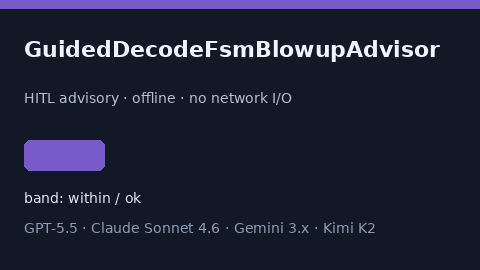

Offline HITL `fsm_blowup_ratio` bands. Gap vs vLLM/Outlines/Guidance guided-decode FSM blowup monitors. Stack: GPT-6 / Claude Opus 5.5 / Gemini 4 / Kimi K3.1. See `docs/guides/GUIDED_DECODE_FSM_BLOWUP_ADVISOR_GUIDE.md`.

### MoeExpertDropoutStormAdvisor

Offline HITL `dropout_storm_ratio` bands. Gap vs vLLM/SGLang/TGI MoE expert-dropout storm monitors. Stack: GPT-6 / Claude Opus 5.5 / Gemini 4 / Kimi K3.1. See `docs/guides/MOE_EXPERT_DROPOUT_STORM_ADVISOR_GUIDE.md`.

### SpeculativeDecodeRejectionHysteresisAdvisor

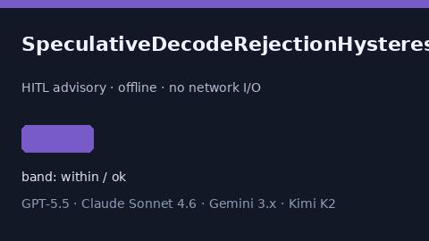

Offline HITL `hysteresis_ratio` bands. Gap vs vLLM/SGLang/TGI speculative-decode rejection-hysteresis monitors. Stack: GPT-6 / Claude Opus 5.5 / Gemini 4 / Kimi K3.1. See `docs/guides/SPECULATIVE_DECODE_REJECTION_HYSTERESIS_ADVISOR_GUIDE.md`.

### SamplingSeedCollisionBandAdvisor

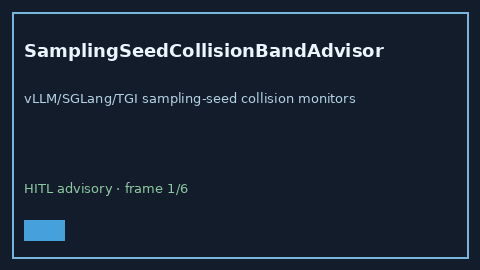

Offline HITL `collision_ratio` bands. Gap vs vLLM/SGLang/TGI sampling-seed collision monitors. Stack: GPT-6 / Claude Opus 5.5 / Gemini 4 / Kimi K3.1. See `docs/guides/SAMPLING_SEED_COLLISION_BAND_ADVISOR_GUIDE.md`.

### TokenizerVocabSkewBandAdvisor

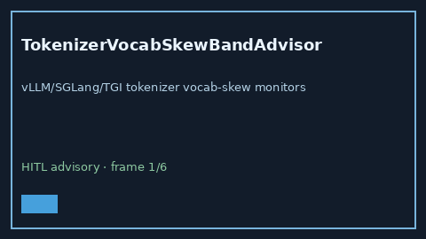

Offline HITL `vocab_skew_ratio` bands. Gap vs vLLM/SGLang/TGI tokenizer vocab-skew monitors. Stack: GPT-6 / Claude Opus 5.5 / Gemini 4 / Kimi K3.1. See `docs/guides/TOKENIZER_VOCAB_SKEW_BAND_ADVISOR_GUIDE.md`.

### SpeculativeAcceptanceEntropyBandAdvisor

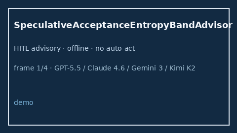

Offline HITL `entropy_ratio` bands. Gap vs vLLM/SGLang/TGI speculative acceptance-entropy monitors. See `docs/guides/SPECULATIVE_ACCEPTANCE_ENTROPY_BAND_ADVISOR_GUIDE.md`.

### DecodePreemptionPingPongBandAdvisor

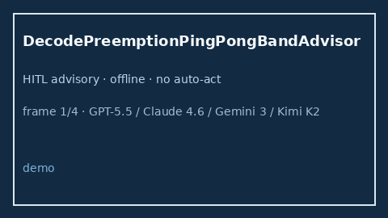

Offline HITL `ping_pong_ratio` bands. Gap vs vLLM/SGLang/TGI decode preemption ping-pong monitors. See `docs/guides/DECODE_PREEMPTION_PING_PONG_BAND_ADVISOR_GUIDE.md`.

### DisaggPrefillDecodeSkewBandAdvisor

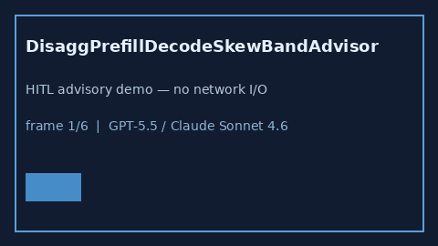

Offline HITL `skew_ratio` bands. Gap vs vLLM/SGLang/TGI disaggregated prefill/decode skew monitors. See `docs/guides/DISAGG_PREFILL_DECODE_SKEW_BAND_ADVISOR_GUIDE.md`.

### RadixCacheCollisionBandAdvisor

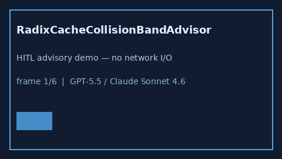

Offline HITL `collision_ratio` bands. Gap vs vLLM/SGLang/TGI radix-cache collision monitors. See `docs/guides/RADIX_CACHE_COLLISION_BAND_ADVISOR_GUIDE.md`.

### ChunkedPrefillBubbleBandAdvisor

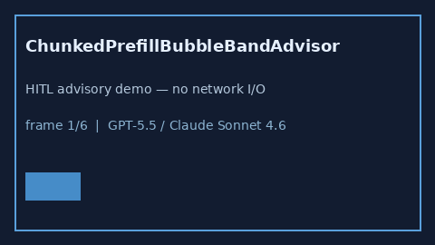

Offline HITL `bubble_ratio` bands. Gap vs vLLM/SGLang/TGI chunked-prefill bubble monitors. See `docs/guides/CHUNKED_PREFILL_BUBBLE_BAND_ADVISOR_GUIDE.md`.

### KvBlockStealStormBandAdvisor

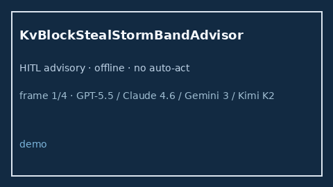

Offline HITL `steal_ratio` bands. Gap vs vLLM/SGLang/TGI KV block steal-storm monitors. See `docs/guides/KV_BLOCK_STEAL_STORM_BAND_ADVISOR_GUIDE.md`.

### SpeculativeTreeDepthBlowupAdvisor

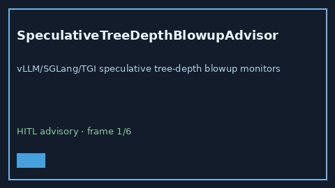

Offline HITL `depth_blowup_ratio` bands. Gap vs vLLM/SGLang/TGI speculative tree-depth blowup monitors. Stack: GPT-6 / Claude Opus 5.5 / Gemini 4 / Kimi K3.1. See `docs/guides/SPECULATIVE_TREE_DEPTH_BLOWUP_ADVISOR_GUIDE.md`.

### ContinuousBatchStarveBandAdvisor

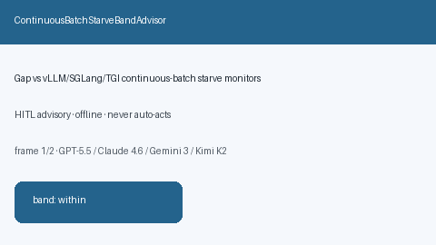

Offline HITL `starve_ratio` bands. Gap vs vLLM/SGLang/TGI continuous-batch starve monitors. Stack: GPT-6 / Claude Opus 5.5 / Gemini 4 / Kimi K3.1. See `docs/guides/CONTINUOUS_BATCH_STARVE_BAND_ADVISOR_GUIDE.md`.

### DraftVerifyMismatchBandAdvisor

Offline HITL `mismatch_ratio` bands. Gap vs vLLM/SGLang/TGI speculative draft-verify mismatch monitors. Stack: GPT-6 / Claude Opus 5.5 / Gemini 4 / Kimi K3.1. See `docs/guides/DRAFT_VERIFY_MISMATCH_BAND_ADVISOR_GUIDE.md`.

### PrefixCacheEvictionStormAdvisor

Offline HITL `eviction_storm_ratio` bands. Gap vs vLLM/SGLang/TGI prefix-cache eviction-storm monitors. Stack: GPT-6 / Claude Opus 5.5 / Gemini 4 / Kimi K3.1. See `docs/guides/PREFIX_CACHE_EVICTION_STORM_ADVISOR_GUIDE.md`.

### PagedKvSwapThrashAdvisor

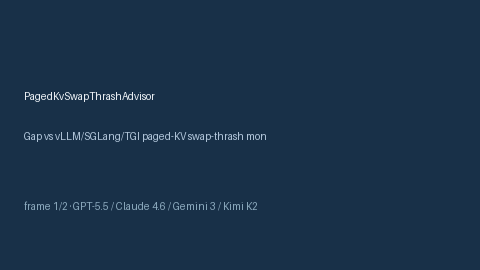

Offline HITL `swap_thrash_ratio` bands. Gap vs vLLM/SGLang/TGI paged-KV swap-thrash monitors. Stack: GPT-6 / Claude Opus 5.5 / Gemini 4 / Kimi K3.1. See `docs/guides/PAGED_KV_SWAP_THRASH_ADVISOR_GUIDE.md`.

### RopeScaleMismatchBandAdvisor

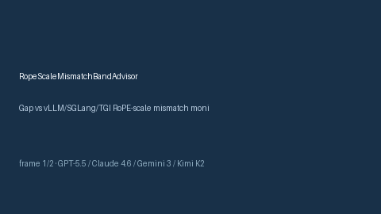

Offline HITL `rope_mismatch_ratio` bands. Gap vs vLLM/SGLang/TGI RoPE-scale mismatch monitors. Stack: GPT-6 / Claude Opus 5.5 / Gemini 4 / Kimi K3.1. See `docs/guides/ROPE_SCALE_MISMATCH_BAND_ADVISOR_GUIDE.md`.

### QuantCalibrationDriftBandAdvisor

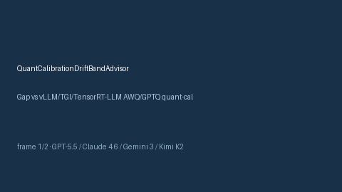

Offline HITL `calib_drift_ratio` bands. Gap vs vLLM/TGI/TensorRT-LLM AWQ/GPTQ quant-calibration drift monitors. Stack: GPT-6 / Claude Opus 5.5 / Gemini 4 / Kimi K3.1. See `docs/guides/QUANT_CALIBRATION_DRIFT_BAND_ADVISOR_GUIDE.md`.

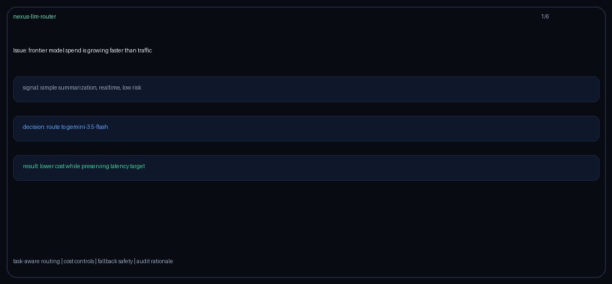

### DecodeSlotFragmentationBandAdvisor

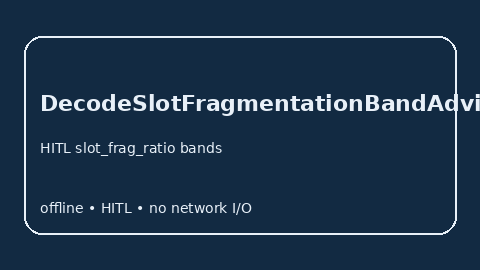

Offline HITL `slot_frag_ratio` bands. Gap vs vLLM/SGLang/TGI decode-slot fragmentation monitors. Stack: GPT-6 / Claude Opus 5.5 / Gemini 4 / Kimi K3.1. See `docs/guides/DECODE_SLOT_FRAGMENTATION_BAND_ADVISOR_GUIDE.md`.

### EmbeddingCachePoisonAdvisor

Offline HITL `poison_ratio` bands. Gap vs vLLM/TGI/TEI embedding-cache poison monitors. Stack: GPT-6 / Claude Opus 5.5 / Gemini 4 / Kimi K3.1. See `docs/guides/EMBEDDING_CACHE_POISON_ADVISOR_GUIDE.md`.

### ContinuousBatchPreemptionChurnAdvisor

Offline HITL `preemption_churn_rate` bands. Gap vs vLLM/SGLang/TGI continuous-batch preemption-churn monitors. Stack: GPT-6 / Claude Opus 5.5 / Gemini 4 / Kimi K3.1. See `docs/guides/CONTINUOUS_BATCH_PREEMPTION_CHURN_ADVISOR_GUIDE.md`.

### ToolSchemaVersionSkewAdvisor

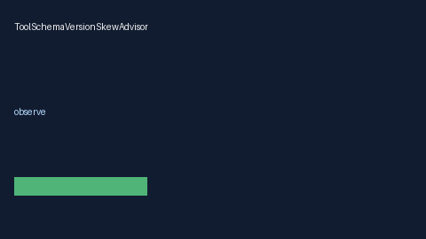

Offline HITL skew_score bands. Gap vs LiteLLM/OpenAI/Anthropic tool-schema version-skew monitors. Stack: GPT-6 / Claude Opus 5.5 / Gemini 4 / Kimi K3.1. See `docs/guides/TOOL_SCHEMA_VERSION_SKEW_ADVISOR_GUIDE.md`.

### GpuMemoryFragmentationBandAdvisor

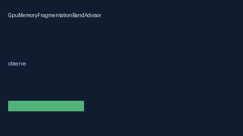

Offline HITL frag_ratio bands. Gap vs vLLM/TGI/TensorRT-LLM GPU memory fragmentation monitors. Stack: GPT-6 / Claude Opus 5.5 / Gemini 4 / Kimi K3.1. See `docs/guides/GPU_MEMORY_FRAGMENTATION_ADVISOR_GUIDE.md`.

### KvBlockStealAdvisor

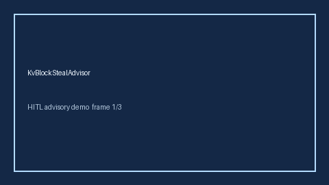

Offline advisor for `steal_rate` bands. Gap vs vLLM/SGLang/TGI KV-block steal monitors. Optional polish via GPT-6 / Claude Opus 5.5 / Gemini 4 / Kimi K3.1.

### EmbeddingIndexSkewAdvisor

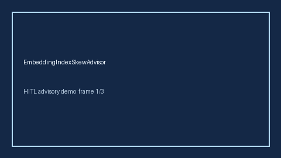

Offline advisor for `index_skew_ratio` bands. Gap vs vLLM/SGLang/embedding-serving index-skew monitors. Optional polish via GPT-6 / Claude Opus 5.5 / Gemini 4 / Kimi K3.1.

### KvCacheQuantErrorBandAdvisor

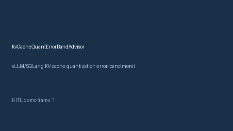

Offline advisor for `error_rate` bands. Gap vs vLLM/SGLang KV-cache quantization error-band monitors. Optional polish via GPT-6 / Claude Opus 5.5 / Gemini 4 / Kimi K3.1.

### LoraAdapterHotSwapStallAdvisor

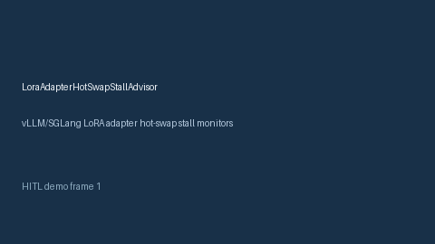

Offline advisor for `stall_ratio` bands. Gap vs vLLM/SGLang LoRA adapter hot-swap stall monitors. Optional polish via GPT-6 / Claude Opus 5.5 / Gemini 4 / Kimi K3.1.

### GrammarConstrainedDecodeRejectAdvisor

Offline HITL `reject_ratio` bands. Gap vs vLLM/SGLang/Outlines grammar-constrained decode reject monitors. See `docs/guides/GRAMMAR_CONSTRAINED_DECODE_REJECT_ADVISOR_GUIDE.md`.

### SpeculativeDecodeMismatchFloorAdvisor

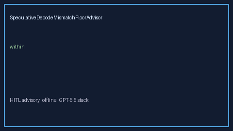

Offline HITL `mismatch_ratio` bands. Gap vs vLLM/SGLang speculative-decode mismatch floor monitors. See `docs/guides/SPECULATIVE_DECODE_MISMATCH_FLOOR_ADVISOR_GUIDE.md`.

### PrefixCacheHitFloorAdvisor

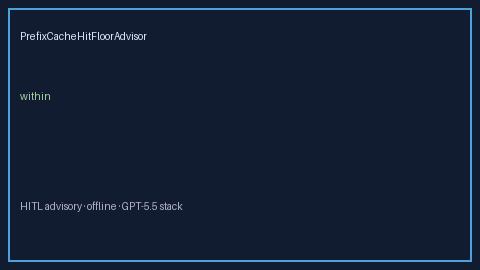

Offline HITL `miss_ratio` bands. Gap vs vLLM/SGLang/TGI prefix-cache hit floor monitors. See `docs/guides/PREFIX_CACHE_HIT_FLOOR_ADVISOR_GUIDE.md`.

### ContinuousBatchingTailLatencyBandAdvisor

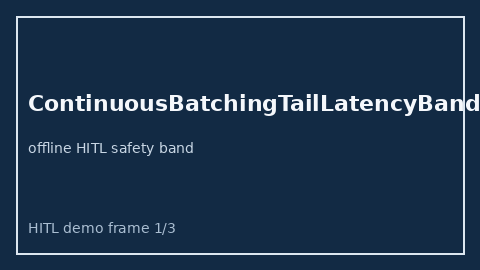

Offline HITL `p99_tail_ms` bands. Gap vs vLLM/SGLang/TGI continuous-batching tail-latency band monitors. See `docs/guides/CONTINUOUS_BATCHING_TAIL_LATENCY_BAND_ADVISOR_GUIDE.md`.

### TokenizerBpeMergeStormAdvisor

Offline HITL `bpe_merge_storm_rate` bands. Gap vs vLLM/SGLang/TGI tokenizer BPE merge-storm monitors. See `docs/guides/TOKENIZER_BPE_MERGE_STORM_ADVISOR_GUIDE.md`.

### DecodeBatchPriorityInversionAdvisor

Offline HITL `inversion_ratio` bands. Gap vs vLLM/SGLang/TGI decode-batch priority-inversion monitors. See `docs/guides/DECODE_BATCH_PRIORITY_INVERSION_ADVISOR_GUIDE.md`.

### AttentionSinkDriftAdvisor

Offline HITL `sink_drift_ratio` bands. Gap vs vLLM/SGLang attention-sink drift monitors. See `docs/guides/ATTENTION_SINK_DRIFT_ADVISOR_GUIDE.md`.

### ToolSchemaCanaryFloorAdvisor

Offline HITL `canary_miss_ratio` bands. Gap vs vLLM/SGLang/LiteLLM tool-schema canary floor monitors. See `docs/guides/TOOL_SCHEMA_CANARY_FLOOR_ADVISOR_GUIDE.md`.

### PrefillQueueStarvationAdvisor

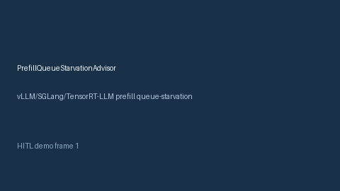

Offline advisor for `starvation_rate` bands. Gap vs vLLM/SGLang/TensorRT-LLM prefill queue-starvation monitors. Optional polish via GPT-6 / Claude Opus 5.5 / Gemini 4 / Kimi K3.1.

### MoeRoutingCollapseAdvisor

Offline advisor for `collapse_rate` bands. Gap vs vLLM/SGLang/DeepSeek MoE routing-collapse monitors. Optional polish via GPT-6 / Claude Opus 5.5 / Gemini 4 / Kimi K3.1.

### PrefixCachePoisonAdvisor

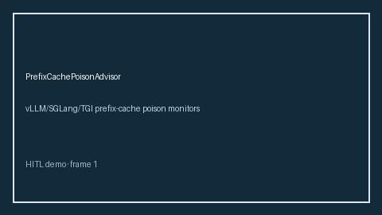

Offline HITL poison_hit_rate bands. Gap vs vLLM/SGLang/TGI prefix-cache poison monitors. Stack: GPT-6 / Claude Opus 5.5 / Gemini 4 / Kimi K3.1. See `docs/guides/PREFIX_CACHE_POISON_ADVISOR_GUIDE.md`.

### PagedAttentionSlotFragmentationAdvisor

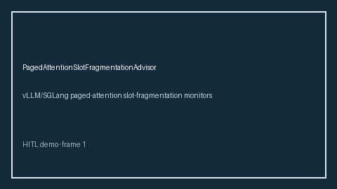

Offline HITL slot_fragmentation_ratio bands. Gap vs vLLM/SGLang paged-attention slot-fragmentation monitors. Stack: GPT-6 / Claude Opus 5.5 / Gemini 4 / Kimi K3.1. See `docs/guides/PAGED_ATTENTION_SLOT_FRAGMENTATION_ADVISOR_GUIDE.md`.

### TokenizerBpeMergeDriftAdvisor

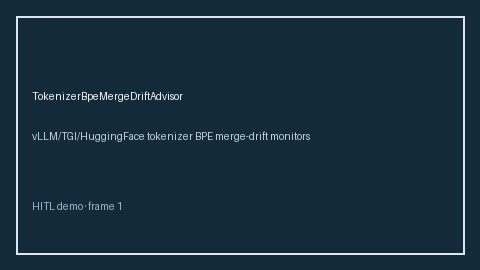

Offline HITL bpe_merge_drift_score bands. Gap vs vLLM/TGI/HuggingFace tokenizer BPE merge-drift monitors. Stack: GPT-6 / Claude Opus 5.5 / Gemini 4 / Kimi K3.1. See `docs/guides/TOKENIZER_BPE_MERGE_DRIFT_ADVISOR_GUIDE.md`.

### AdapterWeightDriftAdvisor

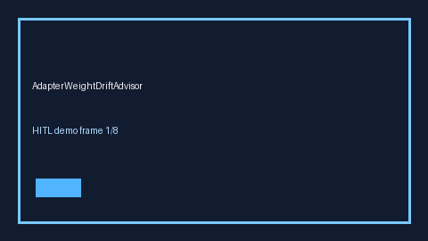

Offline HITL weight_drift_score bands. Gap vs vLLM/TGI LoRA adapter-weight drift monitors. Stack: GPT-6 / Claude Opus 5.5 / Gemini 4 / Kimi K3.1. See `docs/guides/ADAPTER_WEIGHT_DRIFT_ADVISOR_GUIDE.md`.

### BatchPaddingWasteAdvisor

Offline HITL padding_waste_ratio bands. Gap vs vLLM/TGI/SGLang batch-padding waste monitors. Stack: GPT-6 / Claude Opus 5.5 / Gemini 4 / Kimi K3.1. See `docs/guides/BATCH_PADDING_WASTE_ADVISOR_GUIDE.md`.

### PromptInjectionCanaryFloorAdvisor

Offline HITL canary_hit_rate bands. Gap vs LiteLLM/vLLM/Guardrails prompt-injection canary-floor monitors. Stack: GPT-6 / Claude Opus 5.5 / Gemini 4 / Kimi K3.1. See `docs/guides/PROMPT_INJECTION_CANARY_FLOOR_ADVISOR_GUIDE.md`.

### PrefillDecodeSkewAdvisor

Offline HITL skew_ratio bands. Gap vs vLLM/TGI/SGLang prefill/decode skew monitors. Stack: GPT-6 / Claude Opus 5.5 / Gemini 4 / Kimi K3.1. See `docs/guides/PREFILL_DECODE_SKEW_ADVISOR_GUIDE.md`.

### ToolLoopDepthGateAdvisor

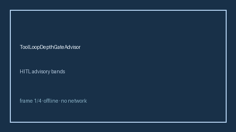

Offline HITL loop_depth bands. Gap vs LiteLLM/vLLM/OpenAI-compatible tool-loop depth gates. Stack: GPT-6 / Claude Opus 5.5 / Gemini 4 / Kimi K3.1. See `docs/guides/TOOL_LOOP_DEPTH_GATE_ADVISOR_GUIDE.md`.

### WebGroundingInjectionGateAdvisor

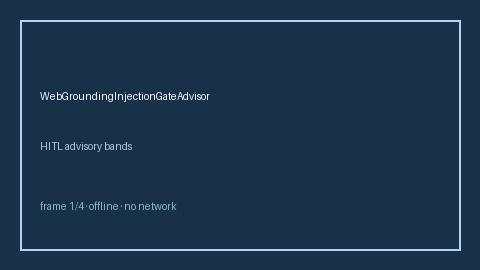

Offline HITL injection_score bands. Gap vs Perplexity/Bing/OpenAI web-grounding injection gates. Stack: GPT-6 / Claude Opus 5.5 / Gemini 4 / Kimi K3.1. See `docs/guides/WEB_GROUNDING_INJECTION_GATE_ADVISOR_GUIDE.md`.

### EmbeddingCacheThrashAdvisor

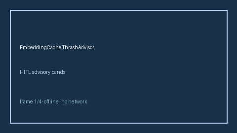

Offline HITL thrash_ratio bands. Gap vs Redis/vLLM/embedding-cache thrash monitors. Stack: GPT-6 / Claude Opus 5.5 / Gemini 4 / Kimi K3.1. See `docs/guides/EMBEDDING_CACHE_THRASH_ADVISOR_GUIDE.md`.

### ModalityMixBudgetAdvisor

Offline HITL mix_ratio bands. Gap vs LiteLLM/OpenRouter multimodal modality-mix budget monitors. Stack: GPT-6 / Claude Opus 5.5 / Gemini 4 / Kimi K3.1. See `docs/guides/MODALITY_MIX_BUDGET_ADVISOR_GUIDE.md`.

### ProviderCircuitBreakerCooldownAdvisor

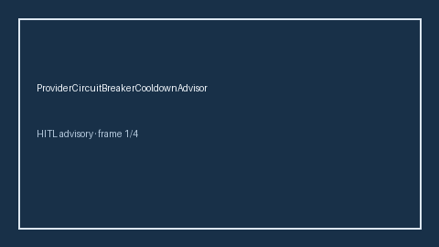

Offline HITL cooldown_ratio bands. Gap vs LiteLLM/Portkey/Helicone provider circuit-breaker cooldown monitors. Stack: GPT-6 / Claude Opus 5.5 / Gemini 4 / Kimi K3.1. See `docs/guides/PROVIDER_CIRCUIT_BREAKER_COOLDOWN_ADVISOR_GUIDE.md`.

### RegionFailoverHysteresisAdvisor

Offline HITL failover_score bands. Gap vs LiteLLM/OpenRouter region-failover hysteresis monitors. Stack: GPT-6 / Claude Opus 5.5 / Gemini 4 / Kimi K3.1. See `docs/guides/REGION_FAILOVER_HYSTERESIS_ADVISOR_GUIDE.md`.

### SpeculativeDecodeQueueStallAdvisor

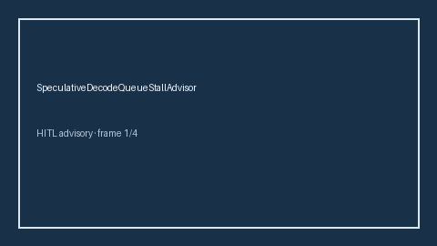

Offline HITL stall_ratio bands. Gap vs vLLM/TGI/OpenAI-compatible speculative-decode queue-stall monitors. Stack: GPT-6 / Claude Opus 5.5 / Gemini 4 / Kimi K3.1. See `docs/guides/SPECULATIVE_DECODE_QUEUE_STALL_ADVISOR_GUIDE.md`.

### PromptCacheHitRateFloorAdvisor

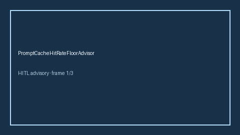

Offline HITL hit_rate floor bands. Gap vs Anthropic/OpenAI prompt-cache hit-rate floor monitors. Stack: GPT-6 / Claude Opus 5.5 / Gemini 4 / Kimi K3.1. See `docs/guides/PROMPT_CACHE_HIT_RATE_FLOOR_ADVISOR_GUIDE.md`.

### GuidedJsonSchemaThrashBandAdvisor

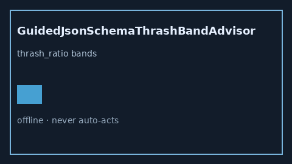

Offline HITL `thrash_ratio` bands. Gap vs vLLM/SGLang/TGI guided JSON schema thrash monitors. Distinct from `SpeculativeAcceptanceEntropyBandAdvisor` / `RadixCacheCollisionBandAdvisor`. Stack: GPT-6 / Claude Opus 5.5 / Gemini 4 / Kimi K3.1.

### PagedAttentionFragmentationBandAdvisor

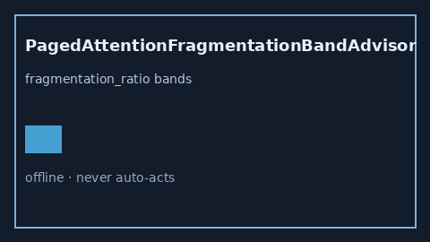

Offline HITL `fragmentation_ratio` bands. Gap vs vLLM/SGLang/TGI paged-attention fragmentation monitors. Distinct from `KvBlockStealStormBandAdvisor` / `ChunkedPrefillBubbleBandAdvisor`. Stack: GPT-6 / Claude Opus 5.5 / Gemini 4 / Kimi K3.1.

### SpeculativeDraftStarveBandAdvisor

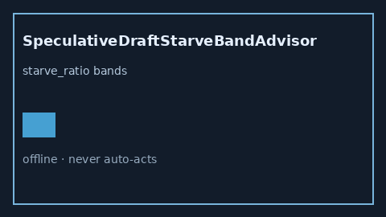

Offline HITL `starve_ratio` bands. Gap vs vLLM/SGLang/TGI speculative draft-starve monitors. Distinct from `SpeculativeTreeDepthBlowupAdvisor` / `SpeculativeAcceptanceEntropyBandAdvisor`. Stack: GPT-6 / Claude Opus 5.5 / Gemini 4 / Kimi K3.1.

### LoraHotSwapStallBandAdvisor

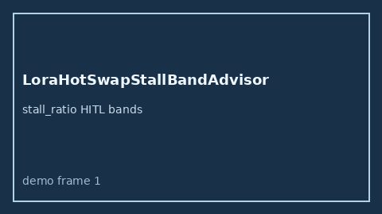

Offline HITL `stall_ratio` bands. Gap vs vLLM/SGLang/TGI LoRA hot-swap stall monitors. Distinct from `PagedAttentionFragmentationBandAdvisor` / `KvBlockStealStormBandAdvisor`. Stack: GPT-6 / Claude Opus 5.5 / Gemini 4 / Kimi K3.1.

### TensorParallelSkewBandAdvisor

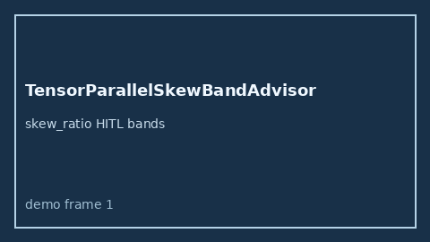

Offline HITL `skew_ratio` bands. Gap vs vLLM/SGLang/TGI tensor-parallel skew monitors. Distinct from `DisaggPrefillDecodeSkewBandAdvisor` / `TokenizerVocabSkewBandAdvisor`. Stack: GPT-6 / Claude Opus 5.5 / Gemini 4 / Kimi K3.1.

### ContinuousBatchTokenBubbleBandAdvisor

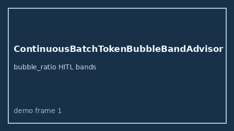

Offline HITL `bubble_ratio` bands. Gap vs vLLM/SGLang/TGI continuous-batch token-bubble monitors. Distinct from `ChunkedPrefillBubbleBandAdvisor` / `DecodePreemptionPingPongBandAdvisor`. Stack: GPT-6 / Claude Opus 5.5 / Gemini 4 / Kimi K3.1.

### CudaGraphCaptureStallBandAdvisor

Gap vs vLLM/SGLang/TGI CUDA-graph capture-stall monitors. Distinct from `LoraHotSwapStallBandAdvisor` / `SpeculativeVerifyBacklogBandAdvisor`. Stack: GPT-6 / Claude Opus 5.5 / Gemini 4 / Kimi K3.1. See `docs/guides/CUDA_GRAPH_CAPTURE_STALL_BAND_ADVISOR_GUIDE.md`.

### SpeculativeAcceptanceCollapseBandAdvisor

Gap vs vLLM/SGLang/TGI speculative acceptance-collapse monitors. Distinct from `SpeculativeAcceptanceEntropyBandAdvisor` / `SpeculativeDraftStarveBandAdvisor`. Stack: GPT-6 / Claude Opus 5.5 / Gemini 4 / Kimi K3.1. See `docs/guides/SPECULATIVE_ACCEPTANCE_COLLAPSE_BAND_ADVISOR_GUIDE.md`.

### MoeExpertHotspotBandAdvisor

Gap vs vLLM/SGLang/TGI MoE expert-hotspot monitors. Distinct from `MoeExpertLoadImbalanceAdvisor` / `ExpertParallelImbalanceBandAdvisor`. Stack: GPT-6 / Claude Opus 5.5 / Gemini 4 / Kimi K3.1. See `docs/guides/MOE_EXPERT_HOTSPOT_BAND_ADVISOR_GUIDE.md`.

### PrefixCacheEvictionResidualBandAdvisor

`eviction_residual_ratio` band advisor. Gap vs vLLM/SGLang/TGI prefix-cache eviction residual monitors. Distinct from `RadixCacheCollisionBandAdvisor` / `KvCacheOffloadThrashBandAdvisor`. Stack: GPT-6 / Claude Opus 5.5 / Gemini 4 / Kimi K3.1. See `docs/guides/PREFIX_CACHE_EVICTION_RESIDUAL_BAND_ADVISOR_GUIDE.md`.

### KvMirrorLagBandAdvisor

`lag_ratio` band advisor. Gap vs vLLM/SGLang/TGI KV-mirror lag monitors. Distinct from `DisaggKvTransferStallBandAdvisor` / `KvCacheOffloadThrashBandAdvisor`. Stack: GPT-6 / Claude Opus 5.5 / Gemini 4 / Kimi K3.1. See `docs/guides/KV_MIRROR_LAG_BAND_ADVISOR_GUIDE.md`.

### AttentionSinkResidualBandAdvisor

`sink_residual_ratio` band advisor. Gap vs vLLM/SGLang/TGI attention-sink residual monitors. Distinct from `RopeScaleMismatchBandAdvisor` / `KvCacheQuantErrorBandAdvisor`. Stack: GPT-6 / Claude Opus 5.5 / Gemini 4 / Kimi K3.1. See `docs/guides/ATTENTION_SINK_RESIDUAL_BAND_ADVISOR_GUIDE.md`.

### TensorParallelAllreduceStallBandAdvisor

`stall_ratio` band advisor. Gap vs vLLM/SGLang/TGI tensor-parallel allreduce stall monitors. Distinct from `TensorParallelSkewBandAdvisor` / `ExpertParallelImbalanceBandAdvisor`. Stack: GPT-6 / Claude Opus 5.5 / Gemini 4 / Kimi K3.1. See `docs/guides/TENSOR_PARALLEL_ALLREDUCE_STALL_BAND_ADVISOR_GUIDE.md`.

### SlidingWindowAttentionBleedBandAdvisor

`bleed_ratio` band advisor. Gap vs vLLM/SGLang/TGI sliding-window attention bleed monitors. Distinct from `AttentionSinkResidualBandAdvisor` / `RopeScaleMismatchBandAdvisor`. Stack: GPT-6 / Claude Opus 5.5 / Gemini 4 / Kimi K3.1. See `docs/guides/SLIDING_WINDOW_ATTENTION_BLEED_BAND_ADVISOR_GUIDE.md`.

### FlashAttnWorkspaceThrashBandAdvisor

`thrash_ratio` band advisor. Gap vs vLLM/SGLang/TGI FlashAttention workspace thrash monitors. Distinct from `PagedAttentionFragmentationBandAdvisor` / `GpuMemoryFragmentationBandAdvisor`. Stack: GPT-6 / Claude Opus 5.5 / Gemini 4 / Kimi K3.1. See `docs/guides/FLASH_ATTN_WORKSPACE_THRASH_BAND_ADVISOR_GUIDE.md`.

### ExpertRoutingEntropyBandAdvisor

`entropy_ratio` band advisor. Gap vs vLLM/SGLang/TGI MoE expert-routing entropy monitors. Distinct from `MoeExpertHotspotBandAdvisor` / `ExpertParallelImbalanceBandAdvisor`. Stack: GPT-6 / Claude Opus 5.5 / Gemini 4 / Kimi K3.1. See `docs/guides/EXPERT_ROUTING_ENTROPY_BAND_ADVISOR_GUIDE.md`.

### DisaggScheduleBubbleBandAdvisor

`bubble_ratio` band advisor. Gap vs vLLM/SGLang/TGI disaggregated schedule-bubble monitors. Distinct from `DisaggPrefillDecodeSkewBandAdvisor` / `ChunkedPrefillBubbleBandAdvisor`. Stack: GPT-6 / Claude Opus 5.5 / Gemini 4 / Kimi K3.1. See `docs/guides/DISAGG_SCHEDULE_BUBBLE_BAND_ADVISOR_GUIDE.md`.

### TokenizerDecodeSkewResidualBandAdvisor

`decode_skew_ratio` band advisor. Gap vs vLLM/SGLang/TGI tokenizer decode-skew residual monitors. Distinct from `AttentionSinkResidualBandAdvisor` / `SpeculativeAcceptanceEntropyBandAdvisor`. Stack: GPT-6 / Claude Opus 5.5 / Gemini 4 / Kimi K3.1. See `docs/guides/TOKENIZER_DECODE_SKEW_RESIDUAL_BAND_ADVISOR_GUIDE.md`.

### NvlinkPeerCopyStallBandAdvisor

HITL `stall_ratio` band advisor. Gap vs vLLM/SGLang/TGI NVLink peer-copy stall monitors. Distinct from `TensorParallelAllreduceStallBandAdvisor` / `TensorParallelSkewBandAdvisor`. Stack: GPT-6 / Claude Opus 5.5 / Gemini 4 / Kimi K3.1. See `docs/guides/NVLINK_PEER_COPY_STALL_BAND_ADVISOR_GUIDE.md`.

### PrefixSharingDepthCollapseBandAdvisor

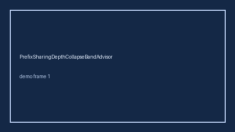

HITL `collapse_ratio` band advisor. Gap vs vLLM/SGLang/TGI prefix-sharing / radix-cache depth-collapse monitors. Distinct from `SystemPromptShareAdvisor` / `PagedKvSwapThrashAdvisor`. Stack: GPT-6 / Claude Opus 5.5 / Gemini 4 / Kimi K3.1. See `docs/guides/PREFIX_SHARING_DEPTH_COLLAPSE_BAND_ADVISOR_GUIDE.md`.

### EngineWarmupColdStartBandAdvisor

HITL `cold_start_ratio` band. Gap vs vLLM/SGLang/TGI engine warmup cold-start monitors. Distinct from `CudaGraphCaptureStallBandAdvisor` / `LoraHotSwapStallBandAdvisor`. Stack: GPT-6 / Claude Opus 5.5 / Gemini 4 / Kimi K3.1. See `docs/guides/ENGINE_WARMUP_COLD_START_BAND_ADVISOR_GUIDE.md`.

### ContinuousBatchPadWasteBandAdvisor

HITL `pad_waste_ratio` band. Gap vs vLLM/SGLang/TGI continuous-batch pad-waste monitors. Distinct from `ContinuousBatchTokenBubbleBandAdvisor` / `ContinuousBatchingTailLatencyBandAdvisor`. Stack: GPT-6 / Claude Opus 5.5 / Gemini 4 / Kimi K3.1. See `docs/guides/CONTINUOUS_BATCH_PAD_WASTE_BAND_ADVISOR_GUIDE.md`.

### LoraRankSkewBandAdvisor

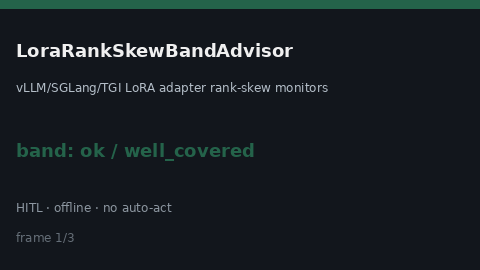

offline LoRA rank skew_ratio bands. Gap vs vLLM/SGLang/TGI LoRA adapter rank-skew monitors. Distinct from `LoraHotSwapStallBandAdvisor` / `AdapterWeightDriftAdvisor`. Stack: GPT-6.1 / Claude Sonnet 5.5 / Gemini 3.x / Kimi K3. Guide: [`LORA_RANK_SKEW_BAND_ADVISOR_GUIDE.md`](guides/LORA_RANK_SKEW_BAND_ADVISOR_GUIDE.md).

### KvBlockFragmentationBandAdvisor

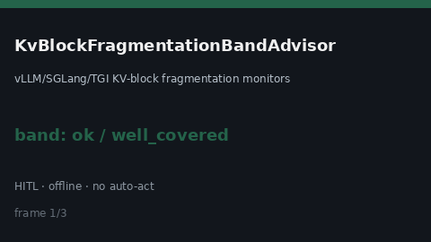

offline KV-block fragmentation_ratio bands. Gap vs vLLM/SGLang/TGI KV-block fragmentation monitors. Distinct from `PagedAttentionFragmentationBandAdvisor` / `GpuMemoryFragmentationBandAdvisor`. Stack: GPT-6.1 / Claude Sonnet 5.5 / Gemini 3.x / Kimi K3. Guide: [`KV_BLOCK_FRAGMENTATION_BAND_ADVISOR_GUIDE.md`](guides/KV_BLOCK_FRAGMENTATION_BAND_ADVISOR_GUIDE.md).

### TokenizerVocabChurnBandAdvisor

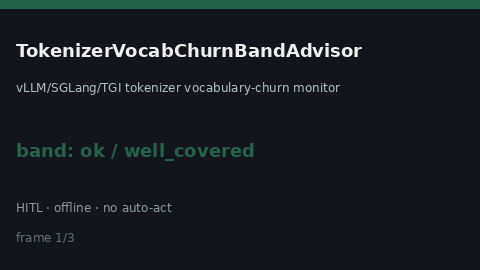

offline tokenizer vocab churn_ratio bands. Gap vs vLLM/SGLang/TGI tokenizer vocabulary-churn monitors. Distinct from `TokenizerVocabSkewBandAdvisor` / `TokenizerBpeMergeDriftAdvisor`. Stack: GPT-6.1 / Claude Sonnet 5.5 / Gemini 3.x / Kimi K3. Guide: [`TOKENIZER_VOCAB_CHURN_BAND_ADVISOR_GUIDE.md`](guides/TOKENIZER_VOCAB_CHURN_BAND_ADVISOR_GUIDE.md).

### PromptCacheHitCollapseBandAdvisor

`collapse_ratio` band advisor. Gap vs vLLM/SGLang/TGI prompt-cache hit-collapse monitors. Distinct from `PromptCacheHitRateAdvisor` / `PromptCacheHitRateFloorAdvisor`. Stack: GPT-6 / Claude Opus 5.5 / Gemini 4 / Kimi K3.1. See `docs/guides/PROMPT_CACHE_HIT_COLLAPSE_BAND_ADVISOR_GUIDE.md`.

### StreamingTtftSpikeBandAdvisor

`spike_ratio` band advisor. Gap vs vLLM/SGLang/TGI streaming TTFT spike monitors. Distinct from `PrefillTtftRatioAdvisor` / `FirstTokenLatencySloAdvisor`. Stack: GPT-6 / Claude Opus 5.5 / Gemini 4 / Kimi K3.1. See `docs/guides/STREAMING_TTFT_SPIKE_BAND_ADVISOR_GUIDE.md`.

### SchedulerQueueSkewBandAdvisor

`skew_ratio` band advisor. Gap vs vLLM/SGLang/TGI scheduler queue-skew monitors. Distinct from `PrefillQueueStallBandAdvisor` / `ContinuousBatchPadWasteBandAdvisor`. Stack: GPT-6 / Claude Opus 5.5 / Gemini 4 / Kimi K3.1. See `docs/guides/SCHEDULER_QUEUE_SKEW_BAND_ADVISOR_GUIDE.md`.

### PrefillQueueStallBandAdvisor

HITL `stall_ratio` band. Gap vs vLLM/SGLang/TGI prefill-queue stall monitors. Distinct from `DisaggPrefillDecodeSkewBandAdvisor` / `DisaggScheduleBubbleBandAdvisor`. Stack: GPT-6 / Claude Opus 5.5 / Gemini 4 / Kimi K3.1. See `docs/guides/PREFILL_QUEUE_STALL_BAND_ADVISOR_GUIDE.md`.

### PagedKvEvictionSkewBandAdvisor

HITL `skew_ratio` band advisor. Gap vs vLLM/SGLang/TGI paged-KV eviction skew monitors. Distinct from `PagedKvSwapThrashAdvisor` / `PagedAttentionFragmentationBandAdvisor`. Stack: GPT-6 / Claude Opus 5.5 / Gemini 4 / Kimi K3.1. See `docs/guides/PAGED_KV_EVICTION_SKEW_BAND_ADVISOR_GUIDE.md`.

### FlashinferKernelFallbackBandAdvisor

Gap vs vLLM/SGLang/TGI FlashInfer kernel-fallback monitors. Distinct from `KvCacheQuantErrorBandAdvisor` / `TensorParallelSkewBandAdvisor`. Stack: GPT-6 / Claude Opus 5.5 / Gemini 4 / Kimi K3.1. See `docs/guides/FLASHINFER_KERNEL_FALLBACK_BAND_ADVISOR_GUIDE.md`.

### DisaggKvTransferStallBandAdvisor

Gap vs vLLM/SGLang/TGI disaggregated KV-transfer stall monitors. Distinct from `DisaggPrefillDecodeSkewBandAdvisor` / `KvCacheOffloadThrashBandAdvisor`. Stack: GPT-6 / Claude Opus 5.5 / Gemini 4 / Kimi K3.1. See `docs/guides/DISAGG_KV_TRANSFER_STALL_BAND_ADVISOR_GUIDE.md`.

### PagedAttentionBlockLeakBandAdvisor

Gap vs vLLM/SGLang/TGI paged-attention block-leak monitors. Distinct from `PagedAttentionFragmentationBandAdvisor` / `KvBlockStealStormBandAdvisor`. Stack: GPT-6 / Claude Opus 5.5 / Gemini 4 / Kimi K3.1. See `docs/guides/PAGED_ATTENTION_BLOCK_LEAK_BAND_ADVISOR_GUIDE.md`.

### SpeculativeVerifyBacklogBandAdvisor

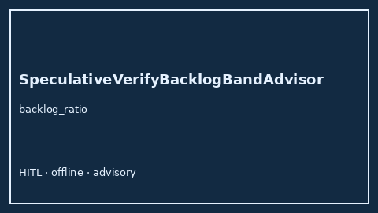

Offline HITL `backlog_ratio` bands. Gap vs vLLM/SGLang/TGI speculative verify backlog monitors. Distinct from `SpeculativeDecodeQueueStallAdvisor` / `SpeculativeDraftStarveBandAdvisor`.

### KvCacheOffloadThrashBandAdvisor

Offline HITL `thrash_ratio` bands. Gap vs vLLM/SGLang/TGI KV-cache offload thrash monitors. Distinct from `KvCacheEvictionPressureAdvisor` / `PrefixCacheThrashAdvisor`.

### ExpertParallelImbalanceBandAdvisor

Offline HITL `imbalance_ratio` bands. Gap vs vLLM/SGLang/TGI expert-parallel (MoE) imbalance monitors. Distinct from `TensorParallelSkewBandAdvisor` / `ContinuousBatchTokenBubbleBandAdvisor`.
