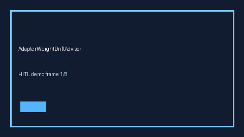

# AdapterWeightDriftAdvisor Guide



Offline HITL advisor for weight_drift_score. Gap vs vLLM/TGI LoRA adapter-weight drift monitors.

Optional polish via **GPT-5.5 / Claude Sonnet 4.6 / Gemini 3.x / Kimi K2**.

Distinct from `LoraAdapterSwapCostAdvisor` / `EmbeddingDimMismatchAdvisor`.

## Usage

```python
from safety.adapter_weight_drift import AdapterWeightDriftAdvisor

advice = AdapterWeightDriftAdvisor().advise(request_id="r1", weight_drift_score=0.0)
print(advice.band)
```

## Safety

No network I/O. Advisory bands only.
