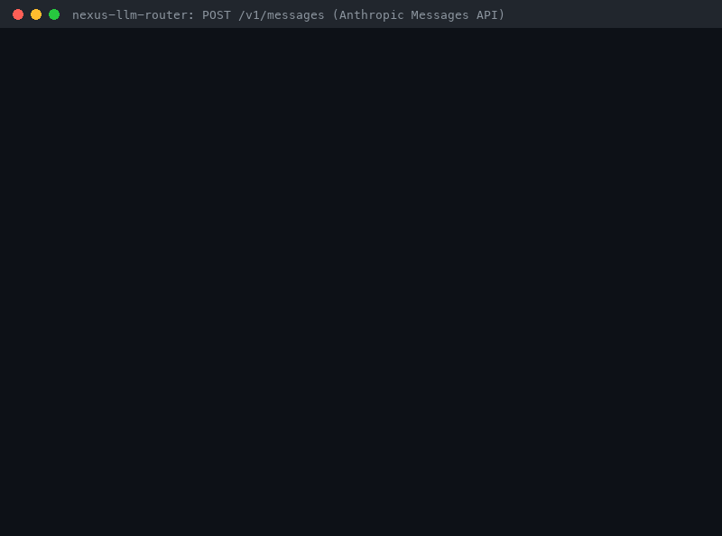

# Anthropic Messages API Guide (`POST /v1/messages`)



Nexus speaks the **Anthropic Messages API** in addition to Chat Completions and
the OpenAI Responses API. Point the official Anthropic SDK (or any client built
on the Messages format) at nexus and call `client.messages.create(...)`,
`client.messages.stream(...)`, or `client.messages.count_tokens(...)`: nexus
routes the request with the same strategies, guards, cache, budgets, and spend
accounting as `/v1/chat/completions`, and answers with an Anthropic `message`
(or Anthropic's SSE event stream) plus a namespaced `nexus` routing block.

This is a documented **text-only** subset: provider adapters exchange plain
text, so tools, extended thinking, structured outputs, and non-text content
blocks are rejected with an Anthropic-style 400 instead of being silently
dropped. That also means nexus is **not a backend for Claude Code** (see
[Known limitations](#known-limitations)).

## Why

- **Anthropic SDK apps should switch gateways by changing `base_url`, not by
  rewriting calls.** Other gateways already expose the Messages format:
  - the [LiteLLM proxy](https://docs.litellm.ai/docs/anthropic_unified) serves
    `/v1/messages` for every LiteLLM provider (plus
    [`/v1/messages/count_tokens`](https://docs.litellm.ai/docs/count_tokens));
  - [OpenRouter](https://openrouter.ai/docs/api/api-reference/anthropic-messages/create-a-message)
    serves `POST /api/v1/messages`;
  - [Bifrost](https://github.com/maximhq/bifrost/blob/dev/docs/integrations/anthropic-sdk/overview.mdx)
    (maximhq/bifrost) serves `/anthropic/v1/messages`;
  - [Portkey](https://docs.portkey.ai/docs/product/ai-gateway/messages-api)
    serves `/v1/messages` for its whole model catalog.
- **The gap this closes.** Nexus only spoke the OpenAI formats
  (`/v1/chat/completions`, `/v1/responses`), so an Anthropic SDK pointed at
  nexus got a `404`. `src/adapters/anthropic.py` only *calls* Anthropic
  upstream; there was no inbound Anthropic endpoint. Now the same client works
  unchanged, and nexus still decides which provider model serves the request.

## Quickstart

Run nexus with real provider keys (`.env`, see [QUICKSTART](../../QUICKSTART.md))
or fully offline with deterministic mock providers:

```bash
PYTHONPATH=src uvicorn api.main:app --port 8000            # real providers
PYTHONPATH=src python scripts/serve_mock.py --port 8000     # mock providers, no keys
```

### curl

```bash
curl -s http://localhost:8000/v1/messages \
  -H 'content-type: application/json' \
  -H 'x-api-key: <your-nexus-key>' \
  -H 'anthropic-version: 2026-10-21' \
  -d '{
    "model": "claude-opus-5-5",
    "max_tokens": 512,
    "system": "You are a terse support agent.",
    "metadata": {"user_id": "user-1234"},
    "messages": [
      {"role": "user", "content": "Design a multi-region failover strategy for a payments platform: compare active-active, active-passive, and pilot-light architectures, analyze cost, latency, and consistency trade-offs, and recommend one with a phased rollout plan."}
    ]
  }'
```

Real response from the mock-provider server (`scripts/serve_mock.py`); mock
providers answer `[<model>] routed response`. `claude-opus-5-5` is in the
default catalog, so the `rule-based` strategy honors it:

```json
{
  "id": "msg_5f39f13d662947d984ccb71793b5effb",
  "type": "message",
  "role": "assistant",
  "model": "claude-opus-5-5",
  "content": [
    {
      "type": "text",
      "text": "[claude-opus-5-5] routed response"
    }
  ],
  "stop_reason": "end_turn",
  "stop_sequence": null,
  "usage": {
    "input_tokens": 65,
    "output_tokens": 16
  },
  "nexus": {
    "routing_strategy": "rule-based",
    "rationale": "explicit compatible model request honored",
    "cost_usd": 0.000081,
    "latency_ms": 0.5667079240083694,
    "request_id": "1c33820620aa4bd48e5540484a54bc5e"
  }
}
```

### Streaming with curl

Add `"stream": true`. Real output for the same body (`curl -sN`):

```text
event: message_start
data: {"type": "message_start", "message": {"id": "msg_19e95410996944059081efbb58a6fe9a", "type": "message", "role": "assistant", "model": "claude-opus-5-5", "content": [], "stop_reason": null, "stop_sequence": null, "usage": {"input_tokens": 65, "output_tokens": 0}}}

event: content_block_start
data: {"type": "content_block_start", "index": 0, "content_block": {"type": "text", "text": ""}}

event: ping
data: {"type": "ping"}

event: content_block_delta
data: {"type": "content_block_delta", "index": 0, "delta": {"type": "text_delta", "text": "[claude-opus-5-5] "}}

event: content_block_delta
data: {"type": "content_block_delta", "index": 0, "delta": {"type": "text_delta", "text": "routed "}}

event: content_block_delta
data: {"type": "content_block_delta", "index": 0, "delta": {"type": "text_delta", "text": "response"}}

event: content_block_stop
data: {"type": "content_block_stop", "index": 0}

event: message_delta
data: {"type": "message_delta", "delta": {"stop_reason": "end_turn", "stop_sequence": null}, "usage": {"input_tokens": 65, "output_tokens": 16}, "nexus": {"routing_strategy": "rule-based", "rationale": "explicit compatible model request honored", "cost_usd": 8.1e-05, "latency_ms": 1.2114578858017921, "request_id": "f50a0a51338b4fffaad32a7718ce4bdf"}}

event: message_stop
data: {"type": "message_stop"}
```

### Count tokens

`POST /v1/messages/count_tokens` takes the same `model`, `messages`, and
`system` (no `max_tokens`) and returns nexus's prompt estimate without calling
a provider. Real output for the Quickstart body without `max_tokens` and
`metadata`:

```bash
curl -s http://localhost:8000/v1/messages/count_tokens \
  -H 'content-type: application/json' \
  -d '{
    "model": "claude-opus-5-5",
    "system": "You are a terse support agent.",
    "messages": [
      {"role": "user", "content": "Design a multi-region failover strategy for a payments platform: compare active-active, active-passive, and pilot-light architectures, analyze cost, latency, and consistency trade-offs, and recommend one with a phased rollout plan."}
    ]
  }'
```

```json
{"input_tokens":65}
```

It is the same estimate that routing strategies and the budget guardrail use
for the request (about four characters per token, see
[Known limitations](#known-limitations)). Mock providers count tokens the same
way, which is why it equals `usage.input_tokens` above; real providers report
their own tokenizer counts in `usage`.

## Official Anthropic Python SDK

The SDK appends `/v1/messages` to `base_url`, so pass the **server root**
(not `.../v1` as with the OpenAI SDK):

```python
import anthropic

client = anthropic.Anthropic(base_url="http://localhost:8000", api_key="<your-nexus-key>")

message = client.messages.create(
    model="claude-opus-5-5",  # a routing hint, see "Choosing a model"
    max_tokens=512,
    system="You are a terse support agent.",
    messages=[{"role": "user", "content": "Summarize our refund policy in one line."}],
    extra_headers={"X-Router-Strategy": "cost-optimal"},  # optional nexus strategy
)
print(message.content[0].text)
print(message.model)  # model nexus actually used
print(message.model_extra["nexus"])  # routing strategy, rationale, cost, latency

with client.messages.stream(
    model="claude-haiku-5-5",
    max_tokens=256,
    messages=[{"role": "user", "content": "Stream a status update."}],
) as stream:
    for text in stream.text_stream:
        print(text, end="", flush=True)
    final = stream.get_final_message()  # provider-reported usage and stop_reason

count = client.messages.count_tokens(
    model="claude-opus-5-5",
    messages=[{"role": "user", "content": "Summarize our refund policy in one line."}],
)
print(count.input_tokens)
```

Conversations are stateless, as with the Anthropic API: resend earlier turns
in `messages` (the assistant `text` blocks you received can be replayed as is).

`scripts/anthropic_messages_demo.py` runs create, `messages.stream()`,
`count_tokens`, `stop_sequences`, and a rejected tool call with the official
SDK. Real output against the mock-provider server (`anthropic` 2.6.0):

```text
create: msg_9ca8b99a... model=claude-opus-5-5 stop=end_turn
  text='[claude-opus-5-5] routed response' usage in=60 out=16
  nexus strategy=rule-based rationale='explicit compatible model request honored'
stream: text_stream='[gpt-6-astra] routed response' stop=end_turn out=16
count_tokens: input_tokens=60 (router estimate, no provider call)
stop_sequences: text='[claude-opus-5-5] ' stop=stop_sequence stop_sequence='routed'
tools: HTTP 400 invalid_request_error
anthropic 2.6.0
```

The SDK raises its usual typed exceptions for nexus errors
(`anthropic.BadRequestError`, `RateLimitError`, `ServiceUnavailableError`, …),
and a mid-stream `event: error` surfaces as an `APIStatusError` while you
iterate the stream.

## Supported request fields

Nexus implements a documented, text-only subset of
[`POST /v1/messages`](https://platform.claude.com/docs/en/api/messages).
Like the Anthropic API, unknown fields are **rejected**
(`<field>: Extra inputs are not permitted`), so no feature is ever dropped
silently. Known fields fall into three groups:

| Field | Status | Behavior in nexus |
| --- | --- | --- |
| `model` | Supported (required) | Routing hint with the same semantics as Chat Completions `model` (see [Choosing a model](#choosing-a-model)); `message.model` reports the model that served the request. Unknown ids are routed by the strategy, not a 404. |
| `max_tokens` | Supported (required) | Integer ≥ 1, used as the router completion cap and in the pre-dispatch budget estimate. `0` (Anthropic's prompt-cache pre-warming) → 400. |
| `messages` | Supported (required) | At least one message; roles `user` and `assistant`; `content` is a string or a list of `text` blocks (joined with newlines). The last message must be `user` (no prefill). |
| `system` | Supported | String or list of `text` blocks, sent first as a system message. |
| `stream` | Supported | Anthropic's SSE events ([Streaming](#streaming)). |
| `stop_sequences` | Supported, enforced by nexus | Output is cut before the first stop sequence generated, with `stop_reason: "stop_sequence"` ([Stop reasons](#stop-reasons-and-stop-sequences)). Whitespace-only entries → 400. |
| `metadata.user_id` | Supported | End-user id for budgets, the spend ledger, and the cache and idempotency scopes (like Chat Completions `user`); never forwarded upstream. Other `metadata` keys → 400. |
| `temperature` (0–1), `top_p` (0–1), `top_k` (≥ 0) | Accepted, not forwarded | Validated; `temperature` is part of the response-cache key. Nexus never forwards sampling parameters (see [Provider parameter compatibility](../../CONFIGURATION.md#provider-parameter-compatibility)). |
| `tools: []`, `tool_choice` `{"type": "auto"}` / `{"type": "none"}`, `thinking: {"type": "disabled"}` | Accepted (no-op) | Passive defaults some clients always send. |
| `cache_control` (top level and on text blocks), `citations` on input text blocks | Accepted, ignored | Prompt-caching hints and citation metadata do not change the routed text. |
| `service_tier`, `speed`, `output_config.effort`, `diagnostics` | Accepted, ignored | Validated; nexus has no priority-capacity, fast-mode, effort, or cache-diagnostics control. |
| `tools` (non-empty), `tool_choice` `any` / `tool` | Rejected | Tool use is not routed: adapters are text-only. |
| `thinking` `enabled` / `adaptive` / `between_tools` | Rejected | No extended thinking. |
| `output_config.format` | Rejected | No structured outputs. |
| `container` | Rejected | No code-execution containers or skills. |
| `inference_geo` | Rejected | Nexus cannot pin where a routed provider runs inference, so a data-residency request is never silently ignored. |
| `image`, `document`, `search_result`, `tool_use`, `tool_result`, `thinking`, `redacted_thinking`, server-tool and other non-text blocks | Rejected | The message names the block, e.g. `messages.0.content.1.type: 'image' content blocks are not supported ...`. |
| Any other field (`mcp_servers`, `context_management`, …) | Rejected | `<field>: Extra inputs are not permitted`. |

`POST /v1/messages/count_tokens` accepts `model` (required), `messages`,
`system`, and the passive `tools`, `tool_choice`, `thinking`,
`output_config.effort`, `cache_control`, and `speed` values above; everything
else is validated and rejected the same way.

### Field mapping to nexus routing

| Messages API input | Nexus routing input |
| --- | --- |
| `model` | `RouterRequest.requested_model` (strategy hint) |
| `max_tokens` | `RouterRequest.max_tokens` (completion cap and budget estimate) |
| `system` + `messages` | `RouterRequest.messages`: one system message, then one message per turn |
| `metadata.user_id` | budget, spend-ledger, and response-cache subject (`user_id`), `session_id`, and idempotency tenant when `X-Tenant-Id` is absent |
| `stream` | `NexusRouter.complete_stream` instead of `complete` |
| `temperature` | response-cache key only |
| `stop_sequences` | applied to the routed output by the gateway |
| `x-api-key` / `Authorization` | `api_key_id` fingerprint: per-key rate limit, and budget subject when there is no `user_id` |
| `X-Router-Strategy`, `X-Tenant-Id`, `Idempotency-Key` | same as on `/v1/chat/completions` and `/v1/responses` |

## Streaming

Set `"stream": true` (or use `client.messages.stream(...)`). Each SSE frame
has an `event:` line whose name matches the `type` in its `data:` JSON. There
is no `data: [DONE]` sentinel.

| # | Event | Payload highlights |
| --- | --- | --- |
| 1 | `message_start` | `message` with `id`, the routed `model`, `content: []`, `stop_reason: null`, and `usage.input_tokens` = nexus's prompt estimate (`output_tokens: 0`) |
| 2 | `content_block_start` | `index: 0`, `content_block: {"type": "text", "text": ""}` |
| 3 | `ping` | `{"type": "ping"}` (the SDKs skip it) |
| 4+ | `content_block_delta` | `index: 0`, `delta: {"type": "text_delta", "text": ...}` |
| … | `content_block_stop` | `index: 0` |
| … | `message_delta` | `delta: {stop_reason, stop_sequence}`, cumulative provider-reported `usage: {input_tokens, output_tokens}`, and the `nexus` block |
| last | `message_stop` | — |

The SDK's `get_final_message()` takes `usage.input_tokens` from
`message_delta`, so the final message carries the provider-reported count.
A successful stream always has exactly one text block (possibly with no
deltas when the answer is empty).

Failure semantics match `/v1/responses`:

- Routing failures **before the first output text** (rate limit, every
  provider failed, a provider rejecting the request with 400 / 413 / 422) are
  returned as normal HTTP errors: nexus pulls the stream until its first
  non-empty chunk before it starts the event stream. Provider faults before
  any text still fall back to the next candidate; rejections do not.
- Once text has streamed, nexus **never falls back** (a second provider's
  answer would be spliced onto the partial one). A failure then ends the
  stream with a single error event, as the Anthropic API does mid-stream:

  ```text
  event: error
  data: {"type": "error", "error": {"type": "overloaded_error", "message": "provider google failed after streaming output began: ..."}}
  ```

Streams are accounted by the router exactly like `/v1/chat/completions`
streams: provider-reported usage and cost go to the spend ledger, the budget
guardrail, and the audit log once the stream finishes.

## Stop reasons and stop sequences

| Router outcome | `stop_reason` | `stop_sequence` |
| --- | --- | --- |
| Provider finished normally (`finish_reason: "stop"`) | `end_turn` | `null` |
| Provider hit `max_tokens` (`finish_reason: "length"`) | `max_tokens` | `null` |
| The output contained one of your `stop_sequences` | `stop_sequence` | the matched sequence |

Adapters cannot ask a provider to stop at custom strings, so nexus enforces
`stop_sequences` itself: it cuts the output before the stop sequence that the
model generated first (the one that ends first). Streams hold back the last
`len(longest stop sequence) - 1` characters until they can no longer start a
stop sequence, so text after the cut is never sent. Real run with
`"stop_sequences": ["routed"]`:

```json
{"content":[{"type":"text","text":"[claude-opus-5-5] "}],"stop_reason":"stop_sequence","stop_sequence":"routed","usage":{"input_tokens":65,"output_tokens":16}}
```

`usage.output_tokens` still counts everything the provider generated, because
the provider keeps generating (and billing) until it stops on its own or at
`max_tokens`.

Truncation, real run against
`PYTHONPATH=src python scripts/serve_mock.py --mock-output-tokens 64` (every
mock answer is 64 tokens long):

```text
{"max_tokens_sent":16,"stop_reason":"max_tokens","output_tokens":16}
{"max_tokens_sent":256,"stop_reason":"end_turn","output_tokens":64}
data: {"type": "message_delta", "delta": {"stop_reason": "max_tokens", "stop_sequence": null}, "usage": {"input_tokens": 7, "output_tokens": 16}, ...}
```

## Headers

| Header | Behavior |
| --- | --- |
| `x-api-key` | API key in Anthropic's convention (older SDKs, curl examples). Nexus reduces it to the same non-reversible `key_<16 hex>` fingerprint as `Authorization: Bearer <key>` (see [SECURITY.md](../../SECURITY.md#credential-handling)). |
| `Authorization: Bearer <key>` | What the current Anthropic Python SDK (2.6.0) sends for `api_key=`. Both headers with the **same** key are fine; **different** keys → 401 `authentication_error` (neither key is echoed). |
| `anthropic-version` | Accepted and ignored; nexus does not gate behavior on the version (SDK 2.6.0 sends `2026-10-21`). |
| `anthropic-beta` | Accepted and ignored. Beta features used in the body are still validated (an unknown field is a 400). |
| `X-Router-Strategy` | Any [routing strategy](../../CONFIGURATION.md) name; unknown names → 400. |
| `X-Tenant-Id` | Optional hard per-tenant token bucket (`NEXUS_TENANT_RATE_LIMIT_*`), checked before routing. |
| `Idempotency-Key` | Non-streaming requests only: a retry with the same key and tenant replays the stored `message` verbatim; while the original is still running a duplicate gets 409 `conflict_error` (no second provider call); a failed request releases the key. Keys are scoped per endpoint, so the same key on `/v1/messages`, `/v1/responses`, and `/v1/chat/completions` never collides. Ignored when `stream: true`. |

Non-streaming requests also use the exact-match response cache shared with
Chat Completions and Responses (keyed on messages, model, temperature,
`max_tokens`, strategy, and tenant), so an identical retry is served without a
provider call.

## Errors

Every error on `/v1/messages`, `/v1/messages/count_tokens`, and any other path
below `/v1/messages` uses the Anthropic envelope:

```json
{"type": "error", "error": {"type": "invalid_request_error", "message": "max_tokens: Field required"}}
```

Messages start with the offending field, as the Anthropic API's do. Nexus
keeps the HTTP statuses it returns on its other endpoints and picks the
matching Anthropic `type`:

| HTTP | `error.type` | When | Anthropic SDK exception |
| --- | --- | --- | --- |
| 400 | `invalid_request_error` | Missing or invalid fields (including an empty `messages` list, with or without `system`), rejected features and blocks, a body that is not JSON, an unknown `X-Router-Strategy`, or a provider rejecting the request itself with HTTP 400 | `BadRequestError` |
| 401 | `authentication_error` | `x-api-key` and `Authorization` carry different keys | `AuthenticationError` |
| 402 | `billing_error` | The budget guardrail refused every candidate model (same 402 as the other endpoints) | `APIStatusError` |
| 404 | `not_found_error` | Unknown path below `/v1/messages` (for example `/v1/messages/batches`) | `NotFoundError` |
| 405 | `invalid_request_error` | Wrong method, for example `GET /v1/messages` | `APIStatusError` |
| 409 | `conflict_error` | Another request with the same `Idempotency-Key` is still running | `ConflictError` |
| 413 | `request_too_large` | A provider rejected the request as too large (HTTP 413) | `ContentTooLargeError` |
| 422 | `invalid_request_error` | A provider rejected the request as unprocessable (HTTP 422) | `UnprocessableEntityError` |
| 429 | `rate_limit_error` | Per-key router rate limit or `X-Tenant-Id` bucket exhausted | `RateLimitError` |
| 500 | `api_error` | Internal gateway error, for example a corrupt response-cache entry or no candidate model with a price (`model ... has no price`) | `InternalServerError` |
| 503 | `overloaded_error` | An affordable, priced candidate failed at its provider or had an open circuit, and no other attempt succeeded | `ServiceUnavailableError` |

A provider's rejection of the request itself (HTTP 400, 413, or 422) keeps the
provider's status, as on the other endpoints: it is not retried on another
provider and does not count against the provider's circuit breaker. The
Anthropic API returns 529 for `overloaded_error`; nexus keeps the standard
503 it uses on every endpoint. The SDK retries 409, 429, and 5xx responses
(twice by default); pass `max_retries=0` if a budget-exhausted 503 should fail
fast. Real error bodies:

```text
{"type":"error","error":{"type":"invalid_request_error","message":"tools: tool use is not supported by nexus /v1/messages (provider adapters are text-only); remove `tools`."}} HTTP 400
{"type":"error","error":{"type":"invalid_request_error","message":"messages.0.content.1.type: 'image' content blocks are not supported by nexus /v1/messages (nexus routes text only); send 'text' blocks."}} HTTP 400
{"type":"error","error":{"type":"invalid_request_error","message":"thinking: extended thinking is not supported by nexus /v1/messages; omit `thinking` or send {\"type\": \"disabled\"}."}} HTTP 400
{"type":"error","error":{"type":"invalid_request_error","message":"messages.1.role: the final message must have role 'user'; nexus /v1/messages does not support assistant prefill (continuing a partial assistant turn)."}} HTTP 400
{"type":"error","error":{"type":"authentication_error","message":"The x-api-key and Authorization headers carry different API keys; send the key in one of them (or the same key in both)."}} HTTP 401
{"type":"error","error":{"type":"not_found_error","message":"Not Found"}} HTTP 404
```

Other routes keep their formats: `/v1/chat/completions` returns FastAPI
`{"detail": ...}` bodies (422 for validation errors; only an empty or
system-only `messages` array gets an OpenAI-style 400 there) and
`/v1/responses` returns OpenAI `{"error": {...}}` envelopes.

## Routing metadata

Non-streaming messages carry a namespaced `nexus` object, and streams carry it
on `message_delta`. Anthropic SDKs keep it as an extra field
(`message.model_extra["nexus"]` in Python):

| Field | Meaning |
| --- | --- |
| `routing_strategy` | Strategy that chose the model (`X-Router-Strategy` or `NEXUS_DEFAULT_STRATEGY`). |
| `rationale` | Human-readable reason, including fallback attempts. |
| `cost_usd` | Estimated provider cost of this call. |
| `latency_ms` | End-to-end routing + provider latency. |
| `request_id` | Router request id, also used in the audit log and spend ledger. |

`usage` holds `input_tokens` and `output_tokens` only: adapters do not surface
provider cache counters, so `cache_creation_input_tokens` and
`cache_read_input_tokens` are omitted (the SDK reports them as `None`).

## Known limitations

- **Text only.** No tool use (`tools`, `tool_use` / `tool_result` blocks), no
  images, documents, PDFs, or search results, no extended thinking, no
  structured outputs (`output_config.format`), no citations in responses, and
  no containers, skills, or MCP connector. All of these are rejected with a 400.
- **Not usable for Claude Code or other agent loops.** Claude Code and the
  Claude Agent SDK send `tools` on every request and depend on `tool_use` /
  `tool_result` round trips, which nexus does not route. Do not point
  `ANTHROPIC_BASE_URL` for Claude Code at nexus; use it for text generation
  from Anthropic SDK apps.
- **No prompt caching control.** `cache_control` is accepted but never
  forwarded, `usage` has no cache counters, and `max_tokens: 0` cache
  pre-warming is rejected.
- **No assistant prefill.** The last message must be a `user` turn (Anthropic
  also rejects prefill on models that do not support it).
- **Stop sequences are enforced by nexus, not the provider.** The provider
  keeps generating (and billing) up to `max_tokens`, a stream that matched a
  stop sequence ends only when the provider finishes, and
  `usage.output_tokens` counts the whole generation.
- **Sampling parameters are not forwarded.** `temperature`, `top_p`, and
  `top_k` are validated and accepted for clients that still send them
  (Anthropic API version `2026-10-21` rejects them), but have no effect.
- **`count_tokens` is an estimate.** It returns the router's
  provider-independent estimate (about four characters per token, the number
  used for routing and budget checks), not a provider tokenizer count, so it
  can differ from the provider-reported `usage.input_tokens`.
  `message_start.usage.input_tokens` is the same estimate; `message_delta`
  carries the provider-reported count.
- **Only `end_turn`, `max_tokens`, and `stop_sequence` stop reasons.** Adapters
  normalize provider stop reasons to `stop` / `length`, so `refusal`,
  `pause_turn`, and `model_context_window_exceeded` are never reported.
- **`model` is a routing hint.** Unknown ids are routed by the strategy instead
  of returning `not_found_error`, and `rule-based` rules for simple or
  domain-specific prompts run before an explicit model is honored.
- **No other Anthropic endpoints.** There is no Message Batches API, Files API,
  Anthropic-format model list (`GET /v1/models` returns the OpenAI format), or
  `request-id` response header.
- **Keys are fingerprinted, not authenticated**, exactly as on the other
  endpoints: a missing key routes as `anonymous`, and the only 401 is the
  conflicting-headers check. `VirtualKeyStore` is a building block that is not
  wired into the HTTP endpoints; put authentication in front of nexus.

## Choosing a model

Nexus treats `model` exactly like Chat Completions `model`: a hint that pins
the request when the id exists in the active catalog
(`src/router/model_ids.py` / `default_model_catalog()`) and the strategy honors
explicit requests (`rule-based` does for prompts no stronger rule claims).
Otherwise the strategy decides, and `message.model` always reports the model
that served the request.

The default catalog ships the current provider line-ups (verified against the
provider docs on 2026-11-12):

| Role in the catalog | Default model | Other current IDs with prices in the adapters |
| --- | --- | --- |
| Anthropic safety / fast | `claude-opus-5-5` / `claude-haiku-5-5` | `claude-fable-5-2`, `claude-sonnet-5-5` ([models](https://platform.claude.com/docs/en/about-claude/models/overview)) |
| OpenAI frontier / balanced | `gpt-6-astra` / `gpt-6-luna` | `gpt-6.1-sol`, `gpt-6.1-terra` ([models](https://developers.openai.com/api/docs/models)) |
| Google pro / flash | `gemini-4-argon` / `gemini-3.8-flash` | `gemini-4-carbon`, `gemini-4-hydrogen`, `gemini-3.5-flash-lite` ([models](https://aistudio.google.com/docs/models)) |
| Kimi (Moonshot) | `kimi-k3.1-pro` | `kimi-k3.1-pro-highspeed`, `kimi-k3` ([pricing](https://platform.kimi.ai/docs/pricing/chat)) |

Real behavior against the mock-provider server with the default `rule-based`
strategy and the failover prompt from the Quickstart:

| Requested `model` | `message.model` | `nexus.rationale` |
| --- | --- | --- |
| `claude-opus-5-5` | `claude-opus-5-5` | explicit compatible model request honored |
| `claude-haiku-5-5` | `claude-haiku-5-5` | explicit compatible model request honored |
| `gpt-6-astra` | `gpt-6-astra` | explicit compatible model request honored |
| `gemini-4-argon` | `gemini-4-argon` | explicit compatible model request honored |
| `kimi-k3.1-pro` | `kimi-k3.1-pro` | explicit compatible model request honored |
| `claude-sonnet-5-5` (not in the default catalog) | `gpt-6-luna` | general prompt routed to balanced low-cost model |
| `claude-fable-5-2` (not in the default catalog) | `gpt-6-luna` | general prompt routed to balanced low-cost model |

A short prompt such as "Is this a refund request?" with
`model: "claude-opus-5-5"` is claimed by the `rule-based` "simple realtime
prompt" rule first and goes to `gemini-3.8-flash`. Add `claude-sonnet-5-5` or
`claude-fable-5-2` to the catalog to make them pinnable, and read
`message.model` and `nexus.rationale` to see what ran and why.

## Nexus vs LiteLLM vs OpenRouter vs Bifrost

| Capability | LiteLLM proxy | OpenRouter | Bifrost | Portkey | Nexus |
| --- | --- | --- | --- | --- | --- |
| Messages endpoint | `POST /v1/messages` | `POST /api/v1/messages` | `POST /anthropic/v1/messages` | `POST /v1/messages` | `POST /v1/messages` |
| Anthropic SDK `base_url` | proxy root (`http://0.0.0.0:4000`) | `https://openrouter.ai/api` | `http://localhost:8080/anthropic` | `https://api.portkey.ai` | server root (`http://localhost:8000`) |
| Tool use (needed by Claude Code) | Yes | Yes | Yes | Yes | No: explicit 400 |
| Extended thinking | Yes (`thinking`) | Yes | — | Anthropic models only (silently dropped elsewhere) | No: explicit 400 |
| `count_tokens` | Provider token-count APIs (errors instead of local estimates since v1.108.0) | — | — | — | Router estimate, no provider call |
| Unsupported parameters | — | — | — | Silently dropped on non-Anthropic providers (`thinking`, `top_k`, `cache_control`, …) | Rejected with a 400 naming the field, except documented hints |
| Routing decision on the response | — | Opt-in `openrouter_metadata` (`X-OpenRouter-Metadata`) | — | — | Always: `nexus` block (strategy, rationale, cost, latency, request id) |
| Routing policy | Load balancing and fallbacks across deployments | Provider routing | Load balancing, fallbacks, `provider/model` prefixes | Configs, fallbacks, load balancing | 100+ task-aware strategies per request via `X-Router-Strategy` |

"—" means the linked docs do not cover it. The other gateways are the right
choice when you need tool use or multimodal input through the Messages format
(including Claude Code). Nexus fits Anthropic SDK apps that generate text and
want explainable, policy-driven routing across GPT-6, Claude 5.5, Gemini 4 /
3.8, and Kimi K3.1 with one key fingerprint, tenant limits, budgets, spend
ledger, `Idempotency-Key`, and response cache shared by
`/v1/chat/completions`, `/v1/responses`, and `/v1/messages`.

## How this demo was recorded

The GIF is rendered from a real terminal session against mock providers (no
API keys), recorded on 2026-11-07 on port 8765. Model names are whatever this
build's routing strategy picked from its catalog; mock providers answer
`[model] routed response`. `scripts/anthropic_messages_demo.py` uses the
official `anthropic` package (2.6.0 at recording time, run through
`uv run --with anthropic`, so it is not a nexus dependency). The transcript
was rendered with the shared transcript renderer used for the Responses API
demo (`--rows 28 --type-steps 4 --font-size 13`).

<details>
<summary>Full transcript</summary>

```text
$ PYTHONPATH=src python scripts/serve_mock.py --port 8765 > /dev/null 2>&1 &
$ curl -s localhost:8765/v1/messages -H 'content-type: application/json' -H 'x-api-key: sk-demo' -H 'anthropic-version: 2026-10-21' -d '{"model":"auto","max_tokens":256,"system":"Be terse.","messages":[{"role":"user","content":"Summarize the refund policy."}]}' | jq -c '{id, model, stop_reason, text: .content[0].text, usage, strategy: .nexus.routing_strategy}'
{"id":"msg_75bbd47f8cfc4fe1b21bcde15c1886a2","model":"gemini-3.8-flash","stop_reason":"end_turn","text":"[gemini-3.8-flash] routed response","usage":{"input_tokens":9,"output_tokens":16},"strategy":"rule-based"}
$ curl -sN localhost:8765/v1/messages -H 'content-type: application/json' -H 'x-api-key: sk-demo' -d '{"model":"auto","max_tokens":256,"stream":true,"messages":[{"role":"user","content":"Summarize the refund policy."}]}' | sed -n 's/^event: //p' | paste -sd' ' -
message_start content_block_start ping content_block_delta content_block_delta content_block_delta content_block_stop message_delta message_stop
$ curl -s localhost:8765/v1/messages/count_tokens -H 'content-type: application/json' -d '{"model":"auto","system":"Be terse.","messages":[{"role":"user","content":"Summarize the refund policy."}]}' | jq -c .
{"input_tokens":9}
$ uv run --quiet --no-project --with anthropic python scripts/anthropic_messages_demo.py --base-url http://localhost:8765
create: msg_9ca8b99a... model=claude-opus-5-5 stop=end_turn
  text='[claude-opus-5-5] routed response' usage in=60 out=16
  nexus strategy=rule-based rationale='explicit compatible model request honored'
stream: text_stream='[gpt-6-astra] routed response' stop=end_turn out=16
count_tokens: input_tokens=60 (router estimate, no provider call)
stop_sequences: text='[claude-opus-5-5] ' stop=stop_sequence stop_sequence='routed'
tools: HTTP 400 invalid_request_error
anthropic 2.6.0
```

</details>

## Tests

```bash
pytest tests/test_anthropic_messages_api.py -v
```

Covers the `message` shape, ids, usage, and `nexus` block; string vs block
content and `system` translated into router messages; `max_tokens` and message
validation; every rejected feature and block with the field named in the
error; accepted-and-ignored fields and headers; `length` → `max_tokens`; the
exact streaming event order, final usage, and spend accounting (matching Chat
Completions streams); `event: error` after output (including the real router's
no-splice rule) and HTTP 503 before output; gateway-enforced stop sequences
(chunk boundaries, earliest match, no leaked text); `count_tokens` equal to the
router's estimate without a provider call; `x-api-key` and `Bearer` sharing one
fingerprint, the conflicting-key 401, and anonymous access; 429 / 402 / 503 /
409 / 404 / 405 mapping; provider 400 / 413 / 422 rejections (status kept, no
fallback or circuit failure, in-band after streamed text); `system`-only
requests rejected before routing; idempotent replay scoped per endpoint; response-cache
reuse; `X-Router-Strategy`; explicit model pinning; and unchanged OpenAI and
FastAPI envelopes on the other endpoints.
