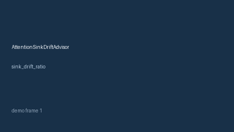

# AttentionSinkDriftAdvisor Guide



Offline HITL advisor for `sink_drift_ratio` bands. Gap vs vLLM/SGLang attention-sink drift monitors. Distinct from `KvCacheQuantErrorBandAdvisor` / `PrefillQueueStarvationAdvisor`.

Optional polish via **GPT-5.5 / Claude Sonnet 4.6 / Gemini 3.x / Kimi K2**.

## Usage

```python
from safety.attention_sink_drift import AttentionSinkDriftAdvisor

advice = AttentionSinkDriftAdvisor().advise(request_id="r1", sink_drift_ratio=0.1)
print(advice.band)
```

## Safety

Advisory only. No network I/O. Humans decide.
