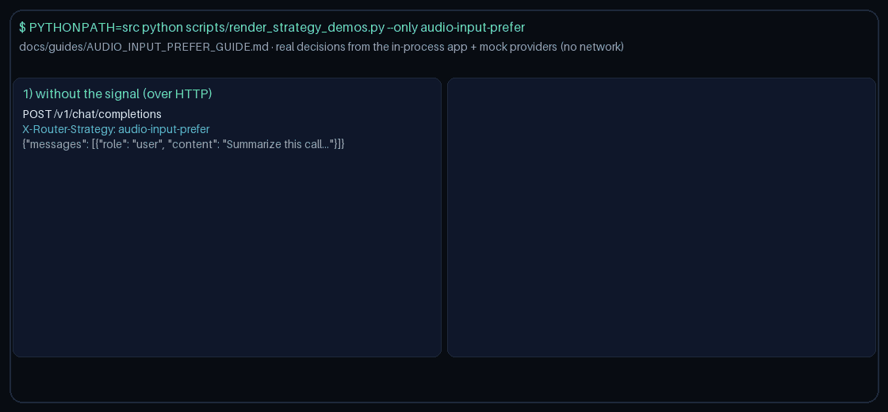

# Audio-Input-Prefer Routing Guide

Use `audio-input-prefer` to bias selection toward `audio`-capable
models when a request declares `metadata.requires_audio` / `metadata.audio_input` / `metadata.audio`, for GPT-6 / Claude Opus 5.5 /
Gemini 4 / Kimi K3.1.



## When to use it

- Gateways that mirror OpenRouter / LiteLLM / Portkey audio-input capability routing and want
  `audio`-capable models preferred when the signal is set.
- Workloads that set `requires_audio`, `audio_input`, `audio` upstream and still want quality-first
  routing when those flags are absent.
- Fleets that maintain a per-request `metadata.audio_models` allowlist
  or `metadata.model_capabilities` override for models whose
  `audio` support is not yet reflected in the built-in map.

## How it works

1. Read `metadata.requires_audio` / `metadata.audio_input` / `metadata.audio`. Truthy values are `true` / `1` / `yes` / `on`, or any
   other non-empty non-falsy token.
2. Filter domain-eligible candidates through provider circuit health
   (emergency-retain the full eligible pool when every circuit is open).
3. When the signal is present, resolve capability from
   `metadata.audio_models`, then `metadata.model_capabilities` /
   the built-in known-model map (`audio`). When neither is
   present for a model, treat names containing `audio`, `realtime`, `gpt-4o-audio`, `gemini` as capable.
4. Rank by `(supports_audio desc, quality desc, cost asc)`.
5. When the signal is absent, route quality-first among healthy
   domain-eligible candidates.

## Quick start

```bash
export NEXUS_DEFAULT_STRATEGY=audio-input-prefer
```

Or select it per request:

```http
X-Router-Strategy: audio-input-prefer
```

```json
{
  "metadata": {
    "requires_audio": true,
    "audio_models": ["gemini-3.8-flash"],
    "model_capabilities": {
      "gemini-3.8-flash": "audio"
    }
  }
}
```

No additional `NEXUS_*` environment variables are required — selection is
driven entirely by request metadata.

> **HTTP note:** strategies read `RouterRequest.metadata`. `POST /v1/chat/completions`,
> `/v1/responses`, and `/v1/messages` do not forward request-body `metadata` to routing
> yet, so over HTTP this strategy takes its no-signal path. Set `metadata` on
> `RouterRequest` when embedding `NexusRouter`, as the demo does
> (`scripts/render_strategy_demos.py`).
