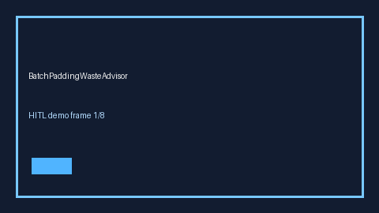

# BatchPaddingWasteAdvisor Guide



Offline HITL advisor for padding_waste_ratio. Gap vs vLLM/TGI/SGLang batch-padding waste monitors.

Optional polish via **GPT-5.5 / Claude Sonnet 4.6 / Gemini 3.x / Kimi K2**.

Distinct from `BatchCoalescePressureAdvisor` / `EmbeddingBatchSkewAdvisor`.

## Usage

```python
from safety.batch_padding_waste import BatchPaddingWasteAdvisor

advice = BatchPaddingWasteAdvisor().advise(request_id="r1", padding_waste_ratio=0.0)
print(advice.band)
```

## Safety

No network I/O. Advisory bands only.
