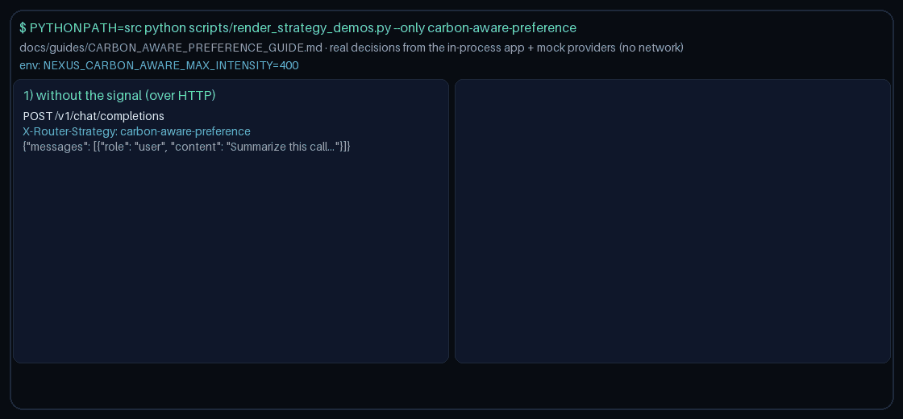

# Carbon-Aware Preference Routing Guide

Prefer lower carbon intensity providers for **GPT-6 Astra**, **Claude Opus 5.5**, **Gemini 4 Argon**, and **Kimi K3.1 Pro** traffic — inspired by sustainability-aware routing in modern LLM gateways.



## Usage

```http
X-Routing-Strategy: carbon-aware-preference
```

Metadata: `carbon_intensity:<provider>` (gCO2eq/kWh) or `region` heuristic (`eu`/`us`/`cn`/`global`). Cap via `NEXUS_CARBON_AWARE_MAX_INTENSITY` (default `400`).
