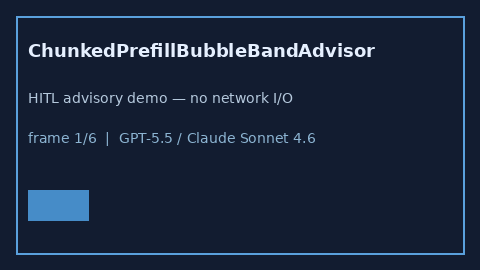

# ChunkedPrefillBubbleBandAdvisor Guide



Offline HITL `bubble_ratio` bands.
Gap vs vLLM/SGLang/TGI chunked-prefill bubble monitors. Distinct from `ContinuousBatchStarveBandAdvisor` / `DecodeSlotFragmentationBandAdvisor`.

Stack: **GPT-5.5 / Claude Sonnet 4.6 / Gemini 3.x / Kimi K2**.

## Usage

```python
from safety.chunked_prefill_bubble_band import ChunkedPrefillBubbleBandAdvisor

advice = ChunkedPrefillBubbleBandAdvisor().advise(request_id="r1", bubble_ratio=0.3)
print(advice.band)
```

## Safety

Advisory only. No network I/O. Never auto-acts.
