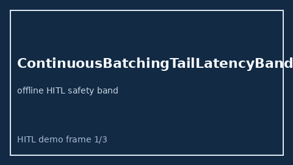

# ContinuousBatchingTailLatencyBandAdvisor Guide



Offline HITL advisor for `p99_tail_ms` bands.
Gap vs vLLM/SGLang/TGI continuous-batching tail-latency band monitors. Distinct from `DecodeBatchPriorityInversionAdvisor` / `GrammarConstrainedDecodeRejectAdvisor`.

Optional polish via **GPT-5.5 / Claude Sonnet 4.6 / Gemini 3.x / Kimi K2**.

## Usage

```python
from safety.continuous_batching_tail_latency_band import ContinuousBatchingTailLatencyBandAdvisor

advice = ContinuousBatchingTailLatencyBandAdvisor().advise(request_id="r1", p99_tail_ms=250.0)
print(advice.band)
```

## Safety

Advisory only. No network I/O. Humans decide.
