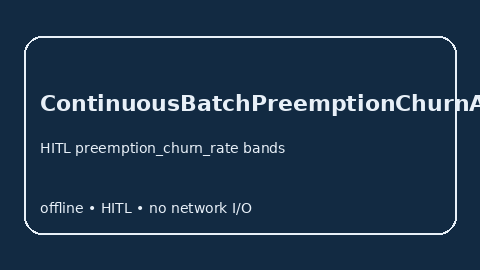

# ContinuousBatchPreemptionChurnAdvisor Guide



Offline HITL `preemption_churn_rate` bands. Gap vs vLLM/SGLang/TGI continuous-batch preemption-churn monitors. Distinct from `ContinuousBatchingTailLatencyBandAdvisor` / `PrefillQueueStarvationAdvisor`.

Stack: **GPT-5.5 / Claude Sonnet 4.6 / Gemini 3.x / Kimi K2**.

## Usage

```python
from safety.continuous_batch_preemption_churn import ContinuousBatchPreemptionChurnAdvisor

advice = ContinuousBatchPreemptionChurnAdvisor().advise(request_id="r1", preemption_churn_rate=0.3)
print(advice.band)
```

## Safety

Advisory only. No network I/O.
