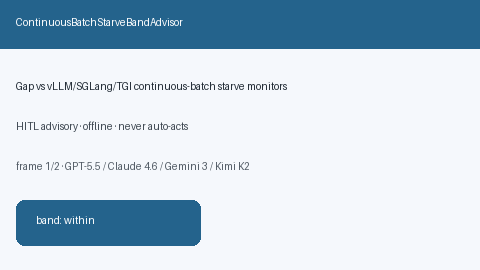

# ContinuousBatchStarveBandAdvisor Guide



Offline HITL `starve_ratio` bands.
Gap vs vLLM/SGLang/TGI continuous-batch starve monitors. Distinct from `ContinuousBatchPreemptionChurnAdvisor` / `ContinuousBatchingTailLatencyBandAdvisor`.

Stack: **GPT-6 Astra / Claude Opus 5.5 / Gemini 4 Argon / Kimi K3.1 Pro**.

## Usage

```python
from safety.continuous_batch_starve_band import ContinuousBatchStarveBandAdvisor

advice = ContinuousBatchStarveBandAdvisor().advise(
    request_id="r1",
    starve_ratio=0.3,
)
print(advice.band)
```

## Safety

Advisory only. No network I/O. Never auto-acts.
