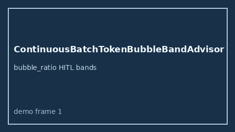

# ContinuousBatchTokenBubbleBandAdvisor Guide



Offline HITL `bubble_ratio` bands.
Gap vs vLLM/SGLang/TGI continuous-batch token-bubble monitors. Distinct from `ChunkedPrefillBubbleBandAdvisor` / `DecodePreemptionPingPongBandAdvisor`.

Stack: **GPT-5.5 / Claude Sonnet 4.6 / Gemini 3.x / Kimi K2**.

## Usage

```python
from safety.continuous_batch_token_bubble_band import ContinuousBatchTokenBubbleBandAdvisor

advice = ContinuousBatchTokenBubbleBandAdvisor().advise(request_id="r1", bubble_ratio=0.4)
print(advice.band)
```

## Safety

Advisory only. No network I/O.
