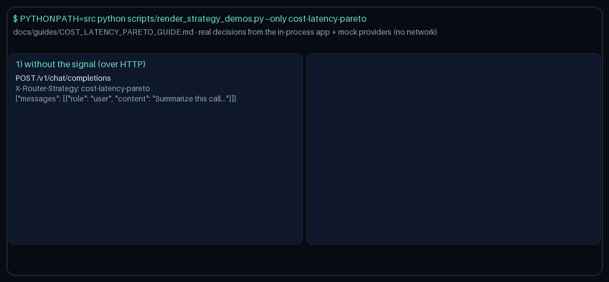

# Cost/Latency Pareto Routing Guide

Use the `cost-latency-pareto` strategy when you want LiteLLM/Portkey-style
multi-objective routing: keep only non-dominated cost/latency trade-offs, then
prefer the highest-quality model on that frontier.

## When to use it

- You care about both spend and tail latency, and a single weighted score would
  hide useful trade-offs.
- Catalog entries such as GPT-6 Astra, Claude Opus 5.5, Gemini 4 Argon, and Kimi K3.1 Pro
  offer different cost/latency profiles for the same domain.
- You want deterministic, explainable selection without tuning blend weights.

## How it works

1. Filter to domain-eligible catalog candidates (full catalog if none match).
2. Estimate per-request cost and read each provider's rolling p95 from
   `LatencyStats`.
3. Keep the Pareto front: a candidate is dominated when another is no worse on
   both cost and latency and strictly better on at least one axis.
4. Among remaining non-dominated candidates, pick higher `quality_score`.
5. Break remaining ties by lower cost, lower latency, then model name.

Cold providers report p95 `0.0`, so equal-latency cold starts collapse the front
to the cheapest candidates before the quality tie-break.

## Quick start

```bash
export NEXUS_DEFAULT_STRATEGY=cost-latency-pareto
```

No additional `NEXUS_*` setting is required.

Or per request:

```http
X-Router-Strategy: cost-latency-pareto
```

## Demo


