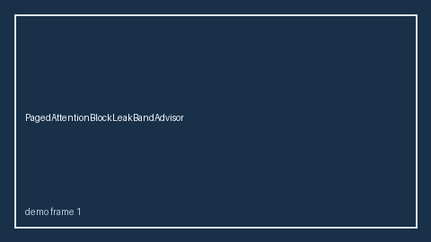

# CudaGraphCaptureStallBandAdvisor Guide



Offline HITL `stall_ratio` bands.
Gap vs vLLM/SGLang/TGI CUDA-graph capture-stall monitors. Distinct from `LoraHotSwapStallBandAdvisor` / `SpeculativeVerifyBacklogBandAdvisor`.

Stack: **GPT-6 Astra / Claude Opus 5.5 / Gemini 4 Argon / Kimi K3.1 Pro**.

## Usage

```python
from safety.cuda_graph_capture_stall_band import CudaGraphCaptureStallBandAdvisor

advice = CudaGraphCaptureStallBandAdvisor().advise(request_id="req-1", stall_ratio=0.15)
print(advice.band)
```

## Safety

Advisory only. No network I/O.
