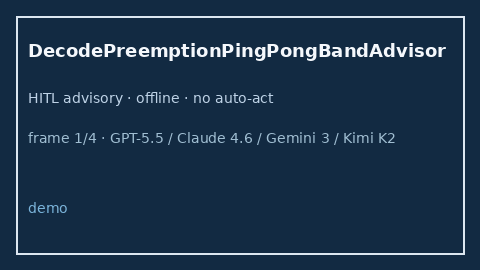

# DecodePreemptionPingPongBandAdvisor Guide



Offline HITL `ping_pong_ratio` bands.
Gap vs vLLM/SGLang/TGI decode preemption ping-pong monitors. Distinct from `ContinuousBatchPreemptionChurnAdvisor` / `ContinuousBatchStarveBandAdvisor`.

Stack: **GPT-5.5 / Claude Sonnet 4.6 / Gemini 3.x / Kimi K2**.

## Usage

```python
from safety.decode_preemption_ping_pong_band import DecodePreemptionPingPongBandAdvisor

advice = DecodePreemptionPingPongBandAdvisor().advise(request_id="r1", ping_pong_ratio=0.3)
print(advice.band)
```

## Safety

Advisory only. No network I/O.
