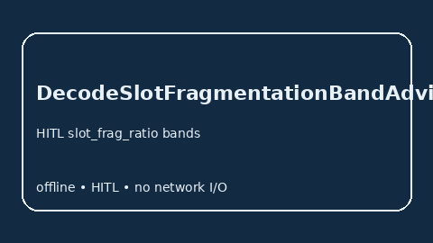

# DecodeSlotFragmentationBandAdvisor Guide



Offline HITL `slot_frag_ratio` bands. Gap vs vLLM/SGLang/TGI decode-slot fragmentation monitors. Distinct from `PagedAttentionSlotFragmentationAdvisor` / `GpuMemoryFragmentationBandAdvisor`.

Stack: **GPT-5.5 / Claude Sonnet 4.6 / Gemini 3.x / Kimi K2**.

## Usage

```python
from safety.decode_slot_fragmentation_band import DecodeSlotFragmentationBandAdvisor

advice = DecodeSlotFragmentationBandAdvisor().advise(request_id="r1", slot_frag_ratio=0.3)
print(advice.band)
```

## Safety

Advisory only. No network I/O.
