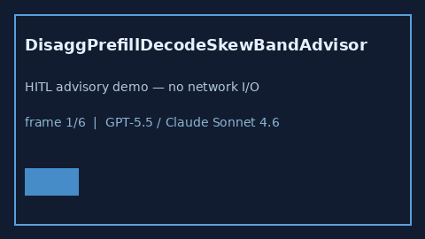

# DisaggPrefillDecodeSkewBandAdvisor Guide



Offline HITL `skew_ratio` bands.
Gap vs vLLM/SGLang/TGI disaggregated prefill/decode skew monitors. Distinct from `PrefillDecodeTokenSkewAdvisor` / `DecodePreemptionPingPongBandAdvisor`.

Stack: **GPT-5.5 / Claude Sonnet 4.6 / Gemini 3.x / Kimi K2**.

## Usage

```python
from safety.disagg_prefill_decode_skew_band import DisaggPrefillDecodeSkewBandAdvisor

advice = DisaggPrefillDecodeSkewBandAdvisor().advise(request_id="r1", skew_ratio=0.3)
print(advice.band)
```

## Safety

Advisory only. No network I/O. Never auto-acts.
