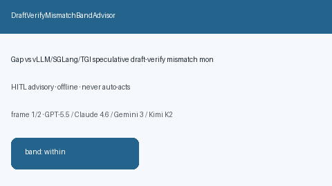

# DraftVerifyMismatchBandAdvisor Guide



Offline HITL `mismatch_ratio` bands.
Gap vs vLLM/SGLang/TGI speculative draft-verify mismatch monitors. Distinct from `SpeculativeDecodeRejectionHysteresisAdvisor` / `SpeculativeDecodeRejectionStormAdvisor`.

Stack: **GPT-5.5 / Claude Sonnet 4.6 / Gemini 3.x / Kimi K2**.

## Usage

```python
from safety.draft_verify_mismatch_band import DraftVerifyMismatchBandAdvisor

advice = DraftVerifyMismatchBandAdvisor().advise(
    request_id="r1",
    mismatch_ratio=0.3,
)
print(advice.band)
```

## Safety

Advisory only. No network I/O. Never auto-acts.
