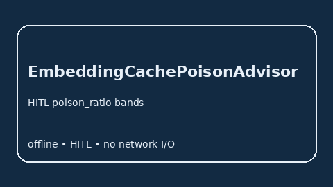

# EmbeddingCachePoisonAdvisor Guide



Offline HITL `poison_ratio` bands. Gap vs vLLM/TGI/TEI embedding-cache poison monitors. Distinct from `EmbeddingCacheThrashAdvisor` / `PrefixCachePoisonAdvisor`.

Stack: **GPT-5.5 / Claude Sonnet 4.6 / Gemini 3.x / Kimi K2**.

## Usage

```python
from safety.embedding_cache_poison import EmbeddingCachePoisonAdvisor

advice = EmbeddingCachePoisonAdvisor().advise(request_id="r1", poison_ratio=0.3)
print(advice.band)
```

## Safety

Advisory only. No network I/O.
