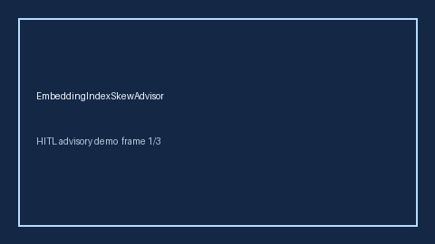

# EmbeddingIndexSkewAdvisor Guide



Offline advisor. Never network I/O. Gap vs vLLM/SGLang/embedding-serving index-skew monitors.

Optional polish via **GPT-5.5 / Claude Sonnet 4.6 / Gemini 3.x / Kimi K2**.

Distinct from `EmbeddingBatchSkewAdvisor` / `EmbeddingDimMismatchAdvisor`.

## Usage

```python
from safety.embedding_index_skew import EmbeddingIndexSkewAdvisor

advice = EmbeddingIndexSkewAdvisor().advise(request_id="r1", index_skew_ratio=0.0)
print(advice.band)
```

## Safety

Advisory bands only. Humans decide.
