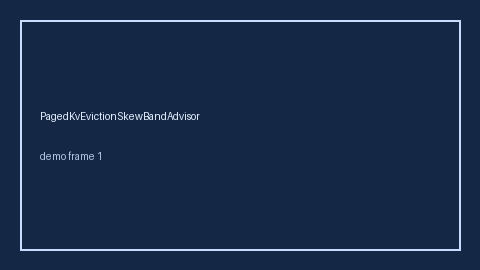

# EngineWarmupColdStartBandAdvisor Guide



Offline helper.
Gap vs vLLM/SGLang/TGI engine warmup cold-start monitors. Distinct from `CudaGraphCaptureStallBandAdvisor` / `LoraHotSwapStallBandAdvisor`.

Stack: **GPT-6 Astra / Claude Opus 5.5 / Gemini 4 Argon / Kimi K3.1 Pro**.

## Usage

```python
from safety.engine_warmup_cold_start_band import EngineWarmupColdStartBandAdvisor

advice = EngineWarmupColdStartBandAdvisor().advise(request_id="r1", cold_start_ratio=0.35)
print(advice.band)
```

## Safety

Advisory only. No network I/O. Never auto-acts. Humans decide.
