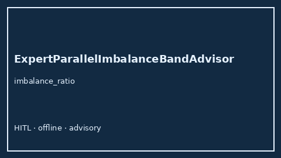

# ExpertParallelImbalanceBandAdvisor Guide



Offline HITL `imbalance_ratio` band advisor.
Gap vs vLLM/SGLang/TGI expert-parallel (MoE) imbalance monitors. Distinct from `TensorParallelSkewBandAdvisor` / `ContinuousBatchTokenBubbleBandAdvisor`.

Stack: **GPT-5.5 / Claude Sonnet 4.6 / Gemini 3.x / Kimi K2**.

## Usage

```python
from safety.expert_parallel_imbalance_band import ExpertParallelImbalanceBandAdvisor

advice = ExpertParallelImbalanceBandAdvisor().advise(request_id="req-1", imbalance_ratio=0.35)
print(advice.band)
```

## Safety

Advisory only. No network I/O.
