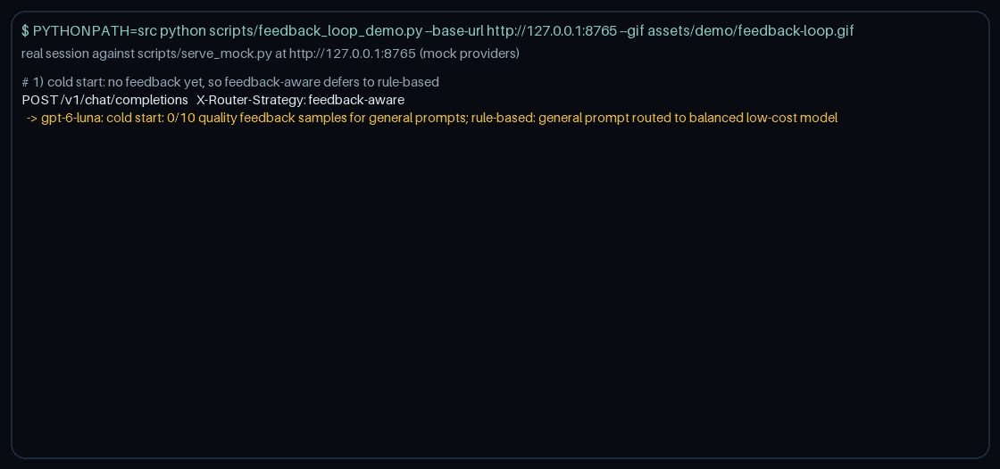

# Feedback Loop Guide (`POST /v1/feedback` and `feedback-aware` routing)



*A real session against `scripts/serve_mock.py` (mock providers, no API keys): a
cold-start decision, twelve rated answers, the Wilson summary, six
`feedback-aware` decisions, and a 404 for another API key
([how it was recorded](#how-this-demo-was-recorded)).*

Nexus records every routed request in the audit log and the spend ledger, but
until now it had no way to learn which model actually satisfied your users.
This feature closes the loop:

1. **`POST /v1/feedback`** attaches a thumbs up/down or a score in `[0, 1]` to a
   completed request, by the `request_id` nexus already returns.
2. **`GET /v1/feedback/summary`** aggregates your feedback per model, strategy,
   domain, or provider, with 95% confidence intervals.
3. **`X-Router-Strategy: feedback-aware`** routes new requests by Thompson
   sampling over that feedback, among exactly the models the default
   `rule-based` policy would have tried.

**Who it is for:** product teams that already collect thumbs up/down in their UI,
evaluation pipelines that score answers automatically (for example an LLM
judge), and platform teams that want routing to adapt per tenant without
hand-tuning quality priors.

## Contents

- [Why](#why)
- [How nexus compares](#how-nexus-compares)
- [Quickstart (offline)](#quickstart-offline)
- [Reference](#reference)
- [How it works](#how-it-works)
- [Safety, privacy, and limits](#safety-privacy-and-limits)
- [Troubleshooting](#troubleshooting)
- [How this demo was recorded](#how-this-demo-was-recorded)
- [Tests](#tests)

## Why

Every routing strategy in nexus decides from signals it can observe before
dispatch: the prompt's domain and complexity, prices, latency, provider health.
None of them knows whether the answer was any good. The catalog's
`quality_score` values are static priors, the same for every tenant and every
kind of prompt. When your users consistently prefer one model's answers for
your support prompts, nexus could not notice.

`feedback-aware` turns that preference into routing, per tenant and per domain,
without widening what the default policy allows: it can only reorder the
candidates `rule-based` already considers, and it never draws a provider whose
circuit is open or a model the engine would refuse before dispatch (no known
price, or over the caller's budget).

## How nexus compares

Each API shape below was checked against the project's own documentation on
2026-11-12. Nexus's endpoint is **not wire-compatible** with any of them; the
field mapping is listed so you can forward feedback you already collect.

| Project | Feedback API (as documented) | Does feedback change routing? |
| --- | --- | --- |
| [TensorZero](https://github.com/tensorzero/tensorzero/blob/main/docs/gateway/api-reference/feedback.mdx) | `POST /feedback` with `metric_name`, `value` (typed by the metric's config, for example boolean or float), `inference_id` or `episode_id`, optional `tags` and `dryrun`; returns `{"feedback_id"}` | Yes: [adaptive A/B tests](https://github.com/tensorzero/tensorzero/blob/main/docs/experimentation/run-adaptive-ab-tests.mdx) use a track-and-stop best-arm identification algorithm over a function's `candidate_variants` for one metric (requires Postgres). The repository was archived (read-only) on 2026-06-12. |
| [Portkey](https://portkey.ai/docs/api-reference/admin-api/data-plane/feedback/create-feedback) | `POST /v1/feedback` with `trace_id`, integer `value` from -10 to 10, optional `weight` in `[0, 1]` (default 1) and `metadata`; returns `{status, message, feedback_ids}` | Not documented; feedback feeds analytics. |
| [Helicone](https://github.com/Helicone/helicone/blob/main/docs/features/advanced-usage/feedback.mdx) | `POST /v1/request/{requestId}/feedback` with `{"rating": true \| false}`; the id comes from a `Helicone-Request-Id` request header or the `helicone-id` response header | Not documented; feedback feeds dashboards. |
| [Langfuse](https://langfuse.com/docs/evaluation/evaluation-methods/scores-via-sdk) | Scores via `POST /api/public/scores` (a JSON array in the current API): `traceId`, optional `observationId` or `sessionId`, `name`, `value`, `dataType` (`NUMERIC`, `CATEGORICAL`, `BOOLEAN`, `TEXT`), `comment`, and an optional `id` that acts as an idempotency key for later updates | No; scores feed evaluation and analytics. |
| [RouteLLM](https://github.com/lm-sys/RouteLLM) | No online feedback endpoint | Routers (`mf` matrix factorization, `sw_ranking`, `bert`, `causal_llm`) are trained offline on Chatbot Arena human-preference data ([paper](https://arxiv.org/abs/2406.18665)) and route between a strong and a weak model with a cost threshold. |
| **nexus** | `POST /v1/feedback` with `request_id`, `metric`, `value` (boolean or `[0, 1]`), `comment`, `source`; returns the stored record | Yes: `feedback-aware` runs Thompson sampling per tenant and domain, online, constrained to the default policy's candidates. |

Field mapping if you forward existing feedback:

| From | To nexus |
| --- | --- |
| TensorZero `inference_id`, `metric_name`, boolean `value` | `request_id`, `metric`, `value` (float metrics: rescale to `[0, 1]` first) |
| Portkey `trace_id`, `value` from -10 to 10 | `request_id`, `value = (v + 10) / 20` (one possible rescaling) |
| Helicone request id, `rating` | `request_id`, `value` |
| Langfuse `traceId`, `name`, `BOOLEAN` 0/1 or `NUMERIC` in `[0, 1]`, `comment` | `request_id`, `metric`, `false`/`true` or the number, `comment` |

The ids must be **nexus** request ids: feedback attaches to the audit record of
the request nexus routed.

## Quickstart (offline)

No API keys: the mock-provider server runs the real API, routing, audit log,
and feedback store. `NEXUS_FEEDBACK_MIN_SAMPLES=10` lowers the cold-start
threshold (default 20) so the demo needs fewer ratings.

```bash
pip install -e ".[dev]"
NEXUS_FEEDBACK_MIN_SAMPLES=10 PYTHONPATH=src python scripts/serve_mock.py --port 8000
```

In a second terminal, send a request and keep its `request_id`:

```bash
REQUEST_ID=$(curl -s localhost:8000/v1/chat/completions -H 'content-type: application/json' \
  -H 'Authorization: Bearer sk-local' \
  -d '{"messages":[{"role":"user","content":"What are your support hours?"}]}' \
  | jq -r .router.request_id)
```

Rate it. The response is the stored record, including the routing snapshot
copied from the request's audit record:

```bash
curl -s localhost:8000/v1/feedback -H 'content-type: application/json' \
  -H 'Authorization: Bearer sk-local' \
  -d "{\"request_id\":\"$REQUEST_ID\",\"value\":true,\"comment\":\"Clear and correct.\"}" | jq .
```

```json
{
  "id": "fb_eddcabd1427f4ca094e4a17a11b2c78a",
  "object": "feedback",
  "request_id": "934eceddf9f642aaabc8a2be794d9521",
  "metric": "quality",
  "value": true,
  "source": "human",
  "comment": "Clear and correct.",
  "model": "gemini-3.8-flash",
  "provider": "google",
  "strategy": "rule-based",
  "domain": "general",
  "created_at": 1794549238,
  "updated_at": 1794549238
}
```

Change your mind: the same `(request_id, metric, source)` keeps one value, so
this replaces the record (same `id`) instead of adding a second vote. The
comment is replaced too:

```bash
curl -s localhost:8000/v1/feedback -H 'content-type: application/json' \
  -H 'Authorization: Bearer sk-local' \
  -d "{\"request_id\":\"$REQUEST_ID\",\"value\":false}" \
  | jq -c '{id, value, comment, created_at, updated_at}'
```

```json
{"id":"fb_eddcabd1427f4ca094e4a17a11b2c78a","value":false,"comment":null,"created_at":1794549238,"updated_at":1794549238}
```

An automated judge can score the same request on another metric:

```bash
curl -s localhost:8000/v1/feedback -H 'content-type: application/json' \
  -H 'Authorization: Bearer sk-local' \
  -d "{\"request_id\":\"$REQUEST_ID\",\"metric\":\"helpfulness\",\"value\":0.8,\"source\":\"automated\"}" \
  | jq -c '{id, metric, value, source, model}'
```

```json
{"id":"fb_a8cff6d6d566477b92b131e848dd79b0","metric":"helpfulness","value":0.8,"source":"automated","model":"gemini-3.8-flash"}
```

Summarize your feedback per model:

```bash
curl -s 'localhost:8000/v1/feedback/summary?group_by=model' \
  -H 'Authorization: Bearer sk-local' | jq .
```

```json
{
  "object": "feedback.summary",
  "metric": "quality",
  "group_by": "model",
  "kind": "boolean",
  "interval": "wilson",
  "confidence": 0.95,
  "since": null,
  "n": 1,
  "groups": [
    {
      "key": "gemini-3.8-flash",
      "n": 1,
      "positives": 0,
      "mean": 0.0,
      "ci_low": 0.0,
      "ci_high": 0.7934506856227626
    }
  ]
}
```

Ask for `feedback-aware` routing. With one sample it is still a cold start, so
it returns the `rule-based` decision and says why:

```bash
curl -s localhost:8000/v1/chat/completions -H 'content-type: application/json' \
  -H 'Authorization: Bearer sk-local' -H 'X-Router-Strategy: feedback-aware' \
  -d '{"messages":[{"role":"user","content":"What are your support hours on weekends?"}]}' \
  | jq -c '{model, strategy: .router.routing_strategy, rationale: .router.rationale}'
```

```json
{"model":"gemini-3.8-flash","strategy":"feedback-aware","rationale":"cold start: 1/10 quality feedback samples for general prompts; rule-based: simple realtime prompt favors low latency"}
```

Run the whole loop (twelve rated answers, the summary, six `feedback-aware`
decisions, and a foreign key's 404) with the demo script, which needs only
`httpx` (a nexus dependency). Start it against a fresh server so the counts
start at zero:

```bash
PYTHONPATH=src python scripts/feedback_loop_demo.py --base-url http://127.0.0.1:8000
```

Its output is the [transcript below](#how-this-demo-was-recorded). The quickstart
output above was captured from the same commands on port 8765 on 2026-11-12.

## Reference

### `POST /v1/feedback`

Attaches feedback to a completed request and returns the stored record.

**Caller identity.** Send the same API key (`Authorization: Bearer <key>` or
`x-api-key: <key>`) and the same `X-Tenant-Id` (or none) as the request you rate.
Nexus compares their fingerprints with the ones recorded for the request; any
mismatch gets the same 404 as an unknown id, so you cannot probe whether another
tenant's request exists. The `X-Tenant-Id` hard rate limit applies.

**Body** (unknown fields are rejected):

| Field | Type | Default | Description |
| --- | --- | --- | --- |
| `request_id` | string, 1-128 chars | required | Nexus request id of a completed request (see [where to find it](#where-to-find-the-request-id)). |
| `metric` | string matching `^[a-z0-9_.-]{1,64}$` | `quality` | What you rate. `feedback-aware` optimizes `NEXUS_FEEDBACK_METRIC`. |
| `value` | `true`/`false`, or a number in `[0, 1]` | required | Thumbs up/down, or a score. `1` is a number, not `true`. |
| `comment` | string, up to 1000 chars | `null` | Free text. Stored and returned to you, never logged or exported. |
| `source` | `human` or `automated` | `human` | Who rated. Human and automated values are stored side by side. |

**Response `200`**: the `feedback` object.

| Field | Description |
| --- | --- |
| `id` | `fb_...`, stable across updates of the same `(request_id, metric, source)` |
| `object` | `feedback` |
| `request_id`, `metric`, `value`, `source`, `comment` | As stored (`value` keeps its kind: boolean or number) |
| `model`, `provider`, `strategy`, `domain` | Routing snapshot copied from the request's audit record when the feedback was first written |
| `created_at`, `updated_at` | Unix seconds of the first and the latest write |

**Errors** use the OpenAI envelope `{"error": {"message", "type", "param", "code"}}`:

| Status | `code` | When |
| --- | --- | --- |
| 401 | (none, `type: authentication_error`) | `Authorization` and `x-api-key` carry different keys |
| 404 | `request_not_found` | Unknown id, a request older than the feedback window, or a request made by another key or tenant |
| 409 | `feedback_kind_conflict` | The metric already holds the other value kind for you (for example `1` after `true`) |
| 422 | `missing_required_parameter`, `invalid_value`, `unknown_parameter` | Validation failed; `param` names the field |
| 429 | `rate_limit_exceeded` | The `X-Tenant-Id` hard rate limit is exhausted |

Real error bodies from the quickstart server:

```text
{"error":{"message":"No request found with id '934eceddf9f642aaabc8a2be794d9521' for this API key and tenant.","type":"invalid_request_error","param":"request_id","code":"request_not_found"}} HTTP 404
{"error":{"message":"Invalid value for 'value': expected true, false, or a number between 0 and 1.","type":"invalid_request_error","param":"value","code":"invalid_value"}} HTTP 422
{"error":{"message":"metric 'quality' already holds boolean feedback for this caller; send true or false, or use another metric name","type":"invalid_request_error","param":"value","code":"feedback_kind_conflict"}} HTTP 409
{"error":{"message":"Unrecognized request argument supplied: metric_name","type":"invalid_request_error","param":"metric_name","code":"unknown_parameter"}} HTTP 422
```

### `GET /v1/feedback/summary`

Aggregates **your** feedback (same key fingerprint and `X-Tenant-Id`) for one
metric.

| Query parameter | Default | Description |
| --- | --- | --- |
| `metric` | `quality` | Metric name (same pattern as above) |
| `group_by` | `model` | `model`, `strategy`, `domain`, or `provider` (from the routing snapshot) |
| `since` | none | ISO 8601 timestamp; naive values are UTC. Counts feedback last written at or after it. |

| Response field | Description |
| --- | --- |
| `object` | `feedback.summary` |
| `metric`, `group_by`, `since` | Echo of the query (`since` normalized to UTC) |
| `kind` | `boolean` or `numeric`; `null` when nothing matched |
| `interval` | `wilson` (boolean) or `normal` (numeric); `null` when nothing matched |
| `confidence` | `0.95` |
| `n` | Values counted |
| `groups[]` | `key`, `n`, `positives` (boolean only, else `null`), `mean`, `ci_low`, `ci_high` |

Groups are sorted by `ci_low` (then `n`), so one positive out of one does not
outrank 45 out of 50. Invalid parameters are a 422 with the OpenAI envelope.

### Where to find the request id

| Endpoint | Field |
| --- | --- |
| `POST /v1/chat/completions` | `router.request_id` |
| `POST /v1/responses` (and its `response.completed` stream event) | `nexus.request_id` |
| `POST /v1/messages` (and its `message_delta` stream event) | `nexus.request_id` |
| Streamed `POST /v1/chat/completions` | Not exposed yet; see [limits](#limits) |

### `feedback-aware` strategy

Select it per request with `X-Router-Strategy: feedback-aware`, or for all
traffic with `NEXUS_DEFAULT_STRATEGY=feedback-aware`.

- **Candidates:** the `rule-based` pick plus its fallback chain, keeping the
  fallbacks that serve the request's domain and latency class, then dropping
  providers with an open circuit and models the engine would refuse before
  dispatch (`NexusRouter.allows_dispatch`: no known price, or over the caller's
  budget).
- **Refusals:** a request no candidate can serve fails exactly as with any other
  strategy: 402 `budget_exceeded` when the budget refuses every candidate, 500
  `model_price_unknown` when none has a price, 503 when providers fail.
- **Cold start:** below `NEXUS_FEEDBACK_MIN_SAMPLES` values across the
  candidates (for this caller, metric, and domain, inside the window), the
  decision is `rule-based`'s, with the rationale
  `cold start: <n>/<min> <metric> feedback samples for <domain> prompts; rule-based: <its rationale>`.
- **Decision:** one draw per candidate from `Beta(1 + positives, 1 + negatives)`;
  the highest draw wins. The rationale reports the draw, posterior mean, and
  `n` of the chosen model and of the best alternative (highest posterior mean).
- **Fallback chain:** the other candidates by posterior mean, then the rest of
  `rule-based`'s attempts. It is always a reordering of the models `rule-based`
  would have tried.
- **Failures:** if the feedback store cannot be read, the decision is
  `rule-based`'s with `feedback unavailable (...)` in the rationale.

### Configuration

| Variable | Default | Description |
| --- | --- | --- |
| `NEXUS_FEEDBACK_PATH` | `migrations/feedback.sqlite3` | SQLite file for the request index and feedback (WAL mode; keep it on a local disk) |
| `NEXUS_FEEDBACK_METRIC` | `quality` | Metric `feedback-aware` optimizes |
| `NEXUS_FEEDBACK_MIN_SAMPLES` | `20` | Values needed across a request's candidates before feedback changes routing |
| `NEXUS_FEEDBACK_WINDOW_SECONDS` | `2592000` (30 days) | How long a request accepts feedback, and how far back routing looks |

### Observability

- **Prometheus:** `router_feedback_total{metric, model}` counts every write (new
  or updated). Labels never carry tenant ids, key fingerprints, or comments.
  Metric names are client-chosen, so only the first 32 distinct names (plus
  `NEXUS_FEEDBACK_METRIC`) get their own label per process; later ones are
  counted as `metric="other"`.
- **Logs:** `feedback_recorded` (request id, feedback id, metric, source, value,
  model, provider, strategy, domain, `created`) and `feedback_rejected`
  (`reason="request_not_found"`). Comments, keys, and tenant ids are never
  logged. `feedback_index_failed` (warning) means a completed request could not
  be indexed; the request itself still succeeded.
- **Audit log:** each record now also carries `api_key_id` (the non-reversible
  fingerprint), `tenant_id`, and `domain`.

### Demo script

`scripts/feedback_loop_demo.py --base-url URL [--gif PATH]` runs the session
shown in the GIF against a nexus with mock providers (it exits with status 1 if
the server answers with real providers or routes differently than expected).
`--gif` renders the printed transcript with the shared helpers in
`scripts/create_demo_gif.py`.

## How it works

```text
request ──> Observe ──> Decide ──> Act ──> RESPONDED ──> audit log (JSONL)
                          ▲                     └──────> feedback store: request index
                          │                                   (request id, key, tenant,
                          │                                    model, provider, strategy, domain)
   feedback-aware reads ──┘
   hourly per-model totals          POST /v1/feedback ──> ownership check ──> upsert
                                                           feedback row (+ snapshot)
                                                           and hourly totals
```

1. **Indexing.** After a provider answers, the router appends the audit record
   and registers the request in the feedback store with the caller's key
   fingerprint and `X-Tenant-Id`. Index rows older than the window are pruned on
   the way, and the first registration of an id wins, so a request can never
   change owner. A failing store logs `feedback_index_failed` and never fails or
   retries the request (retrying would bill a second provider).
2. **Writing feedback.** In one `BEGIN IMMEDIATE` transaction the store checks
   that the id belongs to the caller and is inside the window, checks the
   metric's value kind, upserts the row with the snapshot of the request's
   model, provider, strategy, and domain, and moves the value between hourly
   per-model totals. Booleans are stored as 1/0; a number `v` counts as `v`
   successes and `1 - v` failures.
3. **Summaries.** Boolean metrics use the 95% Wilson score interval, which stays
   inside `[0, 1]` and behaves at small `n`:

   ```text
   p = positives / n, z = 1.959964
   center = (p + z²/2n) / (1 + z²/n)
   half   = z / (1 + z²/n) * sqrt(p(1 - p)/n + z²/4n²)
   ```

   Numeric metrics use `mean ± z * s / sqrt(n)` with the sample standard
   deviation `s`, clipped to `[0, 1]`. Below two values the interval is `[0, 1]`.
4. **Routing.** `feedback-aware` reads the per-model totals of the caller's
   metric and domain inside the window (a few rows per model, however much
   feedback exists), applies the cold-start rule, then draws from each
   candidate's Beta posterior with `random.Random` seeded by
   `sha256("feedback-aware:" + request_id)`. The same request id and the same
   feedback therefore give the same decision, which you can replay from the
   audit log. Unrated candidates keep the uniform `Beta(1, 1)` prior, so they are
   still explored.

## Safety, privacy, and limits

### Feedback-poisoning controls

- **Tenant scoping.** Requests, feedback, summaries, and routing statistics are
  partitioned by API key fingerprint plus `X-Tenant-Id`. A caller can only
  influence routing of its own traffic, and cross-scope writes get the same 404
  as unknown ids.
- **Request-bound, idempotent votes.** Feedback must reference a completed
  request of the caller inside the window, and each `(request_id, metric,
  source)` holds one value. Retries and replays replace a vote instead of
  stacking it, so feedback volume is bounded by the caller's own (rate-limited,
  budgeted) traffic: at most one human and one automated value per request and
  metric.
- **Minimum samples.** Below `NEXUS_FEEDBACK_MIN_SAMPLES` values the strategy is
  exactly `rule-based`.
- **Bounded influence.** Feedback can only reorder the candidates `rule-based`
  would try; open circuits, budgets, price checks, domain and latency
  eligibility, and any catalog restriction still apply. With the `Beta(1, 1)`
  prior, one more value moves a model's posterior mean by less than
  `1 / (n + 3)` after `n` values, and feedback older than the window stops
  counting.
- **Typed metrics.** A metric keeps one value kind per caller, so a stray `1`
  cannot silently turn thumbs into scores.

### Privacy

- Comments are stored in the SQLite file and returned only to the caller that
  wrote them. They are never logged and never exported as metrics.
- Feedback logs and metrics carry no tenant ids or key fingerprints. The audit
  log and the store keep the key fingerprint, which is non-reversible (see
  [SECURITY.md](../../SECURITY.md#credential-handling)).
- There is no delete endpoint yet: to erase a tenant's feedback, delete its
  rows from `feedback` and `feedback_totals` in `NEXUS_FEEDBACK_PATH`.

### Limits

- Streamed `/v1/chat/completions` responses do not carry the request id, so
  they cannot be rated yet. Use non-streaming chat completions, or the
  `/v1/responses` and `/v1/messages` streams, whose final events carry
  `nexus.request_id`.
- A response-cache hit replays the original request id, so ratings of repeated
  identical answers update one record. The cache is namespaced by key, tenant,
  and end user, so a cached answer is only replayed to a caller that can rate
  it.
- Routing applies the window in whole hours; the summary's `since` is exact.
- `feedback-aware` optimizes satisfaction only: it can route simple prompts to
  a more expensive candidate if users prefer it. Budgets still cap spend.
- Only `rule-based` honors an explicit `model` (for general prompts);
  `feedback-aware`, like the other strategies, may route elsewhere. Do not use it
  to pin a model.
- The Prometheus metric-label cap is per process.
- The summary scans your rows for one metric (indexed). Use `since` on very
  large stores.
- SQLite WAL mode needs a local disk; do not put `NEXUS_FEEDBACK_PATH` on a
  network file system.

## Troubleshooting

| Symptom | Cause and fix |
| --- | --- |
| `404 request_not_found` for an id you just received | Send the same key and `X-Tenant-Id` as the original request; check the id is not older than `NEXUS_FEEDBACK_WINDOW_SECONDS`; only completed requests are indexed (look for `feedback_index_failed` in the logs). |
| `409 feedback_kind_conflict` | The metric already holds the other kind for you. Send `true`/`false` instead of `1`/`0` (or the reverse), or use a new metric name. |
| `422 unknown_parameter` for `metric_name`, `inference_id`, or `trace_id` | Those are TensorZero and Portkey names; use `metric` and `request_id`. |
| `feedback-aware` always answers `cold start` | Samples are counted per caller, metric (`NEXUS_FEEDBACK_METRIC`), and domain, across the request's candidates only, inside the window. Rate answers of the models listed in the `rule-based` fallback chain for that kind of prompt, or lower `NEXUS_FEEDBACK_MIN_SAMPLES`. |
| `feedback-aware` picked a model with a lower mean | That is Thompson sampling exploring; the rationale shows both draws. Exploration shrinks as `n` grows. |
| `feedback unavailable (...)` in a rationale | The feedback store could not be read (file permissions, disk errors, or a network file system). Routing fell back to `rule-based`; check `NEXUS_FEEDBACK_PATH`. |

## How this demo was recorded

Recorded on 2026-11-12 with Python 3.11, httpx 0.28.1, and Pillow 13.0.0. The
server used fresh state files so the session starts from zero feedback; model
names are whatever this build's routing picked, and mock providers answer
`[model] routed response`.

```bash
NEXUS_FEEDBACK_MIN_SAMPLES=10 \
NEXUS_FEEDBACK_PATH=build/feedback-demo/feedback.sqlite3 \
NEXUS_AUDIT_LOG_PATH=build/feedback-demo/audit-log.jsonl \
NEXUS_SPEND_LEDGER_PATH=build/feedback-demo/spend-ledger.sqlite3 \
NEXUS_IDEMPOTENCY_PATH=build/feedback-demo/idempotency.sqlite3 \
PYTHONPATH=src python scripts/serve_mock.py --port 8765 &
PYTHONPATH=src python scripts/feedback_loop_demo.py --base-url http://127.0.0.1:8765 \
  --gif assets/demo/feedback-loop.gif
```

`--gif` renders exactly the lines the script printed (one section per frame)
with the GIF helpers in `scripts/create_demo_gif.py`, which
`scripts/render_strategy_demos.py` also uses.

<details>
<summary>Full transcript</summary>

```text
# 1) cold start: no feedback yet, so feedback-aware defers to rule-based
POST /v1/chat/completions   X-Router-Strategy: feedback-aware
  -> gpt-6-luna: cold start: 0/10 quality feedback samples for general prompts; rule-based: general prompt routed to balanced low-cost model
# 2) 12 answers from three models, each rated by a scripted reviewer
gpt-6-luna       request ids f6558ff2 42706287 e551ac88 edb9db42  ->  POST /v1/feedback [down down up down]  HTTP 200 200 200 200
claude-opus-5-5  request ids b6be1c30 d366a2bc 2663e37b 5622e770  ->  POST /v1/feedback [up up up up]  HTTP 200 200 200 200
gpt-6-astra      request ids a520efcb b2a99999 83d0d3f7 48d15381  ->  POST /v1/feedback [up down up down]  HTTP 200 200 200 200
# 3) GET /v1/feedback/summary?group_by=model   kind=boolean, interval=wilson (95%), n=12
key               n   positives  mean   95% CI
claude-opus-5-5   4   4          1.00   [0.51, 1.00]
gpt-6-astra       4   2          0.50   [0.15, 0.85]
gpt-6-luna        4   1          0.25   [0.05, 0.70]
# 4) feedback-aware again: Thompson sampling, seeded by each request id
POST /v1/chat/completions x6   X-Router-Strategy: feedback-aware
  -> served claude-opus-5-5 x6
  rationale: feedback-aware: Thompson sample chose claude-opus-5-5 (draw 0.97, posterior mean 0.83, n=4) over gpt-6-astra (draw 0.75, posterior mean 0.50, n=4); 12 quality samples for general prompts, seeded by request id
# 5) only the API key and tenant that made a request can rate it
POST /v1/feedback  Authorization: Bearer sk-other-team  request f6558ff2  -> HTTP 404 request_not_found
wrote assets/demo/feedback-loop.gif
```

</details>

## Tests

```bash
pytest tests/test_feedback_api.py tests/test_feedback_store.py tests/test_feedback_aware_strategy.py -v
```
