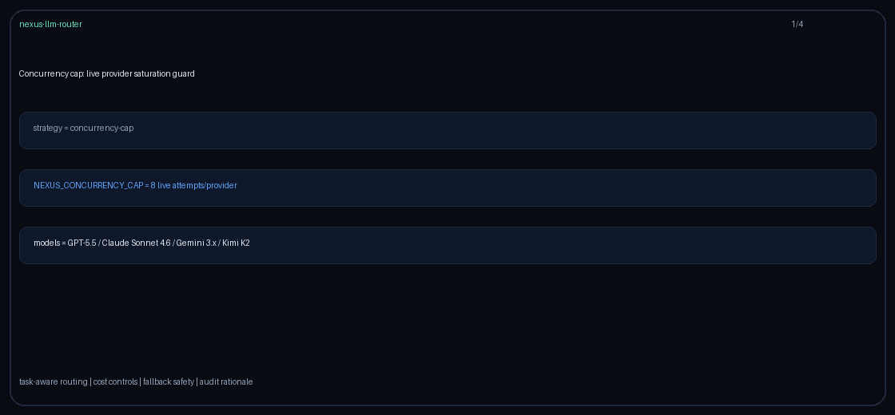

# file-search-prefer Guide

Capability-aware routing for GPT-6 Astra / Claude Opus 5.5 / Gemini 4 Argon / Kimi K3.1 Pro.

## Why

OpenAI Assistants file_search / vector retrieval capability routing.

## Signals

Metadata keys: `requires_file_search`, `file_search`, `file-search`; allowlist `file_search_models`.
