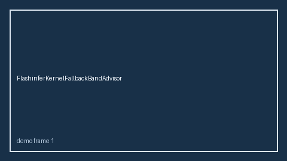

# FlashinferKernelFallbackBandAdvisor Guide



Safety band advisor for `fallback_ratio`.
Gap vs vLLM/SGLang/TGI FlashInfer kernel-fallback monitors. Distinct from `KvCacheQuantErrorBandAdvisor` / `TensorParallelSkewBandAdvisor`.

Stack: **GPT-5.5 / Claude Sonnet 4.6 / Gemini 3.x / Kimi K2**.

## Usage

```python
from safety.flashinfer_kernel_fallback_band import FlashinferKernelFallbackBandAdvisor

advice = FlashinferKernelFallbackBandAdvisor().advise(request_id="req-1", fallback_ratio=0.15)
print(advice.band)
```

## Safety

Advisory only. No network I/O.
