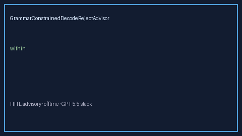

# GrammarConstrainedDecodeRejectAdvisor Guide



Offline HITL advisor for `reject_ratio` bands.
Gap vs vLLM/SGLang/Outlines grammar-constrained decode reject monitors. Distinct from `GrammarConstrainedDecodeBudgetAdvisor` / `JsonSchemaStrictnessBandAdvisor`.

Optional polish via **GPT-5.5 / Claude Sonnet 4.6 / Gemini 3.x / Kimi K2**.

## Usage

```python
from safety.grammar_constrained_decode_reject import GrammarConstrainedDecodeRejectAdvisor

advice = GrammarConstrainedDecodeRejectAdvisor().advise(request_id="r1", reject_ratio=0.3)
print(advice.band)
```

## Safety

Advisory only. No network I/O. Humans decide.
