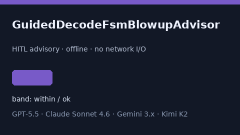

# GuidedDecodeFsmBlowupAdvisor Guide



Offline HITL helper for `fsm_blowup_ratio` bands.
Gap vs vLLM/Outlines/Guidance guided-decode FSM blowup monitors. Distinct from `DecodeSlotFragmentationBandAdvisor` / `PagedKvSwapThrashAdvisor`.

Optional polish via **GPT-5.5 / Claude Sonnet 4.6 / Gemini 3.x / Kimi K2**.

## Usage

```python
from safety.guided_decode_fsm_blowup import GuidedDecodeFsmBlowupAdvisor

advice = GuidedDecodeFsmBlowupAdvisor().advise(request_id="r1", fsm_blowup_ratio=0.35)
print(advice.band)
```

## Safety

Advisory only. No network I/O. Never auto-acts. Humans decide.
