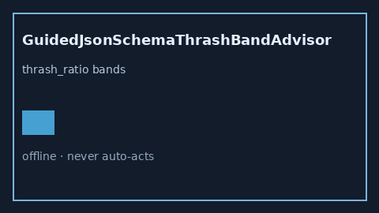

# GuidedJsonSchemaThrashBandAdvisor Guide



Offline HITL helper for `thrash_ratio` bands.
Gap vs vLLM/SGLang/TGI guided JSON schema thrash monitors. Distinct from `SpeculativeAcceptanceEntropyBandAdvisor` / `RadixCacheCollisionBandAdvisor`.

Stack: **GPT-5.5 / Claude Sonnet 4.6 / Gemini 3.x / Kimi K2**.

## Usage

```python
from safety.guided_json_schema_thrash_band import GuidedJsonSchemaThrashBandAdvisor

advice = GuidedJsonSchemaThrashBandAdvisor().advise(request_id="r1", thrash_ratio=0.3)
print(advice.band)
```

## Safety

Advisory only. No network I/O. Never auto-acts.
