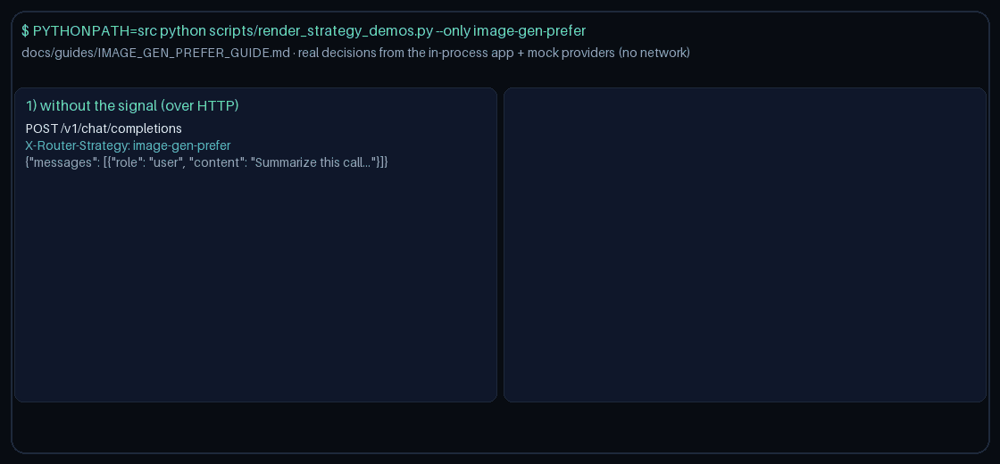

# image-gen-prefer Guide

Prefer models that advertise `image_gen` when the request signals need it.
Works with GPT-6 Astra / Claude Opus 5.5 / Gemini 4 Argon / Kimi K3.1 Pro catalogs.

## Why

OpenRouter / LiteLLM / Portkey image-generation capability routing. Gap fill vs OpenRouter/LiteLLM/Portkey capability routing.

## Signals

Truthiness on any of:
- `metadata.requires_image_gen`
- `metadata.image_gen`
- `metadata.image_generation`

Optional allowlist: `metadata.image_gen_models`.

## Capability resolution

1. Allowlist (if provided)
2. `metadata.model_capabilities` / known-model map looking for `image_gen`
3. Name heuristic tokens: 'image-gen', 'imagen', 'dall-e', 'flux', 'gpt-image'

When the signal is absent, selection stays quality-first.
