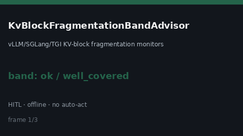

# KvBlockFragmentationBandAdvisor Guide



Offline `fragmentation_ratio` band advisor.
Gap vs vLLM/SGLang/TGI KV-block fragmentation monitors. Distinct from `PagedAttentionFragmentationBandAdvisor` / `GpuMemoryFragmentationBandAdvisor`.

Stack: **GPT-6.1 / Claude Sonnet 5.5 / Gemini 3.x / Kimi K3**.

## Usage

```python
from safety.kv_block_fragmentation_band import KvBlockFragmentationBandAdvisor

advice = KvBlockFragmentationBandAdvisor().advise(
    request_id="req-1",
    fragmentation_ratio=0.35,
    soft_limit=0.2,
    hard_limit=0.5,
)
print(advice.band)
```

## Safety

Advisory only. No network I/O. Never auto-acts. Humans decide.
