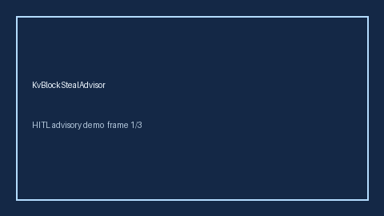

# KvBlockStealAdvisor Guide



Offline advisor. Never network I/O. Gap vs vLLM/SGLang/TGI KV-block steal monitors.

Optional polish via **GPT-5.5 / Claude Sonnet 4.6 / Gemini 3.x / Kimi K2**.

Distinct from `KvCacheEvictionPressureAdvisor` / `KvCacheHitRateAdvisor`.

## Usage

```python
from safety.kv_block_steal import KvBlockStealAdvisor

advice = KvBlockStealAdvisor().advise(request_id="r1", steal_rate=0.0)
print(advice.band)
```

## Safety

Advisory bands only. Humans decide.
