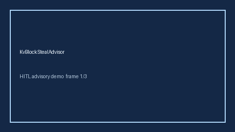

# KvBlockStealAdvisor Guide



Offline advisor. Never network I/O. Gap vs vLLM/SGLang/TGI KV-block steal monitors.

Optional polish via **GPT-6 Astra / Claude Opus 5.5 / Gemini 4 Argon / Kimi K3.1 Pro**.

Distinct from `KvCacheEvictionPressureAdvisor` / `KvCacheHitRateAdvisor`.

## Usage

```python
from safety.kv_block_steal import KvBlockStealAdvisor

advice = KvBlockStealAdvisor().advise(request_id="r1", steal_rate=0.0)
print(advice.band)
```

## Safety

Advisory bands only. Humans decide.
