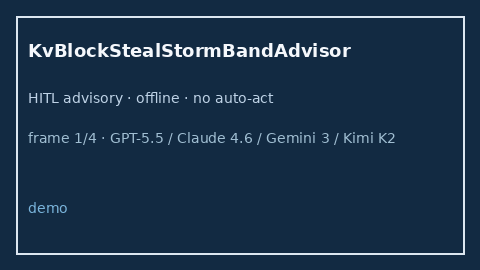

# KvBlockStealStormBandAdvisor Guide



Offline HITL `steal_ratio` bands.
Gap vs vLLM/SGLang/TGI KV block steal-storm monitors. Distinct from `KvBlockStealAdvisor` / `PrefixCacheEvictionStormAdvisor`.

Stack: **GPT-5.5 / Claude Sonnet 4.6 / Gemini 3.x / Kimi K2**.

## Usage

```python
from safety.kv_block_steal_storm_band import KvBlockStealStormBandAdvisor

advice = KvBlockStealStormBandAdvisor().advise(request_id="r1", steal_ratio=0.3)
print(advice.band)
```

## Safety

Advisory only. No network I/O.
