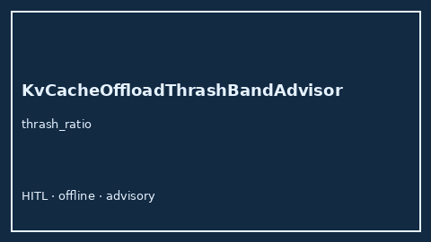

# KvCacheOffloadThrashBandAdvisor Guide



Offline HITL `thrash_ratio` band advisor.
Gap vs vLLM/SGLang/TGI KV-cache offload thrash monitors. Distinct from `KvCacheEvictionPressureAdvisor` / `PrefixCacheThrashAdvisor`.

Stack: **GPT-5.5 / Claude Sonnet 4.6 / Gemini 3.x / Kimi K2**.

## Usage

```python
from safety.kv_cache_offload_thrash_band import KvCacheOffloadThrashBandAdvisor

advice = KvCacheOffloadThrashBandAdvisor().advise(request_id="req-1", thrash_ratio=0.35)
print(advice.band)
```

## Safety

Advisory only. No network I/O.
