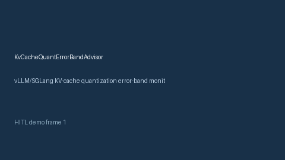

# KvCacheQuantErrorBandAdvisor Guide



Offline HITL advisor for `error_rate` bands. Gap vs vLLM/SGLang KV-cache quantization error-band monitors. Distinct from `KvCacheHitRateAdvisor` / `KvBlockStealAdvisor`.

Optional polish via **GPT-5.5 / Claude Sonnet 4.6 / Gemini 3.x / Kimi K2**.

## Usage

```python
from safety.kv_cache_quant_error_band import KvCacheQuantErrorBandAdvisor

advice = KvCacheQuantErrorBandAdvisor().advise(request_id="r1", error_rate=0.1)
print(advice.band)
```

## Safety

Advisory only. No network I/O. Humans decide.
