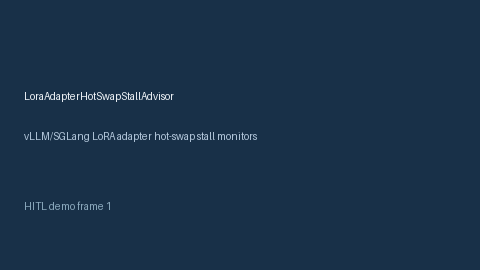

# LoraAdapterHotSwapStallAdvisor Guide



Offline HITL advisor for `stall_ratio` bands. Gap vs vLLM/SGLang LoRA adapter hot-swap stall monitors. Distinct from `LoraAdapterSwapCostAdvisor` / `AdapterWeightDriftAdvisor`.

Optional polish via **GPT-5.5 / Claude Sonnet 4.6 / Gemini 3.x / Kimi K2**.

## Usage

```python
from safety.lora_adapter_hot_swap_stall import LoraAdapterHotSwapStallAdvisor

advice = LoraAdapterHotSwapStallAdvisor().advise(request_id="r1", stall_ratio=0.1)
print(advice.band)
```

## Safety

Advisory only. No network I/O. Humans decide.
