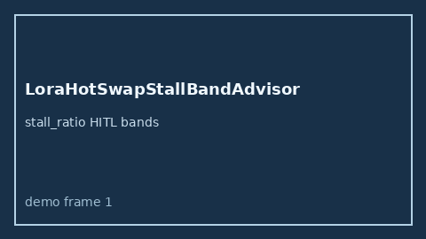

# LoraHotSwapStallBandAdvisor Guide



Offline HITL `stall_ratio` bands.
Gap vs vLLM/SGLang/TGI LoRA hot-swap stall monitors. Distinct from `PagedAttentionFragmentationBandAdvisor` / `KvBlockStealStormBandAdvisor`.

Stack: **GPT-5.5 / Claude Sonnet 4.6 / Gemini 3.x / Kimi K2**.

## Usage

```python
from safety.lora_hot_swap_stall_band import LoraHotSwapStallBandAdvisor

advice = LoraHotSwapStallBandAdvisor().advise(request_id="r1", stall_ratio=0.4)
print(advice.band)
```

## Safety

Advisory only. No network I/O.
