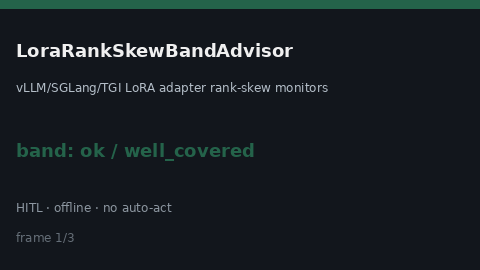

# LoraRankSkewBandAdvisor Guide



Offline `skew_ratio` band advisor.
Gap vs vLLM/SGLang/TGI LoRA adapter rank-skew monitors. Distinct from `LoraHotSwapStallBandAdvisor` / `AdapterWeightDriftAdvisor`.

Stack: **GPT-6 Astra / Claude Opus 5.5 / Gemini 4 Argon / Kimi K3.1 Pro**.

## Usage

```python
from safety.lora_rank_skew_band import LoraRankSkewBandAdvisor

advice = LoraRankSkewBandAdvisor().advise(
    request_id="req-1",
    skew_ratio=0.35,
    soft_limit=0.2,
    hard_limit=0.5,
)
print(advice.band)
```

## Safety

Advisory only. No network I/O. Never auto-acts. Humans decide.
