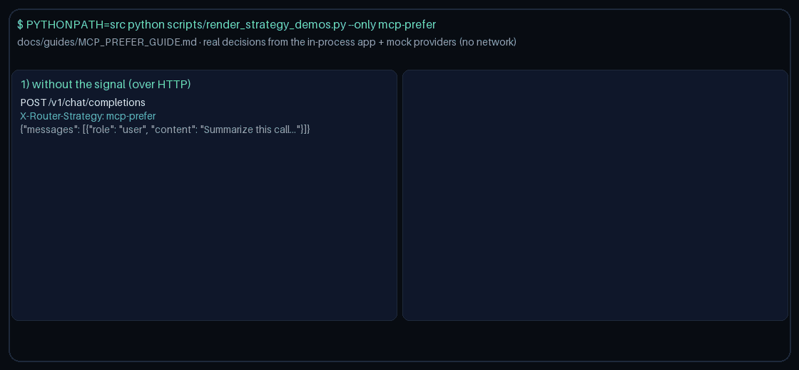

# mcp-prefer Guide

Capability-aware routing for GPT-6 Astra / Claude Opus 5.5 / Gemini 4 Argon / Kimi K3.1 Pro.

## Why

Model Context Protocol (MCP) tool-server routing so requests that need connected MCP servers land on Claude Opus 5.5 / GPT-6 Astra.

## Signals

Metadata keys: `requires_mcp`, `mcp_servers`, `model_context_protocol`; allowlist `mcp_models`.

> **HTTP note:** strategies read `RouterRequest.metadata`. `POST /v1/chat/completions`,
> `/v1/responses`, and `/v1/messages` do not forward request-body `metadata` to routing
> yet, so over HTTP this strategy takes its no-signal path. Set `metadata` on
> `RouterRequest` when embedding `NexusRouter`, as the demo does
> (`scripts/render_strategy_demos.py`).
