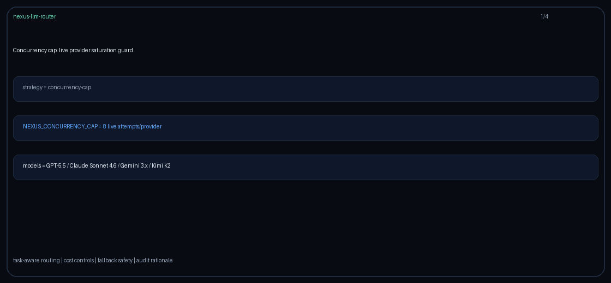

# memory-tool-prefer Guide

Capability-aware routing for GPT-6 Astra / Claude Opus 5.5 / Gemini 4 Argon / Kimi K3.1 Pro.

## Why

Anthropic memory tool / OpenAI Agents API persistent memory gaps.

## Signals

Metadata keys: `requires_memory_tool`, `memory_tool`, `agent_memory`; allowlist `memory_tool_models`.

## Capability

Built-in map includes `memory_tool` on frontier models where applicable. Override with `metadata.model_capabilities` or `memory_tool_models`.

## Behavior

When the signal is truthy, rank healthy domain-eligible candidates by `memory_tool` support, then quality, then cost. Without a signal, stay quality-first.
