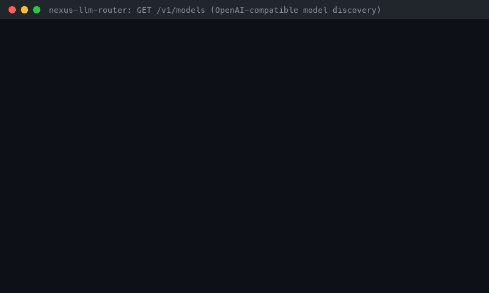

# Models API Guide (`GET /v1/models`)



OpenAI-compatible model discovery for nexus: `GET /v1/models` lists every model
nexus can route to, and `GET /v1/models/{id}` returns one. Each entry is a
standard OpenAI `model` object plus a namespaced `nexus` block with pricing,
token limits, capabilities, and live provider health.

## Why

Model pickers in OpenAI-compatible clients such as Open WebUI, LibreChat, and
Continue populate themselves from `GET /v1/models`. The LiteLLM proxy exposes
`/v1/models` (with `/model/info` for prices and limits), and OpenRouter's
`/api/v1/models` publishes pricing and context lengths. Nexus previously
answered `404` there, so those clients could not discover its models, and
operators had no API for per-model prices, input limits, or provider health.

## Quickstart

Against the mock-provider server (`PYTHONPATH=src python scripts/serve_mock.py
--port 8000`) or a real deployment:

```bash
curl -s localhost:8000/v1/models | jq -c '.data[] | {id, owned_by, context: .nexus.context_window}'
curl -s localhost:8000/v1/models/gpt-6-astra | jq .nexus.pricing
```

With the official OpenAI Python SDK:

```python
from openai import OpenAI

client = OpenAI(base_url="http://localhost:8000/v1", api_key="local-dev")
for model in client.models.list():
    print(model.id, model.owned_by, model.model_extra["nexus"]["pricing"])

astra = client.models.retrieve("gpt-6-astra")
print(astra.model_extra["nexus"]["max_input_tokens"])  # 922000
```

`scripts/models_api_demo.py` prints a model-picker table plus one model's
details; the GIF above is its real output.

## Response

`GET /v1/models` returns `{"object": "list", "data": [...]}` in catalog order.
Real `GET /v1/models/gpt-6-astra` output from the mock-provider server:

```json
{
  "id": "gpt-6-astra",
  "object": "model",
  "created": 1794045198,
  "owned_by": "openai",
  "nexus": {
    "provider": "openai",
    "context_window": 1050000,
    "max_input_tokens": 922000,
    "pricing": {
      "input_per_1m_tokens": 10.0,
      "output_per_1m_tokens": 50.0,
      "long_prompt": {
        "threshold_tokens": 272000,
        "input_per_1m_tokens": 20.0,
        "output_per_1m_tokens": 75.0
      }
    },
    "capabilities": [
      "agents_api",
      "background_mode",
      "deep_research",
      "json",
      "long_context",
      "mcp",
      "memory_tool",
      "parallel_tool_calls",
      "streaming",
      "tools",
      "vision",
      "webhook"
    ],
    "domains": [
      "code",
      "general",
      "legal"
    ],
    "regions": [
      "global",
      "us"
    ],
    "supports_realtime": true,
    "quality_score": 0.97,
    "health": {
      "api_key_configured": true,
      "routable": true
    }
  }
}
```

| Field | Meaning |
| --- | --- |
| `id` | Catalog model ID. Send it as `model` on `/v1/chat/completions` or `/v1/responses`; strategies decide whether to honor it ([Choosing a model](RESPONSES_API_GUIDE.md#choosing-a-model)). |
| `object` | Always `model`. |
| `created` | Unix time when this nexus process loaded its catalog. Nexus has no upstream release dates. |
| `owned_by` | Provider: `openai`, `anthropic`, `google`, or `moonshot`. |
| `nexus.provider` | Provider adapter that serves the model. |
| `nexus.context_window` | Total context window in tokens. |
| `nexus.max_input_tokens` | Input cap when it is lower than the window (GPT-6: 922,000), otherwise `null`. Routing strategies enforce it. |
| `nexus.pricing` | List prices in USD per 1M tokens. `long_prompt` gives the whole-request rates above `threshold_tokens` (GPT-6 above 272K input tokens, Claude Haiku 5.5 above 100K), or `null`. |
| `nexus.capabilities` | Built-in capability flags used by capability-aware strategies (`vision`, `tools`, `json`, `long_context`, ...). |
| `nexus.domains` | Domains the catalog allows the model for (`code`, `general`, `legal`, `medical`). |
| `nexus.regions` | Regions used by region-aware strategies. |
| `nexus.supports_realtime` | Realtime routing prior. |
| `nexus.quality_score` | Per-role routing prior, not a benchmark score. |
| `nexus.health.api_key_configured` | The provider adapter has credentials (the same check as `GET /health`; no provider call is made). |
| `nexus.health.routable` | The provider's circuit breaker currently allows routing; `false` while it is open after repeated failures. |

## Errors

Unknown IDs return the OpenAI error envelope, so SDKs raise `NotFoundError`:

```json
{"error": {"message": "The model 'gpt-4o' does not exist", "type": "invalid_request_error", "param": "model", "code": "model_not_found"}}
```

## What is listed

Only the routable catalog: the seven defaults in the README's
[Current Model Stack](../../README.md#current-model-stack), or your custom
catalog. Models that the adapters can price but that are not in the catalog
(such as `gpt-6.1-sol` or `claude-sonnet-5-5`) are not listed; add them to the
catalog to make them routable and pinnable. The endpoints need no API key and
do not call providers.

## Nexus vs LiteLLM vs OpenRouter

| | LiteLLM proxy | OpenRouter | nexus |
| --- | --- | --- | --- |
| OpenAI-style model list | `/v1/models` | `/api/v1/models` | `/v1/models` and `/v1/models/{id}` |
| Prices and context limits | `/model/info` | in the model list | in the model list (`nexus.pricing`, `context_window`, `max_input_tokens`) |

Each nexus entry also carries the routing inputs that nexus actually uses:
long-prompt pricing tiers, input caps below the context window, capability
flags, domains, regions, and live provider health (credentials plus circuit
breaker state).

## How this demo was recorded

Recorded on 2026-11-07 from a real run: `scripts/serve_mock.py` on port 8765
(port 8000 was busy on the recording machine), then curl and
`scripts/models_api_demo.py` with the official OpenAI Python SDK. The
transcript below is the verbatim output, rendered to
`assets/demo/models-api.gif`:

```text
$ PYTHONPATH=src python scripts/serve_mock.py --port 8765 &
$ curl -s localhost:8765/v1/models | jq -c '.data[] | {id, owned_by, context: .nexus.context_window, routable: .nexus.health.routable}'
{"id":"gpt-6-astra","owned_by":"openai","context":1050000,"routable":true}
{"id":"gpt-6-luna","owned_by":"openai","context":1050000,"routable":true}
{"id":"claude-opus-5-5","owned_by":"anthropic","context":1000000,"routable":true}
{"id":"claude-haiku-5-5","owned_by":"anthropic","context":1000000,"routable":true}
{"id":"gemini-4-argon","owned_by":"google","context":1048576,"routable":true}
{"id":"gemini-3.8-flash","owned_by":"google","context":1048576,"routable":true}
{"id":"kimi-k3.1-pro","owned_by":"moonshot","context":1048576,"routable":true}
$ curl -s localhost:8765/v1/models/gpt-4o | jq -c .
{"error":{"message":"The model 'gpt-4o' does not exist","type":"invalid_request_error","param":"model","code":"model_not_found"}}
$ uv run --quiet --no-project --with openai python scripts/models_api_demo.py --base-url http://localhost:8765/v1
model              owned_by     context  $in/1M  $out/1M  routable
gpt-6-astra        openai     1,050,000    10.0     50.0  True
gpt-6-luna         openai     1,050,000     0.1      0.5  True
claude-opus-5-5    anthropic  1,000,000     4.0     20.0  True
claude-haiku-5-5   anthropic  1,000,000     0.1      0.5  True
gemini-4-argon     google     1,048,576     2.0     10.0  True
gemini-3.8-flash   google     1,048,576    0.75     3.75  True
kimi-k3.1-pro      moonshot   1,048,576     2.0     10.0  True

gpt-6-astra: max input 922,000 tokens
  long-prompt pricing: {'threshold_tokens': 272000, 'input_per_1m_tokens': 20.0, 'output_per_1m_tokens': 75.0}
  capabilities: agents_api, background_mode, deep_research, json, long_context, mcp, memory_tool, parallel_tool_calls, streaming, tools, vision, webhook
```

## Tests

```bash
pytest tests/test_models_api.py -v
```

Covers the OpenAI list and model shapes, catalog order, per-1M pricing with
long-prompt tiers, input limits, capabilities and domains, retrieve-equals-list,
the `model_not_found` 404 envelope, and health that reflects missing credentials
and an open circuit breaker after real failed requests.
