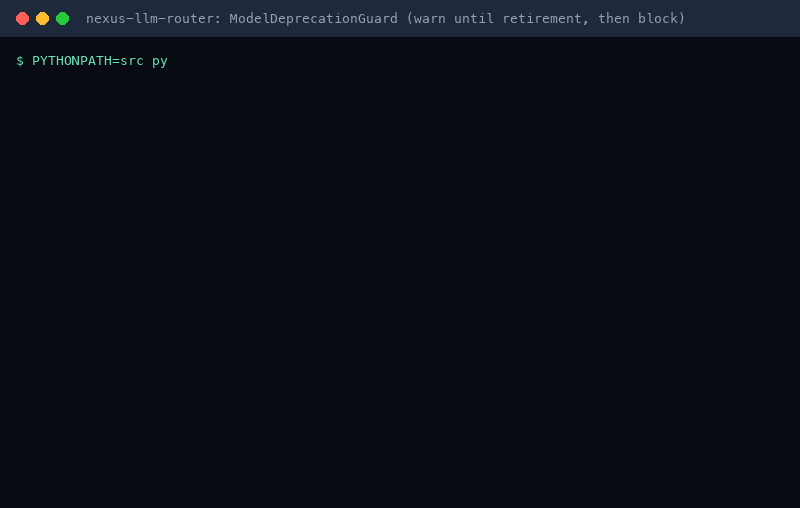

# Model Deprecation Guard Guide

Warn-or-block mapping from retired model aliases to current replacements for
GPT-6 / Claude Opus 5.5 / Gemini 4 / Kimi K3.1 traffic. Entries with a
provider retirement date block from that date on.



## Why

Clients and stored configs often keep sending legacy IDs (`gpt-4o`,
`claude-3-5-sonnet`, `gemini-1.5-pro`, `moonshot-v1-128k`). LiteLLM and
OpenRouter maintain alias tables; offline Nexus gateways need a local
**safety** guard that returns a structured verdict before dispatch.

Deprecation is a two-step lifecycle. A deprecated model still answers until
its retirement date; from then on requests to it fail at the provider. A
guard that only ever warns tells callers nothing new on the day their
requests start failing, so dated entries escalate to `block` on that day.

## Distinct from

| Component | Role |
| --- | --- |
| `router.model_ids` | Canonical *current* catalog constants |
| `ProviderModelListSync` / capability catalog | Refresh known-good capabilities |
| `ModelDeprecationGuard` | Retired alias → replacement + `warn`\|`block` + retirement date |

## How it works

1. Construct `ModelDeprecationGuard()` (loads a small curated seed map).
2. Call `check(model_id)` → `DeprecationVerdict` (`is_deprecated`,
   `replacement`, `severity`, `reason`, `retires_on`).
3. When `is_deprecated` and `severity == "warn"`, log / rewrite to `replacement`.
4. When `severity == "block"`, reject before provider dispatch. `reason` names
   the replacement, so it can go straight into the error message.
5. An entry with `retires_on` reports `block` on and after that date,
   whatever its own severity. Before it, the entry keeps its own severity:
   `warn` for every built-in entry, while an entry registered with
   `severity="block"` blocks immediately. The date comes from the `today`
   clock (default: the current UTC date). Pass `today=` to pin it in tests or
   to preview an upcoming retirement.
6. Extend at runtime with `register()` (optionally with `retires_on=`) /
   `unregister()`.

The guard is a library check: nexus does not call it on the request path, so
wire it in where your gateway resolves a client's `model`.

## Example

```python
from datetime import date

from safety.model_deprecation import ModelDeprecationGuard

guard = ModelDeprecationGuard()
verdict = guard.check("gpt-4o")
assert verdict.is_deprecated
assert verdict.replacement == "gpt-6.2-sol"
assert verdict.severity == "warn"

# claude-sonnet-4-5 retires from the Claude API on 2026-11-30 (UTC).
day_before = ModelDeprecationGuard(today=lambda: date(2026, 11, 29))
retired = ModelDeprecationGuard(today=lambda: date(2026, 11, 30))
assert day_before.check("claude-sonnet-4-5").severity == "warn"
blocked = retired.check("claude-sonnet-4-5")
assert blocked.severity == "block"
assert blocked.retires_on == date(2026, 11, 30)
assert "migrate to claude-sonnet-5-5" in blocked.reason

guard.register("legacy-x", "kimi-k3.1-pro", severity="block")
assert guard.check("legacy-x").severity == "block"
guard.register("legacy-y", "gpt-6.2-sol", retires_on=date(2027, 3, 1))
assert guard.check("legacy-y").retires_on == date(2027, 3, 1)  # warn, then block
```

To preview the verdicts on another date (the demo GIF above records this):

```bash
PYTHONPATH=src python scripts/model_deprecation_demo.py --today 2026-11-30 claude-sonnet-4-5 claude-opus-4-5
```

## Seed map (curated, small)

Lifecycle verified 2026-11-24.

| Deprecated | Replacement | Severity |
| --- | --- | --- |
| `gpt-4o` / `gpt-4o-mini` | `gpt-6.2-sol` / `gpt-6-luna` | warn |
| `claude-3-5-sonnet` (+ `-20241022`) | `claude-sonnet-5-5` | block (retired 2025-10-28) |
| `claude-sonnet-4-5` (+ `-20250929`) | `claude-sonnet-5-5` | warn; block from 2026-11-30 |
| `claude-opus-4-5` (+ `-20251101`) | `claude-opus-5-5` | warn; block from 2027-01-22 |
| `gemini-1.5-pro` | `gemini-4-argon` | warn |
| `gemini-2.5-pro` | `gemini-4-argon` | warn |
| `moonshot-v1-128k` | `kimi-k3.1-pro` | warn |
| `kimi-k2`, `kimi-k2.6`, `kimi-k2.7-code` | `kimi-k3.1-pro` | warn |
| `kimi-k2.7-code-highspeed` | `kimi-k3.1-pro-highspeed` | warn |

Anthropic deprecated `claude-sonnet-4-5` on 2026-09-30 and `claude-opus-4-5` on
2026-11-23. They retire from the Claude API on 2026-11-30 and 2027-01-22, and
requests to them fail from then on; Sonnet 3.5 (`claude-3-5-sonnet-20241022`)
retired on 2025-10-28
([Model deprecations](https://platform.claude.com/docs/en/about-claude/model-deprecations)).
Each retirement covers the dated ID and its undated alias, and the guard lists
both. The dates are the Claude API's, which the nexus Anthropic adapter calls;
Amazon Bedrock and Google-managed Claude on Google Cloud set their own
schedules. `claude-sonnet-4-6` and `claude-haiku-4-5` are still active and pass
the guard.

Kimi closed the K2 series to new users on 2026-10-31 and plans to retire all K2
models by the end of December 2026
([Kimi pricing](https://platform.kimi.ai/docs/pricing/chat)), so K2 IDs now warn
with their K3.1 replacements. They have no exact retirement date, so they keep
warning until one is published and added.

Google deprecated Gemini 2.5 Pro. From 2026-12-01, requests for `gemini-2.5-pro`
are served by Gemini 3.8 Flash at 3.8 Flash rates
([Gemini pricing](https://aistudio.google.com/docs/pricing#gemini-2.5-pro)), so
the guard points it at the default catalog's pro model. Superseded models that
providers still serve are not flagged: `gpt-6-astra` and `gpt-6.1-sol`
(superseded by `gpt-6.2-astra` and `gpt-6.2-sol` on 2026-11-17),
`claude-fable-5-1` (superseded by `claude-fable-5-2`), and `gemini-3.8-flash`
(Google recommends upgrading to `gemini-4-hydrogen`) pass the guard unchanged.

## Gap vs LiteLLM / OpenRouter

| Capability | LiteLLM / OpenRouter | Nexus |
| --- | --- | --- |
| Alias / deprecation table | Yes (hosted) | `ModelDeprecationGuard` (local) |
| Warn vs block severity | Varies | Explicit `warn` \| `block` |
| Retirement date per model | LiteLLM `deprecation_date` in [`model_prices_and_context_window.json`](https://github.com/BerriAI/litellm/blob/main/model_prices_and_context_window.json); OpenRouter `expiration_date` on [`GET /api/v1/models`](https://openrouter.ai/docs/overview/models) | `retires_on` on each entry and verdict; `block` from that date (UTC) |
| Extensible register API | Config / dashboard | `register()` (with optional `retires_on`) / `unregister()` |
| Frontier traffic | Yes | GPT-6.2 Astra / Opus 5.5 / Gemini 4 Argon / Kimi K3.1 Pro |
