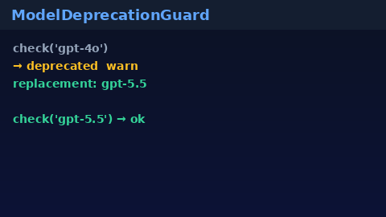

# Model Deprecation Guard Guide

Warn-or-block mapping from retired model aliases to current replacements for
GPT-6 / Claude Opus 5.5 / Gemini 4 / Kimi K3.1 traffic.



## Why

Clients and stored configs often keep sending legacy IDs (`gpt-4o`,
`claude-3-5-sonnet`, `gemini-1.5-pro`, `moonshot-v1-128k`). LiteLLM and
OpenRouter maintain alias tables; offline Nexus gateways need a local
**safety** guard that returns a structured verdict before dispatch.

## Distinct from

| Component | Role |
| --- | --- |
| `router.model_ids` | Canonical *current* catalog constants |
| `ProviderModelListSync` / capability catalog | Refresh known-good capabilities |
| `ModelDeprecationGuard` | Retired alias → replacement + `warn`\|`block` |

## How it works

1. Construct `ModelDeprecationGuard()` (loads a small curated seed map).
2. Call `check(model_id)` → `DeprecationVerdict`.
3. When `is_deprecated` and `severity == "warn"`, log / rewrite to `replacement`.
4. When `severity == "block"`, reject before provider dispatch.
5. Extend at runtime with `register()` / `unregister()`.

## Example

```python
from safety.model_deprecation import ModelDeprecationGuard

guard = ModelDeprecationGuard()
verdict = guard.check("gpt-4o")
assert verdict.is_deprecated
assert verdict.replacement == "gpt-6.1-sol"
assert verdict.severity == "warn"

guard.register("legacy-x", "kimi-k3.1-pro", severity="block")
blocked = guard.check("legacy-x")
assert blocked.severity == "block"
```

## Seed map (curated, small)

| Deprecated | Replacement | Severity |
| --- | --- | --- |
| `gpt-4o` / `gpt-4o-mini` | `gpt-6.1-sol` / `gpt-6-luna` | warn |
| `claude-3-5-sonnet` (+ dated) | `claude-sonnet-5-5` | warn |
| `gemini-1.5-pro` | `gemini-4-argon` | warn |
| `gemini-2.5-pro` | `gemini-4-argon` | warn |
| `moonshot-v1-128k` | `kimi-k3.1-pro` | warn |
| `kimi-k2`, `kimi-k2.6`, `kimi-k2.7-code` | `kimi-k3.1-pro` | warn |
| `kimi-k2.7-code-highspeed` | `kimi-k3.1-pro-highspeed` | warn |

Kimi closed the K2 series to new users on 2026-10-31 and plans to retire all K2
models by the end of December 2026
([Kimi pricing](https://platform.kimi.ai/docs/pricing/chat)), so K2 IDs now warn
with their K3.1 replacements.

Google deprecated Gemini 2.5 Pro. From 2026-12-01, requests for `gemini-2.5-pro`
are served by Gemini 3.8 Flash at 3.8 Flash rates
([Gemini pricing](https://aistudio.google.com/docs/pricing#gemini-2.5-pro)), so
the guard points it at the default catalog's pro model. Superseded models that
providers still serve are not flagged: `claude-fable-5-1` (superseded by
`claude-fable-5-2`) and `gemini-3.8-flash` (Google recommends upgrading to
`gemini-4-hydrogen`) pass the guard unchanged.

## Gap vs LiteLLM / OpenRouter

| Capability | LiteLLM / OpenRouter | Nexus |
| --- | --- | --- |
| Alias / deprecation table | Yes (hosted) | `ModelDeprecationGuard` (local) |
| Warn vs block severity | Varies | Explicit `warn` \| `block` |
| Extensible register API | Config / dashboard | `register()` / `unregister()` |
| Frontier traffic | Yes | GPT-6 Astra / Opus 5.5 / Gemini 4 Argon / Kimi K3.1 Pro |
