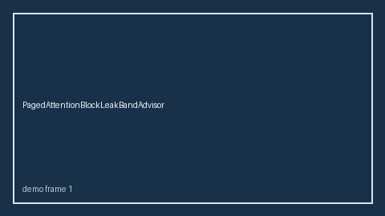

# MoeExpertHotspotBandAdvisor Guide



Offline HITL `hotspot_ratio` bands.
Gap vs vLLM/SGLang/TGI MoE expert-hotspot monitors. Distinct from `MoeExpertLoadImbalanceAdvisor` / `ExpertParallelImbalanceBandAdvisor`.

Stack: **GPT-6 Astra / Claude Opus 5.5 / Gemini 4 Argon / Kimi K3.1 Pro**.

## Usage

```python
from safety.moe_expert_hotspot_band import MoeExpertHotspotBandAdvisor

advice = MoeExpertHotspotBandAdvisor().advise(request_id="req-1", hotspot_ratio=0.15)
print(advice.band)
```

## Safety

Advisory only. No network I/O.
