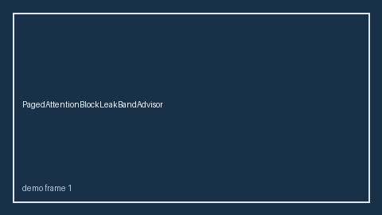

# MoeExpertHotspotBandAdvisor Guide



Offline HITL `hotspot_ratio` bands.
Gap vs vLLM/SGLang/TGI MoE expert-hotspot monitors. Distinct from `MoeExpertLoadImbalanceAdvisor` / `ExpertParallelImbalanceBandAdvisor`.

Stack: **GPT-5.5 / Claude Sonnet 4.6 / Gemini 3.x / Kimi K2**.

## Usage

```python
from safety.moe_expert_hotspot_band import MoeExpertHotspotBandAdvisor

advice = MoeExpertHotspotBandAdvisor().advise(request_id="req-1", hotspot_ratio=0.15)
print(advice.band)
```

## Safety

Advisory only. No network I/O.
