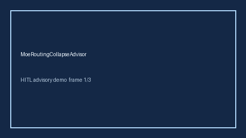

# MoeRoutingCollapseAdvisor Guide



Offline advisor. Never network I/O. Gap vs vLLM/SGLang/DeepSeek MoE routing-collapse monitors.

Optional polish via **GPT-5.5 / Claude Sonnet 4.6 / Gemini 3.x / Kimi K2**.

Distinct from `MoeExpertLoadImbalanceAdvisor` / `SpeculativeDecodeRejectionStormAdvisor`.

## Usage

```python
from safety.moe_routing_collapse import MoeRoutingCollapseAdvisor

advice = MoeRoutingCollapseAdvisor().advise(request_id="r1", collapse_rate=0.0)
print(advice.band)
```

## Safety

Advisory bands only. Humans decide.
