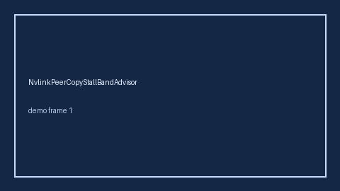

# NvlinkPeerCopyStallBandAdvisor Guide



Offline helper.
Gap vs vLLM/SGLang/TGI NVLink peer-copy stall monitors. Distinct from `TensorParallelAllreduceStallBandAdvisor` / `TensorParallelSkewBandAdvisor`.

Stack: **GPT-5.5 / Claude Sonnet 4.6 / Gemini 3.x / Kimi K2**.

## Usage

```python
from safety.nvlink_peer_copy_stall_band import NvlinkPeerCopyStallBandAdvisor

advice = NvlinkPeerCopyStallBandAdvisor().advise(request_id="req-1", stall_ratio=0.35)
print(advice.band)
```

## Safety

Advisory only. No network I/O. Never auto-acts. Humans decide.
