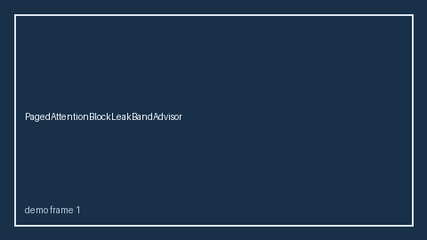

# PagedAttentionBlockLeakBandAdvisor Guide



Safety band advisor for `leak_ratio`.
Gap vs vLLM/SGLang/TGI paged-attention block-leak monitors. Distinct from `PagedAttentionFragmentationBandAdvisor` / `KvBlockStealStormBandAdvisor`.

Stack: **GPT-6 Astra / Claude Opus 5.5 / Gemini 4 Argon / Kimi K3.1 Pro**.

## Usage

```python
from safety.paged_attention_block_leak_band import PagedAttentionBlockLeakBandAdvisor

advice = PagedAttentionBlockLeakBandAdvisor().advise(request_id="req-1", leak_ratio=0.15)
print(advice.band)
```

## Safety

Advisory only. No network I/O.
