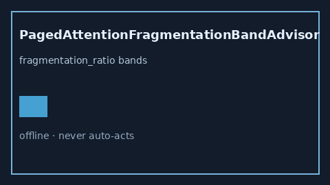

# PagedAttentionFragmentationBandAdvisor Guide



Offline HITL helper for `fragmentation_ratio` bands.
Gap vs vLLM/SGLang/TGI paged-attention fragmentation monitors. Distinct from `KvBlockStealStormBandAdvisor` / `ChunkedPrefillBubbleBandAdvisor`.

Stack: **GPT-5.5 / Claude Sonnet 4.6 / Gemini 3.x / Kimi K2**.

## Usage

```python
from safety.paged_attention_fragmentation_band import PagedAttentionFragmentationBandAdvisor

advice = PagedAttentionFragmentationBandAdvisor().advise(request_id="r1", fragmentation_ratio=0.3)
print(advice.band)
```

## Safety

Advisory only. No network I/O. Never auto-acts.
