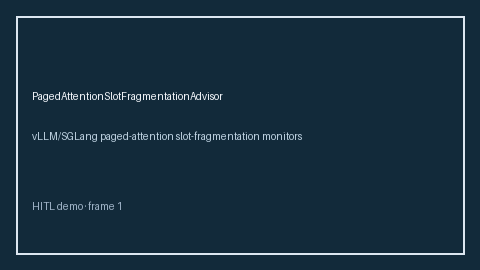

# PagedAttentionSlotFragmentationAdvisor Guide



Offline advisor. Never network I/O. Gap vs vLLM/SGLang paged-attention slot-fragmentation monitors.

Optional polish via **GPT-5.5 / Claude Sonnet 4.6 / Gemini 3.x / Kimi K2**.

Distinct from `GpuMemoryFragmentationBandAdvisor` / `ContextWindowFragmentationAdvisor`.

## Usage

```python
from safety.paged_attention_slot_fragmentation import PagedAttentionSlotFragmentationAdvisor

advice = PagedAttentionSlotFragmentationAdvisor().advise(
    request_id="r1", slot_fragmentation_ratio=0.0
)
print(advice.band)
```

## Safety

Advisory bands only. Humans decide.
